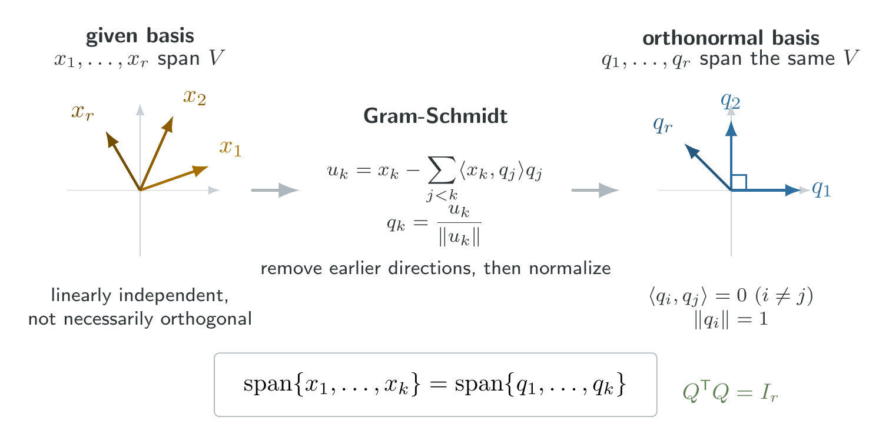
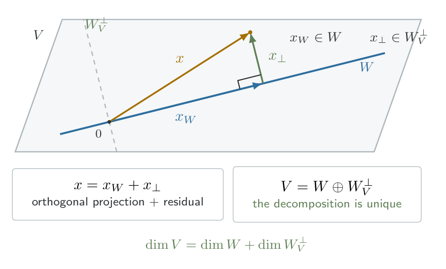

## Vector spaces and their structures

### Vector spaces and subspaces

::: {#def-vector-space}

## Vector space

A set $\mathcal V$ is a _vector space_ if, for any $\mathbf{u}, \mathbf{v}, \mathbf{w}\in \mathcal V$ and scalars $a, b$, operations of vector addition and scalar multiplication are defined such that 

1. $(\mathbf u + \mathbf v) + \mathbf w = \mathbf u + (\mathbf v + \mathbf w)$
2. $\mathbf u + \mathbf v = \mathbf v + \mathbf u$
3. There exists a vector $\mathbf 0\in \mathcal V$ such that $\mathbf u + \mathbf 0 = \mathbf u = \mathbf 0 + \mathbf u$ for any $\mathbf u \in \mathcal V$.
4. For any $\mathbf u \in \mathcal V$, there exists $\mathbf w \equiv -u$ such that $\mathbf u + \mathbf w = 0 = \mathbf w + \mathbf u$.
5. $a (\mathbf u + \mathbf w) = a\mathbf u + a\mathbf w$.
6. $(a + b)\mathbf u = a\mathbf u + b \mathbf u$.
7. $(ab)\mathbf u = a(b\mathbf u)$.
8. There exists a scalar $1$ such that $1\mathbf u = \mathbf u$. 

:::

A standard example is $\R^n=\{(x_1, \ldots, x_n)^\top: x_i \in \R\}$. A plane passing through the origin in $\R^3$ is also a vector space under the usual operations.

::: {#def-subspace}

## Subspace

Let $\mathcal V$ be a vector space, and let $\mathcal W$ be a set with $\mathcal W\subset \mathcal V$. $\mathcal W$ is a _subspace_ of $\mathcal V$ if $\mathcal W$ is a vector space using the same definitions of vector addition and scalar multiplication as for $\mathcal V$.  

:::

::: {#thm-subspace-criterion}

## Subspace criterion

Let $\mathcal V$ be a vector space, and let $\mathcal W$ be a nonempty subset of $\mathcal V$. If $\mathcal W$ is closed under vector addition and scalar multiplication, then $\mathcal W$ is a subspace of $\mathcal V$.
:::

Equivalently, we need to verify $\mathcal u, \mathcal v\in \mathcal W\implies u+v \in \mathcal W$ and $a\in \R, \mathcal u\in \mathcal W \implies a\mathbf u \in \mathcal W$.

::: {.proof}

Since $\mathcal W$ is nonempty, we can choose an arbitrary $\mathbf w \in \mathcal W$. Closure under scalar multiplication implies $\mathbf 0 \mathbf w = \mathbf 0 \in \mathcal W$. For any $\mathbf u \in \mathcal W$, we also have $(-1)\mathbf u = -\mathbf u \in \mathcal W$. Thus the additive identity and additive inverses exist in $\mathcal W$. The remanining vector-space axioms are inherited from $\mathcal V$, since the addition and scalar multiplication operations are unchanged. Therefore $\mathcal W$ is a vector space and hence a subspace.

:::

::: {#example}

Consider $W = \{(x, y, z)^\top \in \R^3: y = z\}$. If $\mathcal u = (a, b, b)^\top$ and $v=(c,d,d)^\top$, then 

$$
u+ v = (a+ c, b+d, b+d)^\top \in W
$$

and 

$$
\alpha u = (\alpha a, \alpha b, \alpha b)^\top \in W
$$

Hence $W$ is a subspace of $\R^3$.

:::

### Linear combinations, span, and linear independence

::: {#def-span}

## Span 

Given $\mathbf{v}_1, \ldots, \mathbf{v}_r\in \mathcal V$, a __linear combination__ is a vector of the form 

$$
x = \sum_{i=1}^r a_i \mathbf v_i
$$

The set of all such linear combination is 

$$
\mathrm{span}\{\mathbf v_1, \ldots, \mathbf v_r\} = \left\{\sum_{i=1}^r a_i\mathbf v_i: a_i\in \R \right\}
$$

:::

::: {#thm-span-is-a-subspace}

## Span is a subspace

The span of any finite collection of vectors in $\mathcal V$ is a subspace of $\mathcal V$.

:::

::: {.proof}

Let $\mathcal W=\mathrm{span}\{\mathbf v_1, \ldots, \mathbf v_r\}$. The zero vector belongs to $\mathcal W$ by choosing every coefficient to be zero.

For arbitrary $\mathbf x, \mathbf y \in \mathcal W$, we can write 

$$
\mathbf x = \sum_{i=1}^r a_i \mathbf v_i, \quad \mathbf y = \sum_{i=1}^r b_i \mathbf v_i.
$$

Then 

$$
\mathbf x + \mathbf y = \sum_{i=1}^r (a_i + b_i) \mathbf v_i \in \mathcal W
$$

Similarly, for any scalar $c$, 

$$
c\mathbf x = \sum_{i=1}^r (ca_i)\mathbf v_i \in \mathcal W. 
$$

@thm-subspace-criterion establishes the result.
:::

::: {#def-column-space}

## Column space

For a matrix $A\in \R^{n\times p}$ with columns $a_1, \ldots, a_p$, 

$$
\mathcal C(A) = \mathrm{span}\{a_1, \ldots, a_p\}= \{A\beta:\beta \in \R^p\}.
$$

Thus $\mathcal C(A)$ is the collection of all vectors that can be obtained by multiplying $A$ by a coefficient vector.
:::

Some refer $\mathcal C(A)$ as the _range space_ of $A$ and write it $R(A)$. This concept is fundamental to linear models, because the possible fitted mean vectors of the model $Y = X\beta + \epsilon$ lie in $\mathcal C(X)$.

::: {#def-linear-independence}

## Linear independence

Vectors $\mathbf v_1, \ldots, \mathbf v_r$ are _linear independent_ if 

$$
\sum_{i=1}^ r a_i \mathbf v_i = \mathbf 0 \implies a_1 = \cdots = a_r = 0
$$

Otherwise, they are linearly dependent. 
:::

An equivalent characterization is that a collection is linearly dependent if one vector can be expressed as a linear combination of the others. For example, 

$$
v_1 = \begin{pmatrix}1 \\ 0\end{pmatrix}, \quad v_2 = \begin{pmatrix}0 \\ 1\end{pmatrix}, \quad v_3 = \begin{pmatrix}1 \\ 1\end{pmatrix}
$$

are linearly dependent because $v_3 = v_1 + v_2$.

### Basis and dimension

::: {#def-basis}

## Basis

A collection $\{\mathbf v_1, \ldots, \mathbf v_r\}$ is a _basis_ for $\mathcal V$ if it satisfies both conditions:

1. The vectors span $\mathcal V$.
2. The vectors are linearly independent.
:::

A basis therefore contains enough vectors to represent every vector in the space, without redundancy.

::: {#thm-invariance-of-basis-size}

## Invariance of basis size

Every basis of a finite-dimensional vector space contains the same number of vectors.

:::

::: {.proof}

We use the following elementary consequence of linear independence, called the [Steinitz exchange lemma](https://en.wikipedia.org/wiki/Steinitz_exchange_lemma):

> If a collection of $m$ vectors is linearly independent and another collection of $n$ vectors spans the same space, then $m\leq n$.

To establish this lemma, suppose $\{u_1, \ldots, u_n\}$ spans the space and $\{v_1, \ldots, v_m\}$ is linearly independent. We can express $v_1$ as a combination of the $u_i$. At least one coefficient is nonzero; therefore, one $u_i$ can be solved for in terms of $v_1$ and the remaining $u_i$. Replacing that $u_i$ with $v_1$ preserves spanning.

Proceed inductively. Since the $v_i$ are independent, each new $v_i$ cannot lie in the span of the previously inserted $v_j$. Consequently, another original $u_i$ can be replaced while preserving spanning. We can perform at most $n$ such replacements, so $m\leq n$.

Now suppose $B_1$ and $B_2$ are two bases with $r$ and $s$ vectors, respectively. Because $B_1$ is independent and $B_2$ spans, $r\leq s$. Reversing their roles gives $r\geq s$. Therefore $r=s$.
:::

::: {#def-dimension-and-rank}

## Dimension and rank

The _dimension_ of a vector space is the number of vectors in any basis. For a matrix $A$, 

$$
\rank(A) = \dim \mathcal C(A). 
$$
:::

@thm-invariance-of-basis-size ensures that dimension and rank are well-defined, independent of the particular basis chosen.

::: {#thm-uniqueness-of-basis-representation}

## Uniqueness of basis representation

If $\{\mathbf v_1, \ldots, \mathbf v_r\}$ is a basis for $\mathcal V$, every $\mathbf x \in \V$ has a unique expression

$$
\mathbf x = \sum_{i=1}^r a_i \mathbf v_i
$$

:::

::: {.proof}

Existence follows from the spanning property. For uniqueness, suppose 

$$
\mathbf x = \sum_{i=1}^r a_i \mathbf v_i = \sum_{i=1}^r b_i \mathbf v_i. 
$$

Subtracting, we have 

$$
\mathbf 0 = \sum_{i=1}^r (a_i-b_i) \mathbf v_i \overset{\text{linear independence}}{\implies} a_i - b_i = 0 , \quad i=1,\ldots, r
$$

Therefore $a_i = b_i$ for every $i$.
:::

Note that, a vector has unique coordinates relative to a basis, even though different bases produce different coordinate vectors.

### Sums and direct sums of subspaces

::: {#def-sum-of-subspaces}

## Sum of subspaces

For two subspaces $\U, \W \subseteq \V$, define

$$
\U + \W = \{\mathbf u + \mathbf w: \mathbf u \in \U, \mathbf w\in \W\}. 
$$

If additionally $\U \cap \W = \{\mathbf 0\}$, the sum is called a _direct sum_, written $\U \oplus \W$. 

:::

The intersection condition distinguishes a direct sum from a general sum.

::: {#thm-sum-of-subspaces}

$\U + \W$ is a subspace. Furthermore, if matrices $A, B$ have the same number of rows, 

$$
\mathcal C(\begin{bmatrix}A & B\end{bmatrix}) = \mathcal C(A) + \mathcal C(B) 
$$

:::

::: {.proof}

If $x=u_1+ w_1$ and $y = u_2+w_2$, then 

$$
x+ y = (u_1 + u_2) + (w_1 + w_2) \in \U + \W. 
$$

Also, 

$$
cx = cu_1 + cw_1 \in \U + \W.
$$

Since $\mathbf 0 \in \U + \W$, @thm-subspace-criterion shows that the sum is a subspace.

For the column-space identity, observe that every linear combination of columns of $\begin{bmatrix}A & B \end{bmatrix}$ can be written 

$$
\begin{bmatrix} A & B \end{bmatrix} \begin{pmatrix}a \\ b \end{pmatrix} = Aa + Bb. 
$$

The first term belongs to $\mathcal C$, and the second to $\mathcal C(B)$. Conversely, every sum $Aa + Bb$ is a linear combination of the concatenated columns. Hence the spaces coincide.
:::

::: {#thm-uniqueness-of-direct-sum-decomposition}

## Uniqueness of direct-sum decomposition

If $\U \cap \W = \{0\}$, then every $x\in \U +\W$ has a unique decomposition 

$$
x = u + w, \qquad u \in\U, w \in \W
$$

:::

::: {.proof}

Suppose $x = u_1+ w_1 = u_2 + w_2$. Rearranging gives $u_1 - u_2 = w_2 - w_1$. The left side belongs to $\U$, while the right side belongs to $\W$. Therefore their common value lies in $\U \cap \W = \{0\}$, giving $u_1 = u_2, w_1 = w_2$. Thus the decomposition is unique. 

:::

::: {#thm-dimension-of-a-direct-sum}

## Dimension of a direct sum

If $\U \cap \W = \{0\}$, then $\dim(\U + \W) =\dim\U + \dim\W$

:::

::: {.proof}

Let $u_1, \ldots, u_r$ from a basis for $\U$, and $w_1, \ldots, w_s$ a basis for $\W$. Their union spans $\U + \W$.

To show linear independence, we assume 

$$
\sum_{i=1}^{r} a_i u_i + \sum_{j=1}^{s} b_j w_j = 0. 
$$

Then 

$$
\sum_{i=1}^r a_i u_i = -\sum_{j=1}^s b_j w_j. 
$$

The common vector belongs to $U\cap W$, and is therefore zero. By independence of each original basis, all $a_i$ and $b_j$ must be zero. The union is a basis consisiting of $r+ s$ vectors. Hence 

$$
\dim(\U + \W) = r + s. 
$$

:::

A useful extension of @thm-dimension-of-a-direct-sum is 

$$
\dim(\U + \W) = \dim \U + \dim \W - \dim(\U \cap \W). 
$$

::: {.proof}

Choose a basis $z_1, \ldots, z_k$ for $\U \cap \W$. Extend it to bases 

$$
(z_1, \ldots, z_k , u_1, \ldots, u_r)
$$

for $\U$, and 

$$
(z_1, \ldots, z_k, w_1, \ldots, w_s)
$$

for $\W$. The combined collection $z_1, \ldots, z_k, u_1, \ldots, u_r, w_1, \ldots, w_s$ spans $\U+ \W$.

To prove indepedence, any zero linear combination can be rearranged so that a linear combination of the $w_j$ belongs to $\U \cap \W$. Independence of the extended basis of $\W$ forces every coefficient to $w_j$ to vanish.

Thus, 

$$
\dim(\U + \W) = k+ r + s 
$$

Since $\dim\U = k + r$ and $\dim \W = k+s$, the claimed formula follows.
:::

## Inner Products, Orthogonality, and Decompositions

### Inner product and norm

::: {#def-euclidean-inner-product}

## Euclidean inner product

For vectors $x, y\in \R^n$, 

$$
\langle x, y \rangle = x^\top y = \sum_{i=1}^n x_i y_i. 
$$

Their Euclidean norm is 

$$
|| x|| = \sqrt{x^\top x}. 
$$

Two vectors are __orthogonal__ if $x^\top y = 0$.

A collection $\{q_1, \ldots, q_r\}$ is orthonomal if 

$$
q_i^\top q_j =\begin{cases}1, & i = j, \\ 0, & i\neq j.\end{cases}
$$
:::

Orthonomal bases are especially useful because coordinates can be computed using inner products:

$$
x = \sum_{i=1}^r (q_i^\top x)q_i \quad \text{for } x \in \mathrm{span}\{q_1, \ldots, q_r\}.
$$

::: {#thm-the-gram-schmidt-theorem}

## The Gram-Schmidt Theorem

Every finite-dimensional inner-product space admits an orthonormal basis. More specifically, given a basis $x_1, \ldots, x_r$, there exists an orthonomal basis $q_1, \ldots, q_r$ satisfying 

$$
\mathrm{span}\{q_1, \ldots, q_s\} = \mathrm{span}\{x_1, \ldots, x_s\} 
$$

for $s= 1, \ldots, r$. 

:::

> **Construction**

Set $w_1 = x_1$, $q_1 = \frac{w_1}{||w_1||}$. For $s=2,\ldots, r$, we define 

$$
w_s = x_s - \sum_{i=1}^{s-1}(x_s^\top q_i)q_i 
$$

and then $q_s = \frac{w_s}{||w_s||}$.

::: {.proof}

We proceed by induction on $s$. For $s=1$, since $x_1 \neq 0$, $q_1 = \frac{x_1}{||x_1||}$ is well-defined, satisfies $||q_1|| = 1$, and spans the same space as $x_1$. 

Suppose $q_1,\ldots, q_{s-1}$ are orthonomal and span precisely the space generated by $x_1,\ldots, x_{s-1}$. We define 

$$
w_s = x_s - \sum_{i=1}^{s-1} (x_s^\top q_i) q_i. 
$$

For any $j<s$, 

$$
\begin{aligned}
    q_j^\top w_s &= q_j^\top x_s - \sum_{i=1}^{s-1} (x_s^\top q_i )q_j^\top q_i\\
    &= q_j^\top x_s - (x_s^\top q_j) \\ 
    &= 0.
\end{aligned}
$$

Thus $w_s$ is orthogonal to all the previously constructed vectors.

Futhermore, $w_s \neq 0$. Otherwise, 

$$
x_s = \sum_{i=1}^{s-1}(x_s^\top q_i)q_i \in \mathrm{span}\{x_1, \ldots, x_{s-1}\}
$$

contradicting the linear independence of the original basis. Therefore $q_s = \frac{w_s}{||w_s||}$ exists and has unit norm.

Finally, the construction shows that $q_s$ lies in the span of $x_1, \ldots, x_s$, while rearranging the formula for $w_s$ expresses $x_s$ in the span of $q_1, \ldots, q_s$. Hence the two spans are equal at each step, and the complete collection is an orthonormal basis.
:::

### Orthogonal Complements 

::: {#def-orthogonal-complement}

## Orthogonal complement 

For a subspace $\W\subseteq \V$, define 

$$
W_V^{\perp} = \{x\in \V: x^\top w = 0 \quad \forall w \in \W\}
$$

When $V= \R^{n}$, we write $W^\perp$.
:::

::: {#cor-trivial-intersection}

## Trivial intersection

For any subspace $\W$, $\W \cap \W^\top = \{0\}$.

:::

::: {.proof}

If $x\in \W \cap \W^\top$, then $x\in \W$ and $x$ is orthogonal to every vector of $\W$, including itself. Therefore 

$$
x^\top x = || x||^2 = 0. 
$$

Positive definiteness of the Euclidean inner product implies $x=0$. 

:::

::: {#thm-orthogonal-decomposition-theorem}

## Orthogonal decomposition theorem

If $\W \subseteq \V$, then $\W_V^\perp$ is a subspace and 

$$
\V = \W \oplus \W_V^\perp 
$$
:::

::: {.proof}

First, $\W_V$ is a subspace. If $x, y\in \W_{V}^\perp$ and $a, b \in \R$, then for every $w\in W$. 

$$
(ax + by)^\top w = ax^\top w + by^\top w = 0. 
$$

Thus $ax + by \in \W_{V}^\perp$. Next, we select an orthonormal basis $q_1, \ldots, q_r$ for $\W$ using Gram-Schmidt. Extend this basis to an orthonormal basis 

$$
q_1, \ldots, q_r, q_{r+1}, \ldots, q_n
$$

for $V$, where $n=\dim V$. Every $x\in \V$ can therefore be written as 

$$
x= \sum_{i=1}^n (x^\top q_i)q_i. 
$$

Separate this into

$$
x = \underbrace{\sum_{i=1}^r (x^\top q_i) q_i}_{x_W} + \underbrace{\sum_{i=r+1}^n (x^\top q_i)q_i}_{x_\perp} 
$$

Clearly $x_W\in \W$. Because $q_{r+1},\ldots, q_n$ are orthogonal to every vector in $\W$, we have $x_\perp \in \W_V^\perp$. Therefore $\V = \W + \W_V^\perp$. By @cor-trivial-intersection, their intersection is $\{0\}$, so the sum is direct.
:::

::: {#cor-unique-orthogonal-decomposition}

## Unique orthogonal decomposition 

Every $x\in \V$ can be expressed uniquely as $x=x_W + x_\perp$ where $x_W \in \W$ and $x_\perp \in W_V^{\perp}$. Moreover, 

$$
\dim V = \dim W + \dim W_V^\top 
$$

:::

::: {.proof}

Existence follows from @thm-orthogonal-decomposition-theorem, uniqueness from @thm-uniqueness-of-direct-sum-decomposition, and the dimension formula from @thm-dimension-of-a-direct-sum.

:::

::: {#thm-orthogonal-complement-of-an-intersection}

## Orthogonal complement of an intersection 

For subspaces $\U, \W \subseteq \R^n$,

$$
(\U \cap \W )^{\perp} = \U^\perp + \W^\perp 
$$

:::

::: {.proof}

We first establish two identities $(S^\perp)^\perp = S$, $(U+W)^\perp = U^\perp \cap W^\perp$. The first follows from orthogonal decomposition: if $x\in (S^\perp)^\perp$, we can write $x = s+ t$ with $s\in S$, $t\in S^\perp$. Since $x\perp t$, 

$$
0 = x^\top t = s^\top t + t^\top t = ||t||^2,
$$

so $t=0$ and $x=s \in S$. 

For the second identity, a vector is orthogonal to every sum $u+w$ when it is orthogonal to both $U$ and $W$. Applying this identity to $U^\perp$ and $W^\perp$, 

$$
(U^\perp + W^\perp)^\perp = (U^\perp)^\perp \cap (W^\perp)^\perp = U\cap W. 
$$

Taking orthogonal complements of both sides proves

$$
U^\perp + W^\perp = (U\cap W)^\perp 
$$

:::

This also establishes the two important identities:

1. $(U+ W)^\perp = U^\perp \cap W^\perp$ and 
2. $(W^\perp)^\perp = W$.

## Matrices and linear transfromations

### Matrix operations and terminology

| Concepts | Definition |
| --- | --- |
| Square matrix | $A\in \R^{n\times n}$ | 
| Transpose | $(A^\top)_{ij} = A_{ji}$ | 
| Symmetric matrix | $A= A^\top$ | 
| Diagonal matrix | $A_{ij} = 0$ for $i\neq j$ | 
| Identity matrix | $I_n =\mathrm{diag}(1, \ldots, 1)$ | 
| Nonsingular matrix | Square matrix possessing an inverse | 
| Null space | $\mathcal N(A) = \{x: Ax = 0\} | 

Matrix multiplication represents composition of linear transformations. If $A: \R^p \to \R^n$, then 

$$
T_A(x) = Ax
$$

is linear because 

$$
A(ax + by) = aAx + bAy. 
$$

The column space is the image of this transformation, whereas the null space is its kernel.

### Matrix Invertibility 

::: {#thm-invertibility-and-full-rank}

## Invertibility and full rank 

For $A\in \R^{n\times n}$, the following are equivalent:

$$
A \text{ is nonsingular} \Longleftrightarrow \mathrm{rank}(A) = n
$$

:::

::: {.proof}

Suppose $A$ is nonsingular. If $Ax = 0$, multiplying by $A^{-1}$ gives 

$$
x = A^{-1}Ax = A^{-1} 0 = 0. 
$$

Thus the columns of $A$ are linearly independent. Since there are $n$ columns in $\R^{n}$, they form a basis, so $\mathrm{rank}(A) = n$. 

Conversely, suppose $\mathrm{rank}(A) = n$. THe columns of $A$ form a basis for $\R^{n}$. For each standard basis vector $e_i$, there exists a unique vector $b_i$ such that $Ab_i = e_i$. We construct $B= [b_1, \ldots, b_n]$. Then 

$$
AB = [Ab_1, \ldots, Ab_n] = I. 
$$

For every $x$, $A(BAx) = Ax$. Since $A$ has linearly independnent columns, this implies $BAx = x$. Hence $BA = I$. Therefore $B=A^{-1}$, and $A$ is nonsingular. 
:::

::: {#cor-singularity-and-nontrivial-null-space}

## Singularity and nontrivial null space

$A_{n\times n}$ is singular if and only if there exists $x\neq 0$ such that $Ax = 0$.  

:::

::: {.proof}

By @thm-invertibility-and-full-rank, $A$ is singular when its columns are linearly dependent. Linear dependence means that there exists a nonzero coefficient vector $x$ for which the linear combination of the columns vanishes, i.e. $Ax = 0$.

:::

### Rank-nullity theorem

::: {#thm-rank-nullity}

## Rank-nullity theorem 

If $A\in \R^{m\times n}$, then $\dim\mathcal N(A) +\mathrm{rank}(A) = n$.

:::

::: {.proof}

Let $k=\dim \mathcal N(A)$, and pick a basis $v_1, \ldots, v_k$ for $\mathcal N(A)$. Extend this basis to a basis for $\R^n$: 

$$
v_1, \ldots, v_k, w_1, \ldots, w_{n-k}.
$$

We claim that $Aw_1, \ldots, Aw_{n-k}$ form a basis for $\mathcal C(A)$. To establish spanning, take any $y\in \mathcal C(A)$. Then $y = Ax$ for some $x\in \R^{n}$. Express $x$ using the chosen basis:

$$
x = \sum_{i=1}^k a_i v_i + \sum_{j=1}^{n-k}b_j w_j. 
$$

Applying $A$, we have 

$$
y = Ax = \sum_{j-1}^{n-k} b_j Aw_j,
$$

because $Av_i = 0$. Thus the $Aw_j$ span $\mathcal C(A)$. 

To establish independence, suppose 

$$
\sum_{j-1}^{n-k} b_j Aw_j = 0.
$$

Then $\sum_j b_j w_j \in \mathcal N(A)$, so it can be expressed as a combination of $v_1, \ldots, v_k$. This gives a linear independence among the original basis vectors, unless every $b_j = 0$. Hence the $Aw_j$ are independent. Therefore, $\mathrm{rank}(A) = n-k$, which establishes the theorem.
:::

For $A\in \R^{m\times n}$, the four fundamental subspaces satisfy

$$
\mathcal C(A), \mathcal N(A^\top) \subseteq \R^m, \quad \mathcal C(A^\top), \mathcal N(A)\subseteq \R^n
$$

Two orthogonality relationships are 

$$
\mathcal C(A)^\perp = \mathcal N(A^\top) \quad \text{and} \quad \mathcal C(A^\top)^\perp = \mathcal N(A).
$$

::: {.proof}

For $y\in \R^{m}$,

$$
\begin{aligned}
y\in \mathcal C(A)^{\perp} &\Longleftrightarrow y^\top Ax = 0 \quad \forall x\in \R^{n}\\ &\Longleftrightarrow A^\top y = 0 \\ & \Longleftrightarrow y\in \mathcal N(A^\top). 
\end{aligned}
$$

The second identity follows by replacing $A$ with $A^\top$.
:::

Combining these identities with orthogonal decomposition gives 

$$
\begin{aligned}
\R^m = \mathcal C(A) \oplus \mathcal N(A^\top)\\ 
\R^n = \mathcal C(A^\top) \oplus \mathcal N(A).
\end{aligned}
$$

## Eigenvalues and Spectral Theory

### Eigenvalues and eigenvectors

::: {#def-eigenvalue}

## Eigenvalue 

For a square matrix $A$, a scalar $\lambda$ is an eigenvalue if there exists a nonzero vector $v$ such that 

$$
Av = \lambda v. 
$$

Equivalently, 

$$
(A-\lambda I)v = 0, 
$$

so $A-\lambda I$ is singular. 
:::

The corresponding eigenspace is 

$$
E_\lambda = \mathcal N(A-\lambda I).
$$

Its dimension is the __geometric multiplicity__ of $\lambda$. 

::: {#lem-orthogonality-of-eigenvectors}

## Orthogonality of eigenvectors 

If $A$ is symmetric, eigenvectors corresponding to distinct eigenvalues are orthogonal. 

:::

::: {.proof}

Suppose $Ax = \lambda x$, $Ay = \mu y$, where $\lambda \neq u$. Since $A = A^\top$, 

$$
x^\top Ay = (Ax)^\top y. 
$$

Therefore 

$$
\mu x^\top y = \lambda x^\top y \implies (\lambda - \mu) x^\top y =0. 
$$

Because $\lambda \neq \mu$, $x^\top y = 0$. 

:::

### Spectral Theorem 

::: {#thm-eigenvector-baisis-for-the-column-space}

## Eigenvector basis for the column space

If $A\in \R^{n\times n}$ is symmetric, then $\mathcal C(A)$ admits a basis consisting of eigenvectors corresponding to nonzero eigenvalues.

:::

::: {.proof}

We establish the spectral decomposition by induction on the dimension. First, evey real symmetric matrix possesses a real eigenvector. One way to see this is to maximize the continuous function $f(x) = x^\top Ax$ over the compact unit sphere $\{x: ||x|| = 1\}$. At a maximizer $u$, the Lagrange multiplier condition for the constraint $u^\top u=1$ gives $2Au = 2 \lambda u$, so $Au = \lambda u$.

Now consider the orthogonal complement $u^\perp$. For $z\in u^\perp$,

$$
u^\top Az = (Au)^\top z = \lambda u^\top z = 0. 
$$

Hence $Az \in u^\perp$: the orthogonal complement is invariant under $A$. The restriction of $A$ to $u^\perp$ remains symmetric. By induction, $u^\perp$ has an orthonormal eigenbasis. Adjoining $u$ gives an orthogonal eigenbasis $q_1, \ldots, q_n$ for $\R^n$. 

Now we express any $x\in \R^n$ as $x = \sum_{i=1}^n c_i q_i$. Applying $A$, 

$$
Ax = \sum_{i=1}^n c_i \lambda_i q_i. 
$$

Consequently, $\mathcal C(A) = \mathrm{span}\{q_i: \lambda_i \neq 0.\}$.

Thus the nonzero-eigenvalue eigenvectors form a basis for the column space.
:::