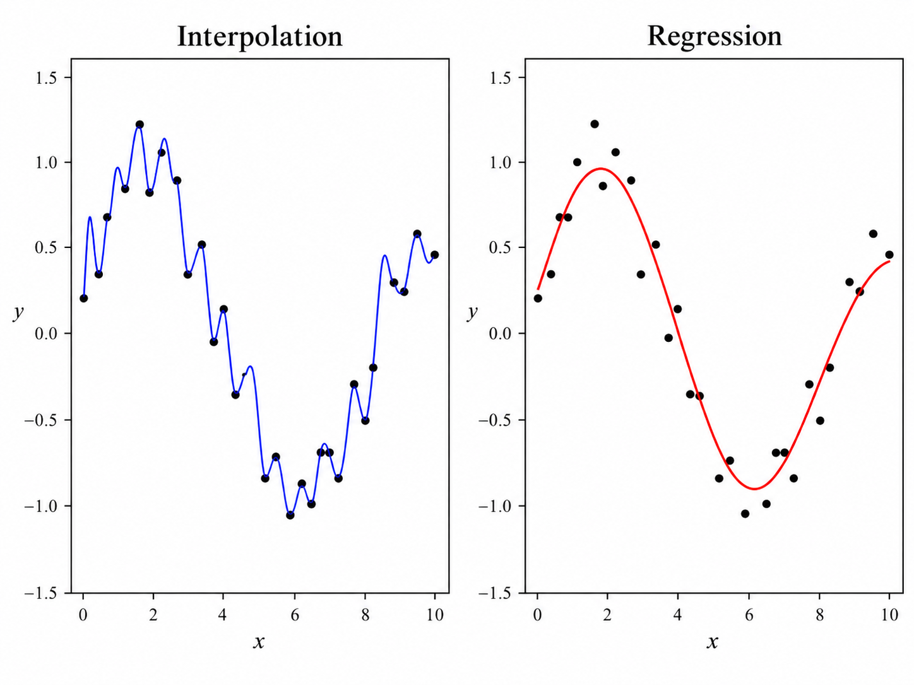
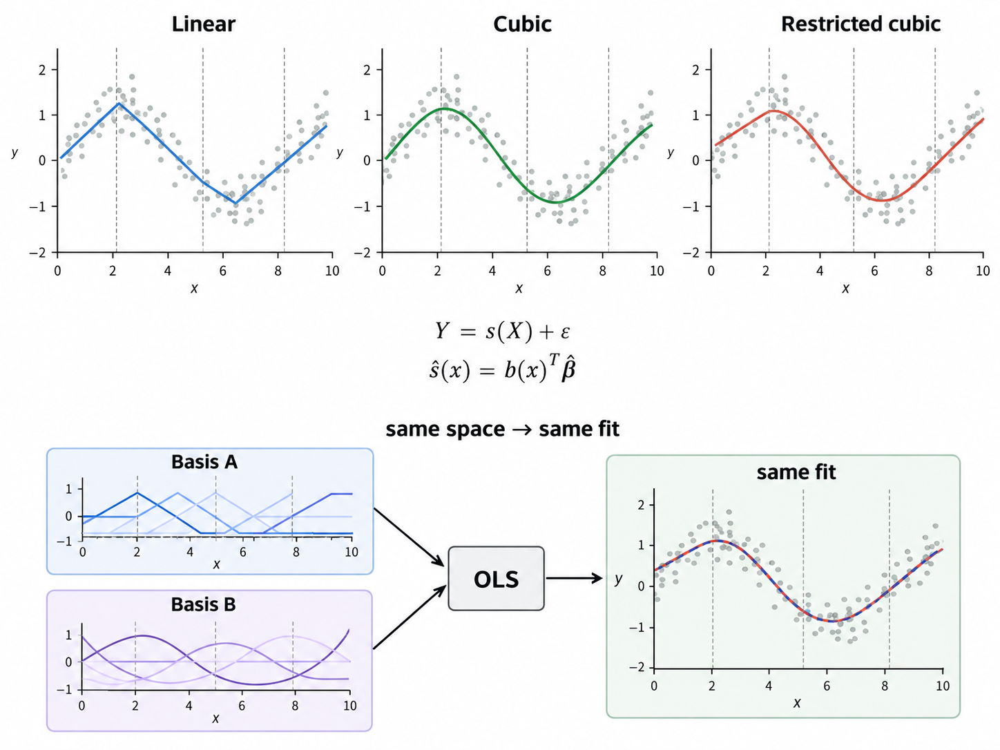

## Motivations

### The problem of approximating an unknown function 

Suppose that we observe a random sample $\mathcal D_n = \{(x_i, y_i)\}_{i=1}^n$ generated according to the regression model $Y_i = f(X_i) + \epsilon_i$ where $f:\R \to \R$ is an unknown regression function and the random errors satisfy $\E[\epsilon_i\mid X_i]=0$. Consequently,

$$
f(x) = \E[Y\mid X= x],
$$

and the statistical problem is to construct an estimator $\hat f$ that approximates $f$ from the available observations.

The simplest approach assumes that $f$ is linear:

$$
f(x) = \beta_0 + \beta_1 x 
$$

This assumption has several advatanges. The parameters admit a straigtforward interpretation, estimation can be carried out ordinary least squares, and the resulting model is computationally inexpensive. In many scientific applications, the effect of a predictor changes with its value. For instance, the relationship between age and mortality, temperature and electricity demand, or the concentration of a pollutant and its health consequences may result in some form of closure.

Some may consider using polynomial regression:

$$
f(x) = \beta_0 + \beta_1 x + \ldots + \beta_p x^p. 
$$

As the degree $p$ increases, the class of possible functions becomes richer. However, a polynomial is a _global approximation_: changing one coefficient generally changes the fitted function throughout the entire domain. High-degree polynomials can also exhibit oscillations, especially near the boundaries of the observed data. Furthermore, increasing the polynomial degree does not allow us to allocate additional flexibility to regions where the underlying relationship is more complicated. These motivate a different question:

> Rather than fitting one complicated polynomial over the entire domain, can we construct a function from several simpler polynomials while ensuring that the pieces join together?

::: {#exm-piecewise-linear-spline}

## A piecewise linear model for electricity demand

Consider a regression model describing how electricity usage depends on temperature. Between moderate temperatures, electricity demand may change slowly. Beyond a sufficiently high temperature, air-conditioning demand may increase much more rapidly. We could represent such a relationship using two linear functions joined at a temperature threshold $\kappa$. Mathematically, 

$$
s(x) = \begin{cases}a_0 + b_0 x, & x \leq \kappa, \\ a_1 + b_1 x,& x > \kappa. \end{cases}
$$

The point $\kappa$ is a knot. It indicates where a different local polynomial becomes active. 

:::

::: {#exm-a-linear-spline-with-two-knots}

## A linear splie with two knots

Consider the function 

$$
s(x) = 1 + 2x - 3(x-2)_{+} + (x-5)_{+}, 
$$

where $(z)_{+} = \max(z, 0)$. The two knots are $\kappa_1 = 2$ and $\kappa_2 = 5$.

```{python}
#| code-fold: true
#| code-summary: "View Python code"
import numpy as np 
import matplotlib.pyplot as plt 

# define the positive-part function
def positive_part(z):
    return np.maximum(z, 0)

def s(x):
    return 1+ 2*x - 3*positive_part(x-2) + positive_part(x-5)

x = np.linspace(0, 8, 500)
y = s(x) 

fig, ax = plt.subplots(figsize=(9, 5))
ax.plot(x, y, label="$s(x)$")
for knot in [2,5]:
    ax.axvline(knot, color="gray", linestyle="--", alpha = 0.6)
    ax.scatter(knot, s(knot), color = "red", zorder= 5)
    ax.annotate(f"Knot={knot}", (knot, s(knot)), xytext=(3,3), textcoords="offset points")

ax.set_xlabel("$x$")
ax.set_ylabel("$s(x)$")
ax.set_title("Linear spline")
ax.legend()
plt.show()
```

For $x\leq 2$, both truncated terms vanish: $s(x) = 1+ 2x$. 

For $2< x\leq 5$, only the first truncated term is active: $s(x)= 1+ 2x -3(x-2) = -x + 7$

For $x> 5$, both terms are active: $s(x) = 1 + 2x -3(x-2) +(x-5) = 2$.

Therefore,

$$
s(x) = \begin{cases}1+2x, &x\leq 2, \\ -x+7, & 2< x\leq 5, \\ 2, & x>5.\end{cases}
$$


:::

### The historical origins of spline functions 

The mathematical theory of spline functions was developed by Issac Jabob Schoenberg. @schoenbergContributionsProblemApproximation1988 investigated how to construct smooth approximations and interpolants from discrete observations. He addressed limitations of classical interpolation, particularly the discontinuities that could arise when successive local polynomial approximations were joined. It helped establish piecewise-polynomial functions with prescribed smoothness as a subject in approximation theory. 

A further connection between splines and optimization was developed by John C. Holladay in his 1957 paper @holladaySmoothestCurveApproximation1957. Holladay examined how to construct a curve passing through specified points while minimizing the measure of its bending. 

The central idea can be expressed as the optimized problem

$$
\underbrace{\min_g \int_a^b [g''(x)]^2 dx}_{\substack{J(g):\text{ roughness functional / }\\ \text{bending-energy functional}}}  \quad \text{subject to } g(x_i) = y_i, i= 1, \ldots, n.
$$

Its interpretation follows from the derivatives of $g$. The first derivative $g'(x)$ measures the local slope of the curve, whereas the second derivative $g''(x)$ measures its departure from a locally linear relationship. Therefore, minimizing $J(g)$ discourages excessive curvature. Under the usual interpolation and regularity conditions, the unique minimizer is a natural cubic spline. We will derive this result in @sec-the-minimum-curvature-property-of-natural-cubic-splines. 

### From interpolation to statisitical regression 



In interpolation, the function is required to reproduce every observed response exactly, e.g., $\hat f(x_i) = y_i$. In regression, however, the observations contain noise, so passing through every data point is neither necessary nor desirable. Instead, the objective is to estimate the underlying conditional expectation. This distinction can be formalized by replacing exact interpolation constaints with a loss function, such as 

$$
\min_{f\in \mathcal S} \sum_{i=1}^n (y_i -f(x_i))^2,
$$

where $\mathcal S$ is an appropriate chosen space of spline functions. 

A major development occured in 1967, when Christian H. Reinsch published @reinschSmoothingSplineFunctions1967. Rather than requiring exact interpolation, Reinsch considered minimizing roughness subject to a bound on the weighted squared discrepancies between the fitted curve and the observations.

The subsequent development of spline methods can be understood through related directions:

1. First, __regression splines__ represent $f$ in a finite-dimensional space generated by predetermined basis functions. The coefficients are estimated using ordinary regression methods. 
2. Second, __smoothing splines__ balance goodness of fit against smoothness by adding a roughness penalty or an equivalent constraint. 

## Mathematical Construction of Regression Splines

### Spline function 

Let $a = \kappa_0 <\kappa_1 < \ldots < \kappa_K <\kappa_{K+1} = b$ define a partition of an interval $[a,b]$. The points $\kappa_1, \ldots, \kappa_k$ are called __interior knots__, and the intervals $[\kappa_j, \kappa_{j+1}]$ are called _polynomial segments_. 

::: {#def-polynomial-spline}

## Polynomial spline

A function $s:[a,b]\to \R$ is a _spline_ of degree $p$, with simple interior knots $\kappa_1, \ldots, \kappa_K$ and maximal smoothness, if:

1. On every segment, $s$ agrees with a polynomial of degree at most $p$.
2. At each interior knot, $s$ and its derivatives through order $p-1$ are continuous. 

:::

Thus, for an interior knot $\kappa_j$, 

$$
s^{(r)} (\kappa_j^{-}) = s^{(r)} (\kappa_j^{+}), \quad r = 0,\ldots, p-1. 
$$

Here $\kappa_j^{-}$ and $\kappa_j^{+}$ denote the limits approaching the knot from the left and right. The first condition provides flexibility by allowing different polynomial expressions in different regions. The second condition prevents the fitted function from becoming arbitrarily disconnected or irregular. 

In particular, the smoothness requirements differ by spline degree:

| Spline | Polynomial degree | Continuity at inferior knots | 
| --- | --- | --- |
| Linear | 1 | Function continuous, $C^0$ | 
| Quadratic | 2 | Function and first derivative continuous, $C^{1}$ | 
| Cubic | 3 | Function, first and second derivatives continuous, $C^{2}$ | 

::: {#def-cr-function}

A function belongs to $C^r [a,b]$ if it possesses continuous derivatives through order $r$ on the interval $[a,b]$. 

:::

The distinction is geometric:

- Continuity of $s$ means there are no jumps in the curve.
- Continuity of $s'$ means there are no abrupt changes in slope. 
- Continuity of $s''$ means curvature, as measured by the second derivative, changes continuously. 

```{python}
#| code-fold: true
#| code-summary: "View Python code"
import numpy as np 
import matplotlib.pyplot as plt

x = np.linspace(-2, 2, 1000)

functions = [lambda x: np.abs(x),
             lambda x: x*np.abs(x),
             lambda x: np.abs(x)**3]

first_derivatives = [lambda x: np.sign(x),
                     lambda x: 2*np.abs(x),
                     lambda x: 3*x*np.abs(x)]

second_derivatives = [lambda x: np.zeros_like(x),
                      lambda x: 2*np.sign(x),
                      lambda x: 6*np.abs(x)]

names = [r"$C^0:\ f(x) = |x|$", 
         r"$C^1:\ f(x) = x|x|$",
         r"$C^2:\ f(x) = |x|^3"]

fig, axes = plt.subplots(3,3, figsize = (13, 10))

for i in range(3):
    curves = [functions[i](x), first_derivatives[i](x), second_derivatives[i](x)]
    for j in range(3):
        ax = axes[i, j]
        left = x< 0
        right = x>0

        ax.plot(x[left], curves[j][left])
        ax.plot(x[right], curves[j][right])
        ax.axvline(0, color="gray", linestyle="--", alpha=0.5)
        ax.axhline(0, color="black", alpha=0.7)
        ax.set_xlim(-2, 2)

        if i == 0:
            ax.set_title(["Function $f(x)$", "First derivative $f'(x)$", "Second derivative $f''(x)$"][j])
        if  j == 0:
            ax.set_ylabel(names[i])

plt.suptitle("Smoothness Classes at a Knot ($x=0$)")
plt.tight_layout()
plt.show()
```

### Regression as a basis expansion 

The key statistical advantages of splines is that they can be expressed as linear combinations of known basis functions. Suppose that $\mathcal S$ is a spline space with basis 

$$
\mathcal B = \{B_1, \ldots, B_d\}. 
$$

Every function $s\in\mathcal S$ can then be represented as 

$$
s(x) = \sum_{j=1}^d \beta_j B_j(x) 
$$

for some coefficient vector $\beta = (\beta_1, \ldots, \beta_d)^\top$. Although $s(x)$ may be nonlinear in $x$, it remains _linear in its coefficients_. Consequently, the corresponding regression model is 

$$
Y_i = \sum_{j=1}^d \beta_j B_j(X_i) + \epsilon_i
$$

We define the design matrix  

$$
\mathbf B = \begin{pmatrix}B_1(x_1) & \ldots & B_d(x_1) \\
                            \vdots & & \vdots \\ 
                            B_1(x_n) & \ldots & B_d(x_n)  \end{pmatrix}
$$

Then $\mathbf y = \mathbf{B\beta} + \mathbf\epsilon$. For ordinary least squares,

$$
\hat{\mathbf \beta} = \arg\min_{\mathbf \beta} ||\mathbf y - \mathbf{B\beta} ||^2_2. 
$$

When $\mathbf B$ has full column rank, 

$$
\hat{\mathbf \beta} =(\mathbf B^\top \mathbf B)^{-1}\mathbf B^{\top} \mathbf y 
$$

Thus, spline regression does not require an entirely new estimation principle. Its essential innovation is the construction of the basis functions used to represent the unknown relationship.

### The truncated-power function 

A convenient construction uses the positive-part function $(x-\kappa)_{+}=\max\{x-\kappa, 0\}$. Equivalently, 

$$
(x-\kappa)_{+} = \begin{cases}0, & x\leq \kappa, \\ 
                              x- \kappa, & x> \kappa \end{cases}
$$

For an integer $p\geq 1$, we can define 

$$
(x-\kappa)^{p}_{+} = \begin{cases}0, & x\leq \kappa, \\ 
                             (x- \kappa)^{p}, & x> \kappa \end{cases} 
$$

The term is zero before the knot and becomes a polynomial after the knot. This gives us a mechanism for changing the behavior of a fitted function at a particular location without changing its polynomial expression to the left of that location. 

For simple interior knots, the general truncated-power representation of a degree-$p$ spline is 

$$
s(x) = \underbrace{\sum_{r=0}^p \beta_r x^r}_{\text{Global polynomial of degree at most }p} + \underbrace{\sum_{j=1}^K \gamma_j(x-\kappa_j)^p_{+}}_{\text{additional changes after the specified knots}}. 
$$

## Linear Regression Splines 

### Construction from piecewise linear functions 

We begin with the simplest spline that allows the slope of the regression function to change. Suppose a relationship is approximately linear for small values of $x$, but after a threshold $\kappa$, the rate of change becomes different. 

$$
s(x) = \begin{cases}a_0 + b_0 x , & x\leq \kappa \\ a_1 + b_1 x, & x> \kappa \end{cases}
$$

Without any additional conditions, the two linear expressions need not meet at the knot. Such a function can have discontinuity, which may be unreasonable when the underlying phenomenon is expected to vary continuously. 

We therefore impose $a_0 + b_0 \kappa = a_1 + b_1 \kappa$. Rearranging gives 

$$
a_1 = a_0 + (b_0 - b*_1) \kappa 
$$

Substituting into the second segment,

$$
s(x) = \begin{cases}a_0 + b_0 x, & x\leq \kappa\\ a_0 + b_0 x + (b_1-b_0) (x-\kappa), & x>\kappa\end{cases}
$$

Define $\beta_0 = a_0, \beta_1 = b_0, \gamma_1 = b_1- b_0$; the piecewise representation becomes 

$$
s(x) = \beta_0 + \beta_1 x + \gamma_1 (x-\kappa)_{+}. 
$$

This is a linear regression spline with one interior knot.

We can immediately see the interpretations of the coefficients. The parameter $\beta_1$ is the slope before the knot, while $\gamma_1$ represents the change in slope after the knot. Indeed, differentiating yields 

$$
s'(x) = \begin{cases}\beta_1, & x< \kappa \\ 
                    \beta_1 + \gamma_1, x> \kappa \end{cases}
$$

The derivative need not exist at the knot when $\gamma_1\neq 0$, even though the function itself remains continuous. 

### Extension to multiple knots 

Let the interior knots be $\kappa_1 <\ldots < \kappa_K$. The general linear spline is 

$$
s(x) = \beta_0 + \beta_1 x + \sum_{j=1}^K \gamma_j (x- \kappa_j)_{+}.
$$

For $x$ that does not coincide with a knot,

$$
s'(x) = \beta_1 + \sum_{j=1}^{K} \gamma_j \mathbf 1\{x> \kappa_j\}
$$

The slope on the segment $\kappa_m < x < \kappa_{m+1}$ is therefore 

$$
\beta_1 + \sum_{j=1}^m \gamma_j. 
$$

::: {#exm-slope}

Recall @exm-a-linear-spline-with-two-knots,

$$
s(x) = \begin{cases}1+2x, &x\leq 2 \\ 7-x, & 2< x\leq 5 \\ 2, & x> 5. \end{cases}
$$

The slope is initially 2, falls into -1 after the first knot, and becomes 0 after the second knot. 

:::

### Dimension of the linear spline space

In [linear algebra](../appendices/linear-algebra-revision.qmd), the dimension of a vector space is the number of linearly independent basis vectors needed to represent every element of that space. 

::: {#exm-dimension}

Every vector in $\R^3$ can be expressed as $\mathbf v= a\mathbf e_1  + b\mathbf e_2 + c\mathbf e_3$. The space has dimension three because three independent coordinates are needed to specify an arbitrary vector. 

Consider $\mathcal P_2 = \{a+ bx + cx^2: a, b, c \in \R\}$, a vector space of polynomials of degree at most two. Its basis is $\{1, x, x^2\}$ so $\dim(\mathcal P_2) = 3$. Similarly, $\mathcal P_3 = \{a+ bx+ cx^2 + dx^3\}$ has basis $\{1, x, x^2, x^3\}$ giving $\dim(\mathcal P_3 )= 4$. 

:::

For spline spaces, dimension tells us how many independent coefficients are needed to specify an arbitrary spline ith the selected knots and constraints. 

The basis of a linear spline with $K$ distinct interior knots is 

$$
\mathcal B_{\text{linear}} = \{1, x, (x-\kappa_1)_{+}, \ldots, (x-\kappa_K)_{+}\}
$$

There are $K+2$ basis functions. 

::: {#prp-dimension-of-linear-spline}

## Dimension of linear spline space

The space of continuous piecewise-linear functions with $K$ prescribed distinct interior knots has dimension $K+2$.

:::


::: {.proof}

There are $K+1$ segments. Each segment has a linear polynomial with two coeffcients, giving $2(K+1)$ coefficients before restrictions. Continuity at the $K$ interior knots imposes $K$ indepedent linear constraints. Hence $\dim(\mathcal S_{\text{linear}}) = 2(K+1) - K = K+2$. The truncated-power representation contains precisely $K+2$ linearly independent basis functions and therefore spans the space.

:::

### Interpretation and limitations 

Linear splines provide a simple mechanism for relaxing the assumption of a constant regression slope. They are useful when the underlying phenomenon plausibly changes its rate at identifiable thresholds. Example include changes in marginal costs, piecewise trends, and dose-response relationships.

Their main limitation is geometric. Although the fitted function is continuous, its first derivative can jump abruptly at knot. Such discontinues in slope may be appropriate if a genuine change point exists. However, if the underlying relationship is expected to vary smoothly, a linear spline may introduce artificial corners. This motivates the use of higher-degree splines, particularly cubic splines, which permit greater flexibility while enforcing smoothness of both the first and second derivatives. 

```{python}
#| code-fold: true 
#| code-summary: "View Python code"
import numpy as np 
import matplotlib.pyplot as plt 
from scipy.interpolate import LSQUnivariateSpline 

# simulate temperature observations over 24 hours
rng = np.random.default_rng(6400)
hours = np.linspace(0, 24, 97)

# smooth daily temperature cycle (min at 3am, max at 3pm)
def true_temp(t):
    return 20 + 6*np.cos(2*np.pi*(t-15)/24)
 
def true_rate(t):
    return -6*(2*np.pi/24) * np.sin(2*np.pi*(t-15)/24)

temperature = true_temp(hours) + rng.normal(0, 0.35, len(hours))

# fit a linear regression spline 

knots = np.array([3, 9, 15, 21])

def linear_basis(x):
    return np.column_stack([np.ones_like(x), x, *[np.maximum(x-k, 0) for k in knots]])

B = linear_basis(hours)
beta = np.linalg.lstsq(B, temperature, rcond=None)[0]

# fit a cubic regression spline using the same knots 
cubic = LSQUnivariateSpline(hours, temperature, t=knots, k=3)

# predict temperatures and derivatives
grid = np.linspace(0, 24, 1000)
y_linear = linear_basis(grid) @ beta
y_cubic = cubic(grid)

# the linear spline has constant slopes between knots 
slopes = np.r_[beta[1], beta[1] + np.cumsum(beta[2:])]

# cubic spline has a continuous first derivative 
cubic_rate = cubic.derivative()(grid)

# visualize

fig, axes = plt.subplots(2, 1, figsize=(11, 8), sharex=True)

# true temperature fit
axes[0].scatter(hours, temperature, color="gray", alpha=0.4, label="Observed temperature")
axes[0].plot(grid, true_temp(grid), "k--", label = "True temperature")
axes[0].plot(grid, y_linear, label="Linear spline")
axes[0].plot(grid, y_cubic, label="Cubic spline")

axes[0].set_ylabel("Temperature (^C)")
axes[0].set_title("Temperature Fit")
axes[0].legend()

# rate of temp change
axes[1].plot(grid, true_rate(grid), "k--", label="True rate")
axes[1].plot(grid, cubic_rate, label="Cubic spline derivative")

# plot piecewise constant derivative of linear spline
edges = np.r_[0, knots, 24]
for i, slope in enumerate(slopes):
    axes[1].hlines(slope, edges[i], edges[i+1], label="Linear spline derivative" if i==0 else None)
# show undefined derivatives at interior knots
for i, knot in enumerate(knots):
    for slope in [slopes[i], slopes[i+1]]:
        axes[1].plot(knot, slope, "o")

for ax in axes:
    for knot in knots:
        ax.axvline(knot, color="gray", linestyle=":", alpha=0.5)
    ax.grid(alpha=0.25)

axes[1].axhline(0)
axes[1].set_xlabel("Hour of day")
axes[1].set_ylabel("Temperature change (^C/hour)")
axes[1].set_title("First derivative: estimating warming/cooling rate")
axes[1].legend()

plt.tight_layout()
plt.show()

# quantify fit against the known simulated truth 
rmse_linear = np.sqrt(np.mean((linear_basis(hours) @ beta - true_temp(hours))**2))
rmse_cubic = np.sqrt(np.mean((cubic(hours) - true_temp(hours))**2))

print(f"Linear spline RMSE: {rmse_linear:.3f} ^C")
print(f"Cubic spline RMSE: {rmse_cubic:.3f} ^C")
```

## Cubic Regression Splines 

### Why cubic polynomial?

The principal difficulty with linear splines is that changes in slope occur abruptly. To represent a relationship that changes gradually, we require a function whose derivatives also behave continuosly at the knots. 

A cubic polynomial has the form 

$$
P(x) = a + bx + cx^2  + dx^3. 
$$

Its first two derivatives are 

$$
P'(x) = b + 2cx + 3dx^2  \quad \text{and} \quad P''(x) = 2c + 6dx 
$$

Thus, cubic polynomials provide sufficient flexibility to control the function value, its slope, and its curvature, as $s\in C^2[a, b]$. In contrast with a linear spline, its slope and curvature cannot jump at an interior knot. 

### Derivation of the cubic spline basis 

Consider two adjacent cubic polynomials, $P_1$ and $P_2$, separated by a knot $\kappa$:

$$
s(x) = \begin{cases}P_1(x), & x\leq \kappa, \\ P_2(x), & x> \kappa.\end{cases}
$$

To ensure that $s\in C^2$, we impose 

$$
\begin{aligned}
P_1(\kappa) &= P_2(\kappa)\\ 
P_1'(\kappa) &= P_2'(\kappa) \\ 
P_1''(\kappa) &=P_2''(\kappa)
\end{aligned}
$$

Then define the difference between the two polynomials:

$$
D(x) = P_2(x) - P_1(x).
$$

Since $D$ is a polynomial of degree at most three, its Taylor expansion around $\kappa$ is exact:

$$
D(x) = D(\kappa) + D'(\kappa)(x-\kappa) + \frac{D''(\kappa)}{2}(x-\kappa)^2 + \frac{D'''(\kappa)}{6}(x-\kappa)^3. 
$$

The continuity conditions imply $D(\kappa) = D'(\kappa) = D''(\kappa) = 0$. Therefore, $D(x) = \gamma(x-\kappa)^3$ for some constant $\gamma$. 

We conclude that $P_2(x) = P_1(x) + \gamma(x-\kappa)^3$. Hence, the piecewise representation may be written as 

$$
s(x) = P_1(x) + \gamma(x-\kappa)^3_{+}
$$

This construction proves that the truncated cubic term allows the polynomial to change at the knot without violating the required continuity conditions. Extending the argument to $K$ interior knots yields 

$$
s(x) = \beta_0 + \beta_1 x + \beta_2 x^2 + \beta_3 x^3 + \sum_{j=1}^{K} \gamma_j (x- \kappa_j)_{+}^3. 
$${#eq-cubic-k-knots}

### Smoothness properties 

The derivatives of @eq-cubic-k-knots are 

$$
\begin{aligned}
s'(x) &= \beta_1 + 2\beta_2 x + 3\beta_3 x^2 + 3\sum_{j=1}^K \gamma_j (x-\kappa_j)^{2}_{+}. \\ 
s''(x) &= 2\beta_2 + 6\beta_3 x + 6\sum_{j=1}^K \gamma_j(x-\kappa_j)_{+}.  
\end{aligned}
$$

and, away from the knots, 

$$
s'''(x) = 6\beta_3 + 6\sum_{j=1}^{K} \gamma_j \mathbf 1\{x> \kappa_j\}. 
$$

Observe that, 

$$
\lim_{x\to \kappa_j^{-}}(x- \kappa_j)^3_{+} = \lim_{x\to \kappa_j^{+}}(x-\kappa_j)^{3}_{+} = 0. 
$$

The same equality holds for its first and second derivatives. Therefore, the spline and its first two derivatives remain continuous at each knot. The third derivatives, however, is generally discontinuous. At knot $\kappa_j$, its jump is 

$$
s'''(\kappa_j^{+}) - s'''(\kappa_j^{-}) = 6\gamma_j . 
$$

This gives a more precise interpretation of the cubic spline coefficients. Whereas a coefficient in a linear spline controls a change in slope, a truncated cubic coefficient controls a change in the third derivatives. 

::: {#exm-cubic-spline}

Consider the function $s(x) = 1+2x+ 0.4(x-2)^3_{+}$. Its piecewise form is 

$$
s(x) = \begin{cases}1+2x, & x\leq 2\\ 1+ 2x + 0.4(x-2)^3, & x> 2.\end{cases}
$$

The first derivative is 

$$
s(x) = \begin{cases}2, & x\leq 2 \\ 2+ 1.2(x-2)^2, & x>2.\end{cases}
$$

and the second derivative is 

$$
s(x) = \begin{cases}0, & x\leq 2 \\ 2.4(x-2), & x>2. \end{cases}
$$

At the knot $x=2$, 
$$
\begin{aligned}
s(2^{-}) &= s(2^{+}) = 5,\\ 
s'(2^{-}) &= s'(2^{+}) = 2,\\ 
s''(2^{-}) &= s''(2^{+}) = 0,
\end{aligned}
$$

Thus, unlike a linear spline, the cubic spline changes its shape gradually after knot.

```{python}
#| code-fold: true
#| code-summary: "View Python code"
def positive_part(z):
    return np.maximum(z, 0)
def s(x):
    return 1+2*x + 0.4*positive_part(x-2)**3
def ds(x):
    return 2+1.2*positive_part(x-2)**2
def d2s(x):
    return 2.4*positive_part(x-2) 
def d3s(x):
    return np.where(x<2, 0.0, np.where(x>2, 2.4, np.nan))

x = np.linspace(0, 5, 1000)
functions = [s, ds, d2s, d3s]
titles = [
    r"$s(x)=1+2x+0.4(x-2)_+^3$",
    r"$s'(x)=2+1.2(x-2)_+^2$",
    r"$s''(x)=2.4(x-2)_+$",
    r"$s'''(x)$"
]
fig, axes = plt.subplots(2, 2, figsize=(12, 8))
for ax, f, title in zip(axes.flat, functions, titles):
    ax.plot(x, f(x))
    ax.axvline(2, color = "gray", linestyle="--", alpha = 0.6)
    ax.set_title(title)
    ax.set_xlabel("$x$")
    
ax = axes[1,1]
ax.scatter([2,2], [0,2.4])
plt.suptitle("Cubic Spline and its Derivates")
plt.tight_layout()
plt.show()
```
:::

The example also illustrates an important limitation. The cubic term grows increasingly rapidly as $x$ moves far to the right of the knot. Smoothness does not ensure reasonable behavior outside the region supported by the data. 

### Dimension of the cubic spline space

Suppose we divide an interval three segments using two interior knots:

$$
a<\kappa_1 < \kappa_2 < b. 
$$

Consider fitting a separate cubic polynomial on each segment:

$$
s(x) = \begin{cases}P_1(x),& a\leq x \leq \kappa_1, \\P_2(x), & \kappa_1 < x \leq \kappa_2, \\ P_3(x), & \kappa_2 < x \leq b.\end{cases}
$$

Each cubic polynomial requires four coefficients $P_j(x) = a_j + b_j(x) + c_j x^2 + d_j x^3$. Therefore, if the polynomials are completely independent, the function requries $3\times 4=12$ coefficients. 

To obtain a conventional cubic spline, we impose continuity of the function and its first two derivatives at both knots. At $\kappa_1$, we require

$$
\begin{aligned}
P_1(\kappa_1) &= P_2(\kappa_1)\\ 
P_1'(\kappa_1) &= P_2'(\kappa_1)\\
P_1 '' (\kappa_1) & = P_2''(\kappa_1)  
\end{aligned}
$$

These are three independent linear constraints on the coefficients. The same three constraints must hold at $\kappa_2$. Thus we have six constraints in total. So 

$$
\dim(\mathcal S_{\text{cubic}}) = 12 - 6 = 6 
$$

::: {#prp-dimension-cubic-spline-space}

## Dimension of the cubic spline space

The space of cubic splines with $K$ distinct, simple interior knots has dimension $K+4$.

:::

::: {.proof}

There are $K+1$ polynomial segments. Each segment has four polynomial coefficients, so there aer initially $4(K+1)$ unknown coefficients. At each of the $K$ interior knots, continuity of the function and its first two derivatives imposes three independent constraints. Consequently, 

$$
\dim(\mathcal S_{\text{cubic}}) = 4(K+1) - 3K = K+4. 
$$

The basis $\{1, x, x^2, x^3, (x-\kappa_1)^3_{+}, \ldots, (x-\kappa_K)^3_{+}\}$ contains exactly $K+4$ linearly independent functions. Hence, it forms a basis for the cubic spline space.

:::

> __A GENERAL DIMENSION FORMULA__ 

Let $\mathcal S_{p,m}$ be the space of degree-$p$ splines with $m$ distinct interior knots and maximal smoothness. There are $m+1$ polynomial segments. Each polynomial segment requires $p+1$ coefficient. Thus, before restrictions, there are 

$$
(m+1)(p+1) 
$$

coefficients. At each interior knot, continuity is imposed for derivative orders $0, 1, \ldots, p-1$. Therefore, there are $p$ continuity constraints at each knot, giving $mp$ constraints. The dimension then is:

$$
\begin{aligned}
\dim(\mathcal S_{p, m}) &= (m+1)(p+1) - mp \\ 
 & = mp + m + p + 1 - mp \\ 
 & = \boxed{m + p + 1}
\end{aligned}
$$

### The problem of boundary behavior 

Although cubic splines are flexible in the interior, their behavior near and beyond the boundaries can be problematic. To see why, suppose the final knot is $\kappa_K$. For $x> \kappa_K$, every truncated-power term is active, and @eq-cubic-k-knots becomes a single cubic polynomial 

$$
s(x) = A+ Bx + Cx^2 + Dx^3
$$

for constants $A, B, C, D$ determined by the fitted coefficients. If $D\neq 0$, then the dominant term for large $|x|$ is $Dx^3$. Therefore, small changes in estimated coefficients can produce large changes in predictions outside the observed range. This is especially concerning when there are few observations near the domain boundaries. In such regions, the data may not contain enough information to determine the curvature reliably. Thus,

> _The relationship should be allowed to exhibit nonlinear behavior where sufficient information is available, but unnecessary curvature should be restricted at the boundaries._

```{python}
#| code-fold: true
#| code-summary: "View Python code"
import numpy as np 
import matplotlib.pyplot as plt 
from scipy.interpolate import BSpline 

rng = np.random.default_rng(6400)

x = np.linspace(0, 10, 60)

def true_mean(x):
    return (0.6+ 0.42*x + 2.0* np.exp(-0.5*((x-5)/1.4)**2)-0.35*np.exp(-0.5*((x-8)/1.2)**2))

y_true = true_mean(x)
y = y_true + rng.normal(0, 0.18, size = len(x))

x_grid = np.linspace(-2, 12, 600)

interior_knots = [4, 7]
boundary_knots = [0,10]
degree = 3

# cubic b-splie knot vector 
t = np.r_[[boundary_knots[0]]*4, interior_knots, [boundary_knots[1]]*4]

def cubic_basis(x):
    x = np.asarray(x) 
    n_basis = len(t) - degree - 1
    B = np.zeros((len(x), n_basis))
    for j in range(n_basis):
        coef = np.zeros(n_basis)
        coef[j] = 1
        
        spline = BSpline(t, coef, degree, extrapolate = True)
        B[:, j] = spline(x) 
    return B

# fit unrestrcited cubic spline by least square
B = cubic_basis(x) 
beta = np.linalg.lstsq(B, y, rcond=None)[0]

y_unrestricted = cubic_basis(x_grid) @ beta

def natural_cubic_basis(x, knots=(0, 4, 7, 10)):
    x = np.asarray(x, dtype=float)
    knots = np.asarray(knots, dtype=float)

    if len(knots) < 3 or np.any(np.diff(knots) <= 0):
        raise ValueError("knots must contain at least three strictly increasing values")

    def d(z, k):
        return (np.maximum(z-knots[k], 0)**3 - np.maximum(z-knots[-1], 0)**3)/ (knots[-1]- knots[k])

    return np.column_stack([np.ones_like(x), x, d(x, 0) - d(x, 2), d(x,1) - d(x, 2)])

# fit natural cubic spline by least square
N = natural_cubic_basis(x) 
theta = np.linalg.lstsq(N, y, rcond=None)[0]

y_natural = natural_cubic_basis(x_grid) @ theta 

# plot 
fig, ax = plt.subplots(figsize = (13, 7))
# observations 
ax.scatter(x, y, alpha=0.4, label="Observed sample in [0,10]")
# unrestricted cubic spline 
ax.plot(x_grid, y_unrestricted, label = "Unrestricted cubic (6 coefficients)")
# natural cubic spline 
ax.plot(x_grid, y_natural, label = "Natural cubic (4 coefficients)")
# true mean
ax.plot(x_grid, true_mean(x_grid), label = "True mean")
# boundary knots
for knot in boundary_knots:
    ax.axvline(knot, linestyle="--", alpha=0.6)
ax.axhline(0, alpha = 0.3)

ax.set(title="Same two interior knots, different boundary constraints",
        xlabel = "Predictor x",
        ylabel = "Response",
        xlim = (-2.7, 12.7),
        ylim = (-3, 11.5))

ax.legend()
plt.tight_layout()
plt.show()
```

## Restricted Cubic Splines and Natural Cubic Splines 

### Motivation for the restriction 

A __restricted cubic spline (RSC)__, also called a _natural cubic spline_, is a cubic spline whose behavior is constrained to be linear outside two designated boundary knots. The model retains cubic polynomial segments in the interior but does not permit unrestricted cubic growth in the tails. 

Restricted cubic splines became influential in applied statistical regression through the work of @durrlemanFlexibleRegressionModels1989. Their paper developed the practical use of cubic spline regression for flexible relationships involving continuous covariates and illustrated restricted cubic splines in survival analysis and cancer research.

### Mathematical definition 

Let $a = \kappa_1 < \kappa_2 <\ldots<\kappa_{K-1} < \kappa_{K} = b$ denote $K$ distinct knots, now _including the two boundary knots_.

::: {#def-restricted-cubic-spline}

## Restricted cubic spline 

A function $s:\R\to \R$ is a __restricted cubic spline__ with boundary knots $a$ and $b$ if it is a cubic spline on $[a,b]$ and is linear on both exterior intervals $(-\infty, a]$ and $[b, \infty)$. Its function value, first derivative, and second derivative are continuous at every knot, including the boundary knots. 

:::

Because a linear function has zero second derivative, the natural boundary conditions are $s''(a) = 0$ and $s''(b)=0$. The spline is extended lineraly beyond the boundary knots using its endpoint values and slopes:

$$
s(x) = \begin{cases}
s(a) + s'(a)(x-a),& x< a\\ 
s_{interior}(x), & a\leq x \leq b  \\ 
s(b) + s'(b)(x-b), & x> b. 
\end{cases}
$$

Notice that these restrictions don't require the fitted curve to have zero slope at either boundary. They restrict _curvature_, not slope. Consequently, the function can increase or decrease linearly outside the boundary knots, while remaining nonlinear inside them. 

### Constructing a restricted cubic spline basis 

The goal is to construct basis functions that automatically satisfy the natural boundary conditions, so that the estimation procedure does not need to enfore then separately. Begin with the truncated cubic functions

$$
u_j (x) = (x-\kappa_j)^{3}_{+}
$$

For $j=1, \ldots, K-1$, define 

$$
d_j(x) = \frac{(x-\kappa_j)^3_{+}- (x-\kappa_K)^3_{+}}{\kappa_K-\kappa_j}. 
$${#eq-distance}

We next construct the nonlinear basis functions 

$$
h_j (x) = d_j(x) - d_{K-1}(x), \qquad j=1, \ldots, K-2
$$

The restricted cubic spline is then represented as 

$$
s(x) = \beta_0 +\beta_1 x + \sum_{j=1}^{K-2}\gamma_j h_j (x). 
$${#eq-restricted-cubic-spline}

This expression contains $K$ coefficients, including the intercept. $h_j$ eliminates quadratic and cubic behavior beyond the boundary knots. 

::: {#prp-linear-tails}

Every function of the form @eq-restricted-cubic-spline is linear for $x\leq \kappa_1$ and and $x\geq \kappa_K$. 

:::

::: {.proof} 

First consider $x\leq \kappa_1$. Since all knots satisfy $\kappa_j \geq \kappa_1$, $(x-\kappa_j)^3_{+} = 0$ for every $j$. Consequently, $d_{j}(x) = 0$ and $h_j(x) = 0$, and therefore

$$
s(x) = \beta_0 + \beta_1 x
$$

Thus, the function is linear to the left of the first boundary knot. 

Now consider $x\geq \kappa_K$. Every truncated cubic term becomes an ordinary cubic polynomial. Differentiating @eq-distance twice gives

$$
d_j''(x) = 6\frac{(x-\kappa_j)-(x-\kappa_K)}{\kappa_K - \kappa_j}= 6. 
$$

Similarly, $d''_{K-1}(x) = 6$. Hence $h''_{j}(x) = d''_{j}(x) - d''_{K-1}(x) = 0$. It follows that 

$$
s''(x) = \sum_{j=1}^{K-2}\gamma_j h_j''(x) = 0
$$

for all $x\geq \kappa_K$. A twice differentiable function whose second derivative is identically zero on an interval must be affine on that interval. Therefore, $s$ is linear to the right of the final boundary knot.

The basis functions are also twice continuously differentiable because they are linear combinations of truncated cubic functions. Thus, the resulting spline satisfies the required smoothness and tail restrictions. 
:::

### Dimension of the restricted cubic spline space

A restricted cubic spline with $K$ total knots has $K-2$ interior knots. From @prp-dimension-cubic-spline-space, the unrestricted cubic spline space on $[a, b]$ has dimension $(K-2) + 4 = K+2$. Imposing the two independent natural boundary conditions 

$$
s''(a) = s''(b) = 0
$$

reduces the dimension by two

$$
\dim(\mathcal S_{\text{natural}})=K. 
$$

This agrees with the representation in @eq-restricted-cubic-spline, which contains an intercept, one linear term, and $K-2$ nonlinear basis functions. Thus, a restricted cubic spline with 5 total knots contains 5 coefficients, or 4 regression degrees of freedom excluidng the intercept. 3 of these are associated with nonlinear basis terms. So the model can represent nonlinear relationships without estimating an excessive number of parameters.

::: {#exm-restricted-cubic-spline}

Consider three knots $\kappa_1 =0$, $\kappa_2 =1$, and $\kappa_3 = 2$. With three total knots, the restricted cubic spline space has dimension three. Its basis consists of an intercept, a linear term, and one nonlinear term. Up to a constant scaling of the coefficient, the nonlinear basis function is 

$$
H(x) = (x)^3_{+} - 2(x-1)^{3}_{+} + (x-2)^{3}_{+}. 
$$

Expanding the positive-part terms gives

$$
H(x) = \begin{cases}
0, & x\leq 0, \\ 
x^3, & 0< x\leq 1 \\ 
x^3 - 2(x-1)^3, & 1< x\leq 2 \\ 
6x - 6, & x> 2. 
\end{cases}
$$

Consider the regression function $s(x) = 1+ x + 0.1H(x)$. For $x\leq 0$, $s(x) = 1+ x$. For $x>2$, $s(x) = 1+ x + 0.1(6x-6) = 0.4 + 1.6x$. Therefore, the left and right tail slopes are 1 and 1.6, respectively. Between the boundary knots, the cubic segments provide a gradual transition between these slopes. 

:::

Note that, for the same number $m$ of interior knots, 

$$
\dim(\mathcal S_{\text{linear}})= \dim(\mathcal S_{\text{natural}}) = m + 2
$$

Thus, both spaces have the same dimension. 

### The minimum-curvature property of natural cubic splines {#sec-the-minimum-curvature-property-of-natural-cubic-splines}

::: {#thm-minimum-curvature-property-of-the-natural-cubic-interpolant}

Let $a=x_1< x_2 < \cdots < x_n = b$ with $n\geq 2$, and suppose interpolation values $y_1, \ldots, y_n$ are given. Let $s$ be the natural cubic spline interpolant satisfying $s(x_i) = y_i$, with $s\in C^2[a, b]$, cubic polynomial pieces between successive observations, and boundary conditions $s''(a) = s''(b) = 0$. Then $s$ uniquely minimizes 

$$
J(g) = \int_{a}^{b}[g''(x)]^2 dx
$$

over all sufficiently regular functions $g$ satisfying the same interpolation constraints. 

:::

::: {.proof}

Let $g$ be any competing interpolating function and define $h(x) = g(x) - s(x)$. Since $g$ and $s$ agree at the interpolation points, 

$$
h(x_i) = 0, \quad i = 1, \ldots, n. 
$$

Expanding the bending energy of $g = s+ h$,

$$
\begin{aligned}
J(g) &= \int_{a}^{b} [s''(x) + h''(x)]^2 dx \\ 
& = \int_{a}^{b}[s''(x)]^2 dx + 2\int_{a}^{b} s''(x)h''(x)dx + \int_{a}^{b}[h''(x)]^2 dx
\end{aligned}
$$

We will show that the cross term vanishes. On each segment $[x_i, x_{i+1}]$, integration by parts twice gives 

$$
\int_{x_i}^{x_{i+1}} s''h'' dx  = [s''h'- s'''h]_{x_i}^{x_{i+1}} + \int_{x_i}^{x_{i+1}}s''''h dx
$$

Because $s$ is cubic on each segment, $s^{(4)} =0$ within that segment. Moreover, $h(x_i)=0$ at each interpolation point, so the term involving $s'''h$ vanish. When the remaining boundary terms are summed over all segments, the contribution involving s''h' cancel at interior knots because s'' and h' are continuous. Finally, the endpoint contributions vanish because $s''(a) = s''(b) = 0$. It follows that 

$$
\int_{a}^{b}s''(x)h''(x) dx = 0. 
$$

Hence

$$
J(g) = J(s) + \int_{a}^{b}[h''(x)]^2 dx
$$

Since the final integral is nonnegative, $J(g) \geq J(s)$. Equality holds only when $h''=0$ almost everywhere. This implies that $h$ is affine, and because it vanishes at at least two distinct interpolation point, $h\equiv 0$. Therefore, $g=s$ is the unique minimizer.
:::

This theorem gives natural cubic splines an interpretaion that goes beyond an arbitrary choice of polynomial basis. Among all interpolating functions with finite squared curvature, the natural cubic spline is the smoothest according to the specified bending-energy criterion.

One must distinguish this result from ordinary restricted cubic spline _regression_. A fixed-knot least-squares regression spline does not interpolate the observations and does not neccesarily minimize bending energy among all possible functions. The variation theorem concerns the natural cubic interpolant; it also helps explain the theoretical foundation of cubic smoothing splines. 

## Statistical Estimation, Model Complexity, and Interpretation 

Having established the mathematical structure of the three spline families, we now consider how they are estimated and how their flexibility should be controlled in statistical applications. 

### A unified regression formulation 

Linear, cubic, and restricted cubic regression splines share the general representation

$$
Y_i = s(X_i) + \epsilon_i 
$$

where $s(x) = \sum_{j=1}^{d} \beta_j B_j(x).$ The distinction among the models lies in their basis functions and constraints but not in the estimation method. For a fixed collection of knots and basis functions, ordinary least sqaures minimizes 

$$
L(\beta) = \sum_{i=1}^n \left[y_i - \sum_{j=1}^d \beta_j B_j(x_i)\right]^2. 
$$

The resulting estimates of the response function are 

$$
\hat s(x) = b(x)^\top \hat \beta,
$$

where $b(x) = (B_1(x), \ldots, B_d(x))^\top$. Importantly, the fitted curve depends on the spline space rather than on the particular basis used to represent that space. Two different bases spanning the same spline space produce identical ordinary least-squares fitted values, provided they are both of full rank and the optimization is solved accurately. This distinction becomes important when considering alternative numerical representations, such as B-splines. 



### Knot selection and model complexity 

The number and placement of knots determine the flexibility of a regression spline. A model with relatively few knots has limited ability to reproduce rapid changes in the regression function. Such a model may exhibit substantial approximation bias. Conversely, introducing too many knots increases the dimension of the model and may lead to high estimation variance or overfitting. This can be understood through the familiar bias-variance decomposition. Under squared-error loss, at a given point $x$, 

$$
\E[(\hat s(x) - f(x))^2] = \mathrm{Bias}[\hat s(x)]^2 + \mathrm{Var}[\hat s(x)]. 
$$

Increasing the number of knots generally enlarges the space of functions available to the model, reducing approximation bias in favorable cases. However, the resulting increase in the number of coefficients may also increase estimation variance. Thus, spline flexibility must be chosen according to the amount of information available. 

Knot placement can be determined using domain knowledge, equally spaced positions, or empirical quantiles of the predictor distribution. Quantile-based placement is especially common for restricted cubic splines. For example, the conventional knot configurations associated with @harrellRegressionModelingStrategies2015 include the following:

| Total knots | Suggested predictor quantiles |
| --- | --- |
| 3 | 10%, 50%, 90% | 
| 4 | 5%, 35%, 65%, 95% | 
| 5 | 5%, 27.5%, 50%, 72.5%, 95% | 

The number of knots may instead be selected through cross-validation:

$$
\hat K = \arg\min_{K \in \mathcal K} CV(K), 
$$

where $CV(K)$ measures the out-of-sample prediction error for a spline model with $K$ knots. 

### Statistical inference 

For a fixed spline basis, suppose $\epsilon\sim \mathcal N(0, \sigma^2 I)$. Then 

$$
\hat \beta\sim \mathcal N(\beta, \sigma^2(B^\top B)^{-1}). 
$$

For a given predictor value $x$, 

$$
\mathrm{Var}[\hat s(x)] = \sigma^2 b(x)^\top (B^\top B)^{-1}b(x).
$$

Substituting an estimator $\hat{\sigma}^2$ gives a standard error for the fitted regression function. Under the usual assumptions, this can be used to construct a pointwise confidence interval for the conditional mean. A useful question is whether the spline provides a pointwise confidence interval for the conditional mean. 

For the restricted cubic spline representation, 

$$
s(x) = \beta_0 + \beta_1 x + \sum_{j=1}^{K-2} \gamma_j h_j(x), 
$$

the hypothesis of a linear relationship is 

$$
H_0: \gamma_1 = \cdots = \gamma_{K-2} = 0 
$$

Under $H_0$, the spline reduces to 

$$
s(x) = \beta_0 + \beta_1 x  
$$

With fixed knots and the usual Gaussian linear-model assumptions, this hypothesis can be evaluated using a partial $F$-test. For generalized regression models, likelihood-ratio or Wald tests may be appropriate. A caveat is necessary: when knots or model complexity are selected using the same data, ordinary fixed-model inference does not automatically account for that selection uncertainty. 

### Interpreting the fitted relationship 

Individual spline coefficients generally do not have simple interpretations comparable to the slope coefficient of an ordinary linear regression. This is particularly true for restricted cubic splines, where a single basis coefficient changes the fitted curve over a substantial portion of the predictor domain. Instead, interpretation should focus on the estimated regression function and its derivatives. 

The conditional marginal effect is 

$$
\frac{d}{dx} \E[Y\mid X = x] = s'(x) 
$$

A finite change in the expected response between $x_a$ and $x_b$ is 

$$
\Delta(x_a, x_b) = s(x_b) - s(x_a). 
$$

The second derivative $s''(x)$ describe how the slope changes with $x$. For example, if $s'(x)>0$ and $s''(x)<0$, the expected response is increasing, but its rate of increase is decreasing. These quantitites provide a meaningful scientific summaries than just interpreting an isolated cubic-basis coefficient.

### Why B-splines are important computationally 

The truncated-power representation, however, is not the best numerical representation. Terms such as $x^3$ and $(x-\kappa_j)^3_{+}$ can be highly correlated, particularly when the predictor has a large numerical range or knots are closely spaced. This may lead to an ill-conditioned design matrix. An alternative is to use __B-splines__, which form a basis of functions with local support. 

A _B-spline basis function_ is nonzero only over a limited range of knots. As a result, the associated design matrix is typically sparse or banded, and the numerical calculations can be more stable. 

Let $t_1\leq \cdots \leq t_M$ be a knot sequence, including repeated boundary knots when needed. For degree zero, we define 

$$
B_{i, 0} = \mathbf 1\{t_i \leq x \leq t_{i+1}\}
$$

For degree $p\geq 1$,

$$
B_{i, p} = \frac{x-t_i}{t_{i+p}-t_i} B_{i, p-1}(x) + \frac{t_{i+p+i}- x }{t_{i+p+1}- t_{i+1}}B_{i+1, p-1}(x), 
$$

where a term with a zero denominator is defined to be zero. For the same knot sequence and boundary conditions, an appropriate B-spline basis and a truncated-power basis span the same function space. Their fitted curves are therefore mathematically equivalent under unpenalized least squares.

## From Regression Splines to Smoothing Splines 

Although the main focus is regression splines, it is important to understand the related smoothing-spline framework because many modern spline methods combine these two ideas.

### Penalizing excessive curvature 

Instead of choosing a small number of knots and estimating an unrestricted coefficient vector, we may introduce a penalty that discourages roughness. 

For cubic smoothing, the objective takes the form 

$$
\hat f_\lambda = \arg \min_{f\in H^2[a, b]}\left\{\underbrace{\sum_{i=1}^n (y_i - f(x_i))^2}_{\text{goodness of fit}}+ \lambda \underbrace{\int_a^b [f''(x)]^2}_{\text{roughness}} dx\right\}
$${#eq-cubic-smoothing-objective}

Here, $H^2[a, b]$ denotes a function space whose members have square-integrable second weak derivative. The tuning parameter $\lambda\geq0$ controls the relative importance of these objectives. As $\lambda$ becomes small, the estimator emphasizes agreement with the observed responses. As $\lambda$ increases, it places greater emphasis on smoothness. When $\lambda\to\infty$, and under the usual nondegeneracy conditions, the fitted curve approaches a linear least-squares regression function, because linear functions have zero second derivative.

::: {#thm-finite-dimensional-characterization}

For distinct observed predictor values, the minimizer of @eq-cubic-smoothing-objective is a natural cubic spline with knots at the distinct observed predictor values. 

:::

::: {.proof}

Consider any candidate function $f$, and let $s_f$ be the natural cubic spline interpolating the values $f(x_i)$. The function $f$ and $s_f$ agree at the observations, so they have identical squared-error terms. By @thm-minimum-curvature-property-of-the-natural-cubic-interpolant, 

$$
\int_{a}^{b}[s''_f(x)]^2 dx \leq \int_{a}^b [f''(x)]^2 dx. 
$$

Therefore, replacing $f$ by its natural cubic interpolant cannot increase the objective in @eq-cubic-smoothing-objective. It follows that minimization over the infinite-dimensional function space can be reduced to minimization over the finite-dimensional space of natural cubic splines with knots at the observed predictor values.

:::

### Matrix representation of a penalized regression spline 

For a finite spline basis 

$$
s(x) = \sum_{j=1}^d \beta_j B_j(x), 
$$

the penalized least-squares criterion becomes 

$$
L_\lambda (\beta) = ||\mathbf y - \mathbf B \beta||_2^2 + \lambda \beta^\top \omega \beta, 
$$

where 

$$
\omega_{jk} = \int_{a}^{b} B''_{j}(x) B''_k(x) dx . 
$$

Differentiating with respec to $\beta$ gives

$$
-2\mathbf B^\top (\mathbf y - \mathbf B \beta) + 2\lambda \omega \beta = 0. 
$$

Consequently, 

$$
(\mathbf B^\top \mathbf B + \lambda \omega)\hat \beta_\lambda = \mathbf B^\top \mathbf y . 
$$

This demonstrates that smoothing can be incorporated into spline regression through regularization. The fitted values may be written as 

$$
\hat{\mathbf{y}} = \mathbf S_{\lambda} \mathbf y,
$$

where 

$$
\mathbf S_\lambda = \mathbf B(\mathbf B^\top \mathbf B + \lambda \omega)^{-1}\mathbf B^\top. 
$$

The quantity 

$$
\mathrm{df}_{\mathrm{eff}}(\lambda) = \mathrm{tr}(\mathbf S_{\lambda})
$$

is called the __effective degrees of freedom__. Unlike the dimension of an unpenalized spline space, this quantity can vary continuously with $\lambda$, reflecting how strongly the fitted curve has been regularized. 

> _Regression splines primarily control complexity through the dimension of the chosen spline space. Smoothing and penalized regression splines additionally control complexity through a roughness penalty._

## Subsequent Developments and Modern Extensions 

### Generalized additive models 

One of the most influential extensions was the development of generalized additive models by @hastieGeneralizedAdditiveModels. Instead of assuming the the response depends linearly on several predictors, they proposed an additive combination of smooth functions. For predictors $X_1, \ldots, X_p$, the generalized additive model has the form 

$$
g(\E[Y | X_1, \ldots, X_p]) = \beta_0 + \sum_{j=1}^p f_j(X_j),
$$

where $g$ is the link function and each $f_j$ is an unknown smoothing function. The component functions can be represented using spline bases:

$$
f_j(x) = \sum_{k=1}^{d_j} \beta_{jk}B_{jk}(x). 
$$

Appropriate identifiability constraints, such as centering the smooth terms, are imposed to distinguish the intercept from the additive components. The generalized additive framework provides interpretable nonlinear effects while retaining much of the structure of familiar regression models. A comprehensive modern treatment appears in @woodGeneralizedAdditiveModels2017, which emphasizes penalized regression splines and their connection to generalized linear and mixed models. 

### Penalized B-splines

@eilersFlexibleSmoothingBsplines1996 introduced an especially influential approach known as __P-splines__, combining B-spline bases with penalties on successive coefficient differences. Instead of penalizing the integrated second derivative directly, a typical P-spline estimator solves

$$
\min_\beta \{||\mathbf y - \mathbf B \boldsymbol \beta||_2^2 + \lambda ||\mathbf D_r \boldsymbol \beta||_2^2\}, 
$$

where $\mathbf D_r$ is a matrix representing differences of order $r$. For example, the second-order coefficient difference is 

$$
\Delta^2 \beta_j = \beta_j - 2 \beta_{j-1} + \beta_{j-2}
$$

Penalizing these differences discourages rapid change between neighboring coefficients. This construction offers a computationally convenient way to obtain smooth functions, even with a relatively large number of basis functions.

### Adapative regression splines 

A different development is the automatic selection of knots and interaction terms. @friedmanMultipleAdditiveRegression2003 introduced _Multivariate Adaptive Regression Splines (MARS)_, a procedure that constructs a model using adaptively selected spline-like basis functions. Its basis building blocks include higne functions, 

$$
(x-\kappa)_{+} \quad \text{and} \quad (\kappa-x)_{+}, 
$$

and products of these functions. This allows the model to identify useful changes behavior and interactions without requiring the analyst to prespecify every knot. MARS therefore shares a conceptual foundation with linear splines, while extending them through automated basis selection. 

### Shape-constrained splines 

In some scientific applications, substantive knowledge suggests that the fitted function must satisfy additional structural properties. For example, a dose-response relationship may be expected to be monotone, or a cost function may be assumed to be convex. Such requirements can be expressed mathematically through derivative constraints:

$$
s'(x) \geq 0 
$$

for nondecreasing function, or $s''(x) \geq 0$ for a convex function. @ramsayMonotoneRegressionSplines1988 is an imporant contribution to the usse of monotonicity constraints in spline-based statisitcal modeling. This line of research demonstrates that splines can incorporate structural prior knowledge. 

### Multivariate splines and interactions 

A further extension converns smooth relationships involving more than one predictor. Suppose $f:\R^2 \to \R$. A tensor-product spline represents the function as 

$$
f(x_1, x_2) = \sum_{j=1}^{d_1} \sum_{k=1}^{d_2} \beta_{jk} B_j(x_1)C_k(x_2). 
$$

This construction permits plexible interactions between continuous predictors. Thin-plate regression splines provide another important approach, particularly in spatial modeling and GAM. @woodThinPlateRegression2003 developed low-rank thin-plate regression splines, while @woodLowrankScaleinvariantTensor2006 developed tensor-product smoothing constructions. 

### Connections to machine learning 

Spline representations have also appeared in more recent ML architectures. One example is @liuKANKolmogorovArnoldNetworks2025: _KAN: Kolmogorov-Arnold Networks_. In this architecture, learnable univariate functions, parameterized using splines, replace conventional scalar connection weights in a proposed alternative to multilayer perceptrons. 
