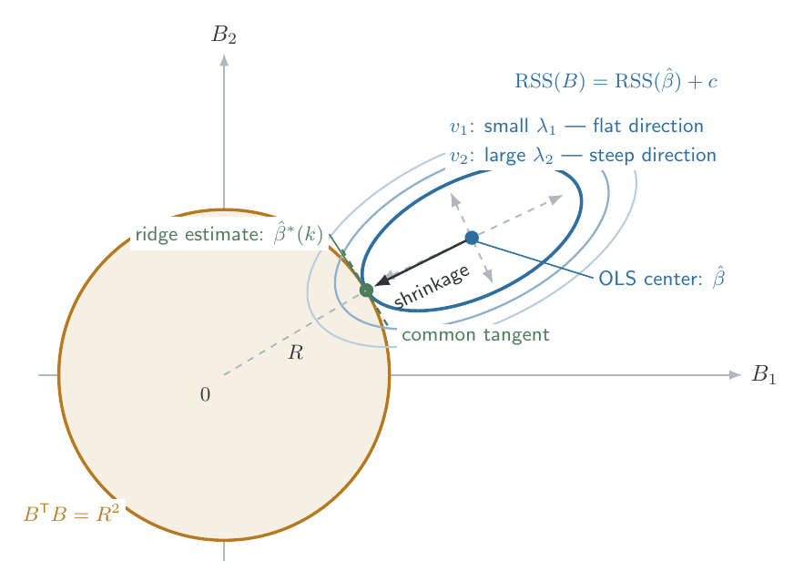

The objective of this chapter is to understand ridge regression as a general approach to statistical estimation in which additional information, restrictions, and stability considerations are incorporated into an optimization problem. Throughout, we adopt the principal notation of @hoerlRidgeRegressionBiased1970. In particular, $\beta$ denotes the unknown regression coefficient vector, $\hat\beta$ the OLS estimator, and $\hat \beta^*(k)$ the ridge estimator. The papers also use $X'X$ and $X'Y$, where the prime denotes transpose; we retain this convention.

## The Motivation for Regularization in Linear Regression 

### Statistical estimation as a problem of constraints

Consider a general optimization problem of the form 

$$
\min_{\theta \in \Theta}L(\theta)
$$

where $\theta$ is an unknown parameter vector, $\Theta$ is its parameter space, and $L(\theta)$ measures how well a particular choice of $\theta$ satisfies an estimation criterion. 

In OLS, the criterion is the residual sum of squares. The model searches for the coefficient vector that minimizes the discrepancy between observed and predicted responses. However, minimizing the discrepancy is only one possible requirement of an estimation procedure. In many scientific problems, the parameter must also satisfy restrictions that arise from the underlying system. Physical quantities are required to remain nonnegative; biological responses may have limited plausible magnitudes; engineering systems may require stable behavior; and models intended for prediction should not change significantly under small perturbations of the observations. 

One general formulation is 

$$
\min_{\theta\in \Theta} L(\theta) \quad \text{subject to } g_j(\theta)\leq c_j, \quad j=1, \ldots, m 
$$

The first component measures goodness of fit, while the constraints express additional requirements that a satisfactory solution must respect. 

Regularization arises from this perspective. Instead of treating goodness of fit as the only objective, we incorporate additional information about which parameter values should be considered reasonable. 

A common alternative to explicit constraints is the penalized optimization problem

$$
\min_{\theta\in \Theta} \{L(\theta) + kJ(\theta)\},
$$

where $J(\theta)$ is a penalty function and $k\geq 0$ controls its influence. The parameter $k$ determines the trade-off between minimizing the original loss and satisfying the additionall criterion.

- When $k=0$, the estimation procedure depends entirely on the original loss. 
- When $k>0$, solutions violating the additional criterion are penalized. 
- As $k$ increases, the penalty becomes more influential.

For ridge regression, the additional criterion concerns the maginitude of the regression coefficients:

$$
J(\beta) = \beta'\beta = \sum_{j=1}^p \beta_j^2. 
$$

The resulting estimator favors coefficient vectors of smaller Euclidean length. Large coefficients can be a natural consequence of certain unstable regression problems, especially when predictors are strongly correlated. In these situations, a restriction on coefficient magnitude can improve estimation accuracy. The question now becomes:

> _Can we accept a small amount of bias in exchange for a sufficiently large reduction in estimation variance?_

### The linear model and ordinary least squares

Consider the standard multiple linear regression model 

$$
Y = X \beta + \epsilon ,
$$

where $Y\in \R^n$, $X\in \R^{n\times p}$, $\beta\in \R^{p}$, $\epsilon \in \R^n$. We assume 

$$
\E[\epsilon] = 0 ,\quad \E[\epsilon\epsilon'] = \sigma^2 I_n
$$

and initially suppose that $\rank(X) = p$. Thus, $X$ has full column rank, so $X'X$ is symmetric positive definite and invertible. These are the assumptions of the original theoretical development. We will later discuss how ridge regression extends to situations where $X$ does not have full column rank.

Let $B\in \R^p$ be a candidate coefficient vector. Define its residual sum of squares as 

$$
\phi(B) = (Y-XB)'(Y-XB). 
$$

The OLS estimator is 

$$
\hat \beta = \arg\min_{B\in \R^p} \phi(B)
$$

Expanding the quadratic expression gives 

$$
\phi(B) = Y'Y -2B'X'Y + B'X'XB
$$

Taking the derivative with respect to $B$,

$$
\frac{\partial \phi (B)}{\partial B} = -2X'Y + 2X'XB
$$

Setting the derivative equal to zero produces the normal equations

$$
X'X\beta = X'Y
$$

Since $X'X$ is invertible, 

$$
\hat \beta = (X'X)^{-1} X'Y
$$

The minimum residual sum of square is then 

$$
\phi_\min = \phi(\hat \beta) = (Y-X\hat \beta)'(Y-X\hat\beta)
$$

Under the assumptions of the [Gauss-Markov theorem](https://en.wikipedia.org/wiki/Gauss–Markov_theorem), $\hat \beta$ is the best linear unbiased estimator. More precisely, it has the smallest covariance matrix in the positive-semidefinite ordering among linear unbiased estimators. 

This property has a limitation: the comparison is restricted to _unbiased linear estimators_. If we allow biased estimators, it becomes possible to obtain a smaller square error. 

::: {#rem-variance-bias}

The variance of an estimator measures its sampling variability, while the mean square error accounts for systematic differents between its expected value and the true parameter. 

An unbiased estimator may have considerable variance, particularly when the data provide little information for distinguishing the contributions of individual predictors. 

:::

### The covariance structure of least squares 

We begin with a fundamental property of the OLS estimator. 

::: {#prp-unbiasedness-and-covariance-of-ols}

## Unbiasedness and covariance of OLS

Under the specified linear model and full-column-rank assumption, 

$$
\E[\hat \beta] = \beta, \quad \text{and} \quad \var(\hat \beta)=\sigma^2 (X'X)^{-1} 
$$

:::

::: {.proof}

Substituting $Y = X\beta + \epsilon$ into the least squares estimator,

$$
\hat \beta = (X'X)^{-1}X'(X\beta+ \epsilon) = \beta + (X'X)^{-1}X'\epsilon 
$$

Taking expectations gives 

$$
\E[\hat \beta] = \beta + (X'X)^{-1}X' \E[\epsilon] = \beta 
$$

Thus, $\hat \beta$ is unbiased.

For the covariance, note that $\beta$ is fixed and 

$$
\begin{aligned}
\var(\hat \beta) &= \var((X'X)^{-1}X'\epsilon)\\ 
&= (X'X)^{-1}X'\var(\epsilon)X(X'X)^{-1}\\ 
&= \sigma^2 (X'X)^{-1} X'X (X'X)^{-1}\\ 
&= \sigma^2(X'X)^{-1}
\end{aligned}
$$

This establishes the result. 

:::

The covariance matrix reveals a dependence between the regression design and the reliability of coefficient estimation. The observations do not influence the variance of $\hat \beta$ only through the sample size. When the columns of $X$ are nearly linear dependent, the inverse $(X'X)^{-1}$ may contain large entries. The coefficient estimates can consequently become highly variable. 

This issue can be understood through a measure of the distance between the estimator and the true coefficient vector. We define the squared estimation error 

$$
L^2 = (\hat \beta - \beta)'(\hat \beta - \beta)
$$

The quantity $L^2$ measures the squared Euclidean distance from the estimated coefficient vector to the true coefficient vector. 

::: {#prp-expected-squared-estimation-error}

## Expected squared estimation error

The OLS estimator satisfies

$$
\E[L^2] = \sigma \mathrm{Trace}[(X'X)^{-1}]
$$

Equivalently, 

$$
\E[\hat \beta'\hat \beta] = \beta'\beta + \sigma^2 \mathrm{Trace}[(X'X)^{-1}]
$$

:::

::: {.proof}

By @prp-unbiasedness-and-covariance-of-ols, $\E[\hat \beta -\beta] = 0$. Using the identity

$$
\E[U'U] = \mathrm{Trace}(\var(U))
$$

for any zero-mean random vector $U$, we obtain

$$
\begin{aligned}
\E[L^2] &= \E[(\hat \beta - \beta)'(\hat \beta - \beta)]\\ 
&= \mathrm{Trace}(\var(\hat \beta)) = \sigma^2 \mathrm{Trace}[(X'X)^{-1}]
\end{aligned}
$$

Furthermore, 

$$
\begin{aligned}
\E[\hat \beta ' \hat \beta] &= \E[(\beta + (\hat \beta - \beta))'(\beta+ (\hat\beta - \beta))]\\ 
&= \E[\beta'\beta + \beta'(\hat \beta-\beta) + (\hat \beta - \beta)'\beta + (\hat \beta -\beta )'(\hat \beta - \beta)] \\  
&= \beta' \beta + 2\beta'\E[\hat \beta - \beta] + \E[L^2] \\ 
&= \beta' \beta + \sigma^2 \mathrm{Trace}[(X'X)^{-1}] 
\end{aligned}
$$
:::

Although $\hat \beta$ is unbiased, the expected squared length of the estimated coefficient vector exceeds the square length of the true coefficient vector. It means that, collectively, the least squares coefficient vector has an inflated expected squared magnitude. The inflation depends directly on the trace of $(X'X)^{-1}$. This observation is a central motivation for shrinking the coefficient vector. 

### Eigenvalues, nonorthogonality, and instability 

Since $X'X$ is symmetric positive definite, it admits an orthogonal diagonalization 

$$
X'X = P'\Delta P, 
$$

where $P$ is orthogonal ($P'P=PP'= I_p$), and 

$$
\Lambda = \mathrm{diag}(\lambda_1, \ldots, \lambda_p)
$$

contains the positive eigenvalues

$$
\lambda_1 \geq \lambda_2 \geq \ldots \geq \lambda_p > 0 
$$

The notation $\Lambda$ represents the eigenvalue matrix used in the original papers; later $P$ will also provide the transformation to the canonical regression system.

Since 

$$
(X'X)^{-1} = P'\Lambda^{-1}P, 
$$

the trace is invariant under orthogonal similarity transformations, giving 

$$
\mathrm{Trace}[(X'X)^{-1}] = \mathrm{Trace}(\Lambda^{-1}) = \sum_{j=1}^p \frac{1}{\lambda_j}
$$

Therefore 

$$
\E[L^2] = \sigma^2 \sum_{j=1}^p \frac{1}{\lambda_j}
$$

> _Small eigenvalues cause large contributions to the expected squared estimation error._

In particular,

$$
\E[L^2]\geq \frac{\sigma^2}{\lambda_p}
$$

As the smmallest eigenvalue approaches zero, the expected estimation error may become arbitrarily large. 

Recall that each column of $X$ represents a predictor vector in $\R^n$. When these vectors are strongly correlated, the same observed response may be explained by several different combinations of regression coefficients. 

For example, suppose two predictors are nearly identical. A large positive and a large negative coefficient on the second may cancel one another in the fitted response. The coefficients themselves may be large and unstable even though their combined is relatively stable. This is the situation in which minimizing residual error can yield an undesirable coefficient vector. 

The difficulty can also be expressed through the condition number of $X'X$:

$$
\kappa(X'X) = \frac{\lambda_1}{\lambda_p}
$$

A large condition number means that the quadratic loss changes much more rapidly in some parameter space directions than in others. Near the least squares solution, movement along a direction associated with a small eigenvalue produces only a small increase. 

::: {#exm-two-predictor-illustration}

Suppose the columns of $X$ have been normalized so that 

$$
X'X = \begin{pmatrix}1 & \rho \\ \rho & 1\end{pmatrix}
$$
where $\rho$ is the correlation between the two predictor vectors. The eigenvalues are 

$$
\lambda_1 = 1+ \rho, \quad \lambda_2 = 1-\rho 
$$

for $0\leq \rho < 1$. Therefore, 

$$
\E[L^2] = \sigma^2(\frac{1}{1+\rho} + \frac{1}{1-\rho}) = \frac{2\sigma^2}{1-\rho^2}. 
$$

If $\rho=0$, the predictors are orthogonal and 

$$
\E[L^2] = 2\sigma^2. 
$$

If $\rho = 0.99$, then 

$$
\E[L^2] \approx 100.50\sigma^2
$$

The expected squared coefficient error is now more than fifty times its value under orthogonality. 

:::

The problem therefore suggests a change in the estimation criterion. Rather than insisting on the coefficient vector that gives the absolute minimum residual sum of squares, we may seek a nearby vector that has a somewhat larger residual error but a substantially. Such a vector may be less sensitive to noise and provide a more accurate estimate of the unknown coefficients. 

Under the normal errors, we can describe the instability even more precisely. Since the components of the least squares estimation error in the eigenvector directions are independent normal variables, the squared distance satisfies

$$
L^2 \overset{d}{=} \sigma^2 \sum_{j=1}^{p} \frac{Z_j^2}{\lambda_j}, \quad Z_j \overset{iid}{\sim} \mathcal N(0, 1)
$$

Because $\var(Z_j^2) = 2$, 

$$
\var(L^2) = 2\sigma^4 \sum_{j=1}^p \frac{1}{\lambda_j^2} = 2\sigma^{4}\mathrm{Trace}[(X'X)^{-2}]
$$

Thus, small eigenvalues increase the expected squared estimation error variability across repeated samples.

## Ridge Regression as a Constrained Estimation Problem 

### Definition and derivation of the ridge estimator 

Let 

$$
||B||^2 = B'B  = \sum_{j=1}^p B_j^2
$$

Instead of minimizing the residual sum of squares without restriction, consider the constrained estimation problem 

$$
\min_{B\in \R^p} (Y-XB)'(Y-XB) \quad \text{subject to}\quad B'B \leq R^2 
$$

where $R\geq 0$ determines the maximum permitted length of the coefficient vector. Geometrically, the constraint requires the coefficient vector to lie inside a hypersphere centered at the origin. 

The parameter $R$ expresses an assumption about the plausible magnitude of the regression coefficient. A smaller value of $R$ represents a stronger, while a sufficiently large value makes the restriction inactive. 

The constrained problem may be studied through its Lagrangian function

$$
\mathcal L(B, k) = (Y-XB)'(Y-XB) + k(B'B-R^2), 
$$

where $k\geq 0$ is the Lagrange multiplier associated with the constraint. 

For any fixed $k$, the term $-kR^2$ does not depend on $B$. Thus, minimizing the Lagrangian with respect to $B$ is equiavalent to minimizing 

$$
\phi(B) + kB'B
$$

::: {#def-ridge-regression-estimation}

## Ridge regression estimator 

For $k\geq 0$, the ridge regresison estimator is 

$$
\hat \beta^* (k) = \arg\min_{B\in \R^p} \{(Y-XB)'(Y-XB) + kB'B\}
$$

:::

The first term measures goodness of fit, while the second penalizes the squared length of the coefficient vector. The parameter $k$ is called the _ridge parameter_ or _regularization parameter_. Under this definition, the two objectives have different roles. The residual sum of squares describes how well the model reproduces the observations, while $B'B$ controls the magnitude of the coefficients. Increasing $k$ places greater emphasis on the second objective. 

The corresponding solution can be obtained directly. 

::: {#thm-closed-form-ridge-estimator}

## Closed-form ridge estimator

For the linear model $Y = X\beta + \epsilon$, the unique minimizer of the ridge objective, for $k> 0$, is 

$$
\hat \beta^* (k) = (X'X + kI_p)^{-1} X'Y
$$

Under the full column rank, this expression is also valid for $k=0$, where it equals the ordinary least squares estimator. 

:::

::: {.proof}

Let 

$$
F_k (B) = (Y-XB)'(Y-XB) + kB'B.  
$$

Expanding, 

$$
F_k(B) = Y'Y -2B'X'Y' + B'(X'X + kI_p) B
$$

Differentiating gives

$$
\frac{\partial F_k(B)}{\partial B} = -2X'Y + 2(X'X+kI_p)B. 
$$

At a stationary point 

$$
(X'X + kI_p B) = X'Y 
$$

To establish that this stationary point is the unique minimum, examine the Hessian:

$$
\nabla^2 F_k(B) = 2(X'X+kI_p). 
$$

For any nonzero $v\in \R^p$,

$$
v'(X'X + kI_p)v = v'X'Xv + kv'v = ||Xv||^2 + k||v||^2. 
$$

If $k>0$, this quantity is strictly positive. Therefore, $X'X + kI_p$ is positive definite and $F_k$ is strictly convex. Its stationary point is consequently its unique global minimizer.

Solving the modified normal equations yields

$$
\hat \beta^*(k) = (X'X +kI_p)^{-1} X'Y 
$$

When $k=0$, the expression reduces to $(X'X)^{-1}X'Y$, provided $X$ has full column rank.  
:::

The effect of ridge regularization is to add a positive quantity each diagonal element of $X'X$. 

This modification has two consequences. First, it controls the magnitude of the estiamted coefficient vector. Second, it alters the eigenvalues of the matrix being inverted, thereby reducing the sensitivity associated with small eigenvalues. 

### Matrix representation and spectral properties

Following @hoerlRidgeRegressionBiased1970, we define 

$$
W = W(k) = (X'X + kI_p)^{-1}
$$

and 

$$
Z = Z(k) = [I_p + k(X'X)^{-1}]^{-1}. 
$$

Because $X'Y = X'X \hat \beta$,

$$
\hat \beta^*(k) = (X'X + kI_p)^{-1} X'X \hat \beta = Z\hat \beta . 
$$

The ridge estimator is a linear transformation of the least squares coefficient vector. Since $X'X$ commutes with $X'X + kI_p$, we can also write 

$$
\begin{aligned}
Z &= (X'X+ kI_p)^{-1}X'X \\ 
&= (X'X + kI_p)^{-1}[(X'X+kI_p) - kI_p] = I_p - k(X'X + kI_p)^{-1}\\ 
&= I_p - kW. 
\end{aligned}
$$

This identity gives another expression for the ridge estimator:

$$
\hat \beta^* = \hat \beta - kW\hat \beta 
$$

It describes ridge estimation as a movement away from the least square solution, with the direction and magnitude of the movement determined by the inverse of the regularized matrix. 

::: {#prp-eigenvalues-of-the-ridge-transformation}

## Eigenvalues of the ridge transformation 

Let $\lambda_1, \ldots, \lambda_p$ denote the positive eigenvalues of $X'X$. Then the eigenvalues of $W$ and $Z$ are, respectively,

$$
\lambda_j(W) = \frac{1}{\lambda_j + k}, \quad \lambda_j(Z) = \frac{\lambda_j}{\lambda_j + k}. 
$$

:::

::: {.proof}

Since $X'X = P'\Lambda P$, we have $X'X + kI_p = P'(\Lambda + kI_p) P$. Taking the inverse gives

$$
W = P'(\Lambda+kI_p)^{-1} P. 
$$

The diagonal elements of $(\Lambda + kI_p)^{-1}$ are $1/(\lambda_j + k)$. These are therefore the eigenvalues of $W$. Similarly, 

$$
Z = WX'X = P'(\Lambda + kI_p)^{-1} \Lambda P
$$

The corresponding eigenvalues are 

$$
\lambda_j (Z) = \frac{\lambda_j}{\lambda_j + k}. 
$$

:::

The quantities 

$$
s_j(k) = \frac{\lambda_j}{\lambda_j + k}
$$

are called _shrinkage factors_. For $k> 0$ and $\lambda_j>0$, $0<s_j(k) < 1$. As a result, ridge regression reduces the magnitude of the least squares coefficient vector along each eigenvector direction. However, the reduction is not uniform across directions. 

If $\lambda_j$ is large relative to $k$, then $s_j(k) \approx 1$. The corresponding component of the least squares solution is preserved to a large extent. 

If $\lambda_j$ is small relative to $k$, then $s_j(k) \approx 0$. The corresponding component is strongly attenuated. This is why ridge regression is particularly useful for nonorthogonal problems: it applies the strongest shrinkage to the directions in which OLS is most unstable. 

To express this precisely, let introduce the transformed parameters

$$
\alpha = P\beta, \quad \hat \alpha = P \hat \beta. 
$$

The ridge estimator satisfies 

$$
P\hat \beta^* = (\Lambda + kI_p)^{-1}\Lambda \hat \alpha. 
$$

Thus, for each $j$,

$$
\hat a_j^* (k) = \frac{\lambda_j}{\lambda_j + k} \hat \alpha_j 
$$

```{python}
#| code-fold: true
#| code-summary: "View Python code"
import numpy as np 
import matplotlib.pyplot as plt 

eigenvalues = [0.05, 0.5, 2]
k = np.linspace(0, 1, 10)

def shrinkage_factor(eigenvalue, k):
    return eigenvalue / (eigenvalue + k)

plt.figure(figsize=(8, 5))

for eigenvalue in eigenvalues:
    plt.plot(k, shrinkage_factor(eigenvalue, k), label=fr"$\lambda={eigenvalue}$")

plt.xlabel("k")
plt.ylabel("Shrinkage factor")
plt.title("Shrinkage factor as a function of k")
plt.legend()
plt.show()
```

The stronger shrinkage of small-eigenvalue directions leads to several additional properties.

::: {#thm-shortening-of-the-ridge-coefficient-vector}

## Shortening of the ridge coefficient vector

For every $k>0$, 

$$
(\hat \beta^*)'\hat \beta * \leq  \hat \beta '\hat \beta 
$$

The inequality is strict whenever $\hat \beta \neq 0$. 

:::

::: {.proof}

Since $\hat \beta^* = Z\hat \beta$, 

$$
(\hat \beta^*)\hat \beta^* = \hat \beta' Z' Z \hat \beta. 
$$

The matrix $Z$ is symmetric, so 

$$
(\hat \beta^*)\hat \beta^* = \hat \beta' Z^2\hat \beta. 
$$

Using the orthogonal transformation, 

$$
\begin{aligned}
(\hat \beta^*)\hat \beta^* &= \hat \alpha' \mathrm{diag}\left(\frac{\lambda_1^2}{(\lambda_1+k)^2}, \ldots, \frac{\lambda_p^2}{(\lambda_p+k)^2}\right)\hat \alpha \\ 
&= \sum_{j=1}^p \left(\frac{\lambda_j}{\lambda_j+k}^2 \right)\hat \alpha_j^2. 
\end{aligned}
$$

Because $\left(\frac{\lambda_j}{\lambda_j+k}\right)^2 < 1$ for every $j$ when $k>0$, 

$$
(\hat \beta^*)' \hat \beta^* \leq \sum_{j=1}^p \hat a_j^2. 
$$

Since $P$ is orthogonal, 

$$
\hat \alpha' \hat \alpha = \hat \beta' \hat \beta. 
$$

Thus, 

$$
(\hat \beta^*)'\hat \beta * \leq  \hat \beta '\hat \beta 
$$

with strict inequality if $\hat \beta \neq 0$

:::

Notice that this theorem concerns the total length of the coefficient vector. A particular coordinate $\hat \beta_j^*(k)$ may increase in absolute value or even change sign as $k$ increases. Nevertheless, the squared length of the entire vector decrease. 

A further consequence concerns the conditioning of the estimation matrix. 

::: {#prp-improvement-in-matrix-conditioning}

## Improvement in matrix conditioning 

For $k>0$, 

$$
\kappa(X'X+ kI_p) = \frac{\lambda_1 + k}{\lambda_p + k} \leq \frac{\lambda_1}{\lambda_p}
$$

This inequality is strict when $\lambda_1 > \lambda_p$.

:::

::: {.proof}

Adding $kI_p$ shift each eigenvalue of $X'X$ by $k$. Thus, the largest and smallest eigenvalues of the regularized matrix are $\lambda_1+ k$ and $\lambda_p+k$. Now, 

$$
\frac{\lambda_1 + k}{\lambda_p + k} \leq \frac{\lambda_1}{\lambda_p}
$$

is equivalent, after multiplying by positive denominators, to 

$$
k\lambda_p \leq k \lambda_1, 
$$

which follows from $\lambda_p \leq \lambda_1$. 

:::

The resulting condition number approaches one as $k \to \infty$. 

::: {#rem-interpret}

Ridge regression does not make the original predictor vectors orthogonal or eliminate their correlations. Rather, it changes the estimation system so that the matrix being inverted is better conditioned. 

:::

In the special case of an orthogonal normalized design, 

$$
X'X = I_p 
$$

the estimator simplifies to 

$$
\hat \beta^*(k) = \frac{1}{1+k} \hat \beta.  
$$

All coefficients are multiplied by the same factor, so their relative magnitudes and signs remain unchanged. For a nonorthogonal design, the transformation is generally more complex because different principal directions are shrunk by different amounts. 

### The geometric and likelihood interpretation of ridge regression 

Consider again the residual sum of squares 

$$
\phi(B) = (Y-XB)'(Y-XB)
$$

Since the ordinary least squares estimator satisfies

$$
X'(Y-X\hat \beta) = 0, 
$$

we can write 

$$
Y-XB = (Y-X\hat \beta) + X(\hat \beta - B)
$$

Expanding the squared length and using the orthogonality of the least squares residuals to the columns of $X$ gives 

$$
\phi(B) = \phi_\min + (B- \hat \beta)X'X (B-\hat \beta). 
$$

This identity decomposes the residual sum of squares into its minimum value and the additional loss incurred by moving away from the least squares solution. 

Because $X'X$ is positive definite, the expression 

$$
(B-\hat \beta)'X' X (B-\hat \beta) =c , \quad c>0,
$$

describes a hyperrellipsoid centered at $\beta$.

The principal axes of this ellipsoid are determined by the eigenvectors of $X'X$. Along an eigenvector associated with $\lambda_j$ , a displacement of magnitude $t$ increases the residual sum of squares by $\lambda_j t^2$. Hence, a small eigenvalue corresponds to a direction in which the loss function is relatively flat.

By contrast, the constraint 

$$
B'B = R^2
$$

describes a hypersphere centered at the origin. 

The ridge estimator can therefore be understood as the point at which an ellipsoidal residual-error surface is tangent to a coefficient-length sphere. We move away from the least square solution, but we choose the movement that achieves the most favorable relationship between fit and coefficient magnitude. 



::: {#thm-equivalent-constrained-characterizations-of-ridge-regression}

## Equivalent constrained characterizations of ridge regression

Let $k>0$ and define 

$$
R^2_k (\hat \beta^* (k))'\hat \beta^* (k), \quad s_k=\phi(\hat \beta^*(k)). 
$$

Then $\hat \beta^*(k)$ is simultaneously:

1. The unique minimizer of $\phi(b)+ k B'B$. 
2. The unique minimizer of $\phi(B)$ subject to $B'B\leq R_k^2$. 
3. The unique minimizer of $B'B$ subject to $\phi(b)\leq s_k$. 

In other words, for a fixed permitted coefficient length, the ridge estimator gives the smallest residual sum of squares. Convresely, for a fixed permitted residual sum of squares along the ridge path, it gives the shortest coefficient vector. 

:::

::: {.proof}

The first statement follows from @thm-closed-form-ridge-estimator. Let $B$ satisfy $B'B \leq R^2_k$. By optimality of $\hat \beta^*$, 

$$
\phi(\hat \beta^*) + kR_k^2 \leq \phi(B) + kB'B 
$$

Since $kB'B\leq kR_k^2$,

$$
\phi(\hat \beta^*) \leq \phi(B)
$$

Therefore, $\hat \beta^*$ minimizes residual sum of squares over the coefficient-length ball. Conversely, suppose $\phi(B) \leq s_k$. Again, by optimality,

$$
s_k + k R_k^2 \leq \phi(B) + kB'B \leq s_k + kB'B 
$$

Subtracting $s_k$ and dividing by $k>0$ gives 

$$
R_k^2 \leq B'B. 
$$

Thus, $\hat \beta^*$ minimizes coefficient length among estimators having residual sum of squares no greater than $s_k. Uniqueness follows from the strict convexity of the corresponding objectives. 

:::

The theorem establishes that the penalized and constrained formulations describe the same family of solutions, provided their parameters are matched appropriately. 

However, the ridge parameter $k$ and the radius $R$ are not numerically identical. The relationship between them is 

$$
R^2 = (\hat \beta^* (k))'\hat\beta^*(k). 
$$

As $k$ increases, the corresponding radius decreases. The ridge solution can also be characterized through the residual sum of squares. Using the modified normal equations, 

$$
X'Y = (X'X+ kI_p) \hat \beta^*, 
$$

we obtain 

$$
\begin{aligned}
\phi(\hat \beta^*) &= Y'Y - 2(\hat \beta^*) X'Y + (\hat \beta^*)'(X'X)\hat \beta^* \\ 
&= Y'Y -(\hat \beta^*)'X'Y - k(\hat \beta^*)'\hat \beta^* 
\end{aligned}
$$

Therefore, 

$$
\phi^*(k) = Y'Y - (\hat \beta^*)'X'Y - k(\hat \beta^*)' \hat \beta^* 
$$

Alternatively, subtracting the least squares estimate from the ridge estimate gives 

$$
\hat \beta^* - \hat \beta = -k (X'X)^{-1}\hat \beta^* 
$$

Substitution into the residual-error decomposition yields

$$
\phi^*(k) = \phi_\min + k^2(\hat \beta^*)'(X'X)^{-1}\hat\beta^* 
$$

The increase is nonnegative, so 

$$
\phi^*(k) \geq \phi_\min. 
$$

Ridge regression does not improve the training residual sum of squares relative to OLS. Such an improvement is impossible because OLS already minimizes that quantity. 

::: {#prp-monotonicity-along-the-ridge-path}

## Monotonicity along the ridge path 

The squared coefficient length 

$$
N(k) = (\hat \beta^*)'\hat \beta^*(k)
$$

is nonincreasing in $k$, while the residual sum of squares $\phi^*(k)$ is nondecreasing. For $\hat \beta^*(k)\neq 0$ and $k>0$, the respective derivatives are strictly negative and positive. 

:::

::: {.proof}

Differentiating 

$$
\hat \beta^*(k) = W(k) X'Y
$$

and using 

$$
\frac{dW}{dk} = -W^2 
$$

gives 

$$
\frac{d\hat \beta^*}{dk} = -W\hat \beta^* 
$$

Therefore, 

$$
\frac{dN(k)}{dk} = 2(\hat\beta^*)'\frac{d\hat \beta^*}{dk} = -2(\hat \beta^*)'W'\hat \beta^*
$$

Because $W$ is positive definite, 

$$
\frac{dN(k)}{dk}\leq 0. 
$$

Next, since 

$$
\nabla_B \phi(B) = -2X'(Y-XB), 
$$

The chain rule now gives, 

$$
\begin{aligned}
\frac{d\phi^*(k)}{dk} &= \nabla_B \phi(\hat \beta^*)'\frac{d\hat \beta^*}{dk} \\  
&= (-2k\hat \beta^*)'(-W\hat \beta^*) = 2k(\hat\beta^*)'W\hat \beta^*.
\end{aligned}
$$
Hence 

$$
\frac{d\phi^*(k)}{dk} \geq 0.  
$$

The stated strict inequalities follow when $k>0$ and $\hat \beta^* \neq 0$. 
:::

Together, these properties show that the ridge path gives a continuous trade-off between residual error and coefficient length. As the coefficient vector becomes shorter, the residual sum of squares becomes larger. The question is not whether this trade-off exists, but whether the additional residual error is sufficiently small to justify the improved stability. 

A related interpretation follows when the random errors are normally distributed:

$$
\epsilon \sim \mathcal N(0, \sigma^2 I_n). 
$$

The likelihood function for a candidate coefficient vector $B$ is 

$$
L(B\mid Y) = (2\pi \sigma^2)^{-\frac{n}{2}} \exp\left\{-\frac{1}{2\sigma^2}(Y-XB)'(Y-XB)\right\}
$$

For fixed $\sigma^2$, maximizing this likelihood is equivalent to minimizing $\phi(B)$. OLS is therefore also the maximum likelihood estimator. Contours of constant likelihood correspond to contours of constant residual sum of squares, which are the hyperellipsoids described previously. 

This interpretation has a direct connection to Bayesian estimation. Suppose that, in addition to normally distributed errors, we assign the regression coefficient vector the prior distribution 

$$
\beta \sim \mathcal N \left(0, \frac{\sigma^2}{k} I_p \right), \quad k> 0 
$$

The posterior density is proportional to 

$$
p(\beta \mid Y) \propto \exp \left\{-\frac{1}{2\sigma^2}[(Y-X\beta)'(Y-X\beta)+ k\beta'\beta] \right\}
$$

Consequently, the posterior mode minimizes precisely the ridge objective. Because the posterior distribution is multivariate normal, its mode and mean coincide, giving 

$$
\E[\beta \mid Y] = (X'X + kI_p)^{-1}X'Y 
$$

Therefore, ridge regression can also be interpreted as the posterior mean under a zero-centered spherical normal prior. The prior expresses the assumption that excessively large coefficient magnitudes are less plausible than moderate ones, with the strength of this assumption controlled by $k$. 

This provides another interpretation of the same mathematical procedure: ridge regression may be viewed as constrained optimization, penalized least squares, or Bayesian estimation under an appropriate normal prior. 

## Statiscal Properties of Ridge Regression 

The preceding section established that ridge regression produces a shorter coefficient vector by modifying the least squares estimation criterion. However, the fact an estimator has smaller coeffcients does not by itself imply that it is statistically better. To evaluate ridge regression, we must investigate how regularization changes the bias, variance, and mean square error of the estimator. 

### The bias, variance, and the mean square error of the ridge estimator 

Consider $\hat \beta^*(k)= WX'Y= Z\hat \beta$, where $W = (X'X+ kI_p)^{-1}$ and $Z =I_p- kW$. 

::: {#thm-bias-and-covariance-of-the-ridge-estimator}

## Bias and covariance of the of the ridge estimator 

Under the standard linear regression assumptions 

$$
\E[\hat \beta^*(k)] = Z\beta 
$$

and therefor the bias vector is 

$$
\mathrm{Bias}(\hat \beta^*(k)) = (Z-I_p)\beta = -kW\beta 
$$

The covariance matrix is 

$$
\var(\hat \beta^*(k)) = \sigma^2 W(X'X)W = \sigma^2 Z(X'X)^{-1}Z'
$$
:::

::: {.proof}

Since $Y= X\beta + \epsilon$, we can express the ridge estimator as 

$$
\begin{aligned}
\hat \beta^* &= WX'(X\beta+ \epsilon) = WX'X\beta + WX'\epsilon  \\ 
&= Z\beta + WX'\epsilon 
\end{aligned}
$$

Taking expectations, 

$$
\E[\hat \beta^*] = Z\beta + WX'\E[\epsilon] = Z\beta 
$$

Therefore, 

$$
\mathrm{Bias}(\hat \beta^*) = \E[\hat \beta^*] - \beta = (Z-I_p)\beta  
$$

Using $Z= I_p- kW$, 

$$
\mathrm{Bias}(\hat \beta^*) = -kW\beta. 
$$

For the covariance, the deterministic term $Z\beta$ makes no contribution, so 

$$
\begin{aligned}
\var(\hat \beta^*) &= \var(WX'\epsilon) \\ 
&= WX'\var(\epsilon) XW' = \sigma^2 WX'XW. 
\end{aligned}
$$

The last equality follows because $W$ is symmetric. Since $Z = W(X'X)$, it also follows that 

$$
WX'XW = Z(X'X)^{-1}Z' 
$$
This completes the proof. 
:::

The theorem establishes that the ridge estimator is generally biased whenever $k>0$. The ridge estimator does not have expectation exactly qual to $\beta$; instead, its expectation is obtained by applying the shrinkage the shrinkage transformation $Z$ to the true coefficient vector. Nevertheless, bias alone does not determine an estimator's accuracy. The appropriate comparison must account for both bias and variance.

We define the squared estimation error of the ridge regression by 

$$
L^2(k) = (\hat \beta^* - \beta)'(\hat \beta^*(k) - \beta). 
$$

The corresponding mean square error is $\E[L^2(k)]$. 

::: {#thm-mean-square-error-decomposition}

## Mean square error decomposition 

The mean square error of the ridge estimator can be written as 

$$
\E[L^2(k)] = \gamma_1(k) + \gamma_2(k)
$$

where 

$$
\gamma_1(k) = \sigma^2 \sum_{j=1}^p \frac{\lambda_j}{(\lambda_j+k)^2}
$$

is the total variance, and 

$$
\gamma_2(k) = k^2 \beta'(X'X+ kI_p)^{-2} \beta 
$$

is the squared bias. Equivalently, if $\alpha = P\beta$, 

$$
\gamma_2(k) = k^2 \sum_{j=1}^p \frac{\alpha_j^2}{(\lambda_j + k)^2}
$$

:::

::: {.proof}

Write the estimation error as 

$$
\hat \beta^* - \beta = (\hat \beta^* - \E[\hat \beta^*]) + (\E[\hat \beta^*] - \beta). 
$$

The first term has zero expectation, while the second is the bias vector. Expanding the squared norm and taking expectations, 

$$
\E[L^2(k)] = \E\left[||\hat \beta^* - \E[\hat \beta^*] ||^2 \right] + ||\E[\hat \beta^*] - \beta ||^2.
$$

The cross term vanishes because the centered estimator has mean zero. Therefore, 

$$
\E[L^2(k)] = \mathrm{Trace}[\var(\hat\beta^*)] + \mathrm{Bias}(\hat \beta^*)'\mathrm{Bias}(\hat \beta^*). 
$$

By @thm-bias-and-covariance-of-the-ridge-estimator, 

$$
\E[L^2(k)] = \sigma^2 \mathrm{Trace}(WX'XW) +k^2\beta'W^2 \beta. 
$$

Since $W=(X'X+kI_p)^{-1}$, 

$$
\E[L^2(k)] = \sigma^2\mathrm{Trace}[(X'X+ kI_p)^{-1}X'X(X'X+ kI_p)^{-1}] + k^2 \beta' (X'X + kI_p)^{-2} \beta 
$$

Using the orthogonal decomposition $X'X = P'\Lambda P$, 

$$
\mathrm{Trace}(WX'XW) = \sum_{j=1}^p \frac{\lambda_j}{(\lambda_j + k)^2}. 
$$

Likewise, with $\alpha=P\beta$, 

$$
\beta'W^2 \beta = \sum_{j=1}^p \frac{\alpha_j^2}{(\lambda_j+k)^2}
$$

Combining these expressions establishes the result. 
:::

An alternative matrix form of the total variance is 

$$
\gamma_1(k) = \sigma^2\mathrm{Trace}[(X'X+ kI_P)^{-1} - k(X'X+kI_p)^{-2}]. 
$$

This follows from 

$$
X'X = (X'X + kI_p) - kI_p 
$$

The decomposition is the central statistical result underlying ridge regression. The total variance $\gamma_1(k)$ measures the uncertainty arising from random errors, while $\gamma_2(k)$ measures the squared displacement of the estimator's expectation from the true coefficient vector. At $k=0$, 

$$
\gamma_1(0) = \sigma^2\sum_{j=1}^p \frac{1}{\lambda_j}, \quad \gamma_2(0) = 0 
$$

so 

$$
\E[L^2(0)] = \sigma^2 \sum_{j=1}^p \frac{1}{\lambda_j}. 
$$

This recovers the OLS result. For $k>0$, the estimator becomes biased, but its variance is reduced. 

### Fundamental theorems on the variance and squared bias 

The behavior of the two components of the mean square error can be established through their derivatives with respect to $k$. 

::: {#thm-monotonic-decrease-of-the-total-variance}

The total variance 

$$
\gamma_1(k) = \sigma^2\sum_{j=1}^p \frac{\lambda_j}{(\lambda_j+k)^2}
$$

is continuous and strictly decreasing for $k\geq0$, provided $\sigma^2 > 0$. 
:::

::: {.proof}

Since each $\lambda_j> 0$, every denominator $(\lambda_j + k)^2$ is positive for $k\geq 0$. tHus, $\gamma_1(k)$ is continuous. Differentiating term by term 

$$
\frac{d\gamma_1(k)}{dk} = \sigma^2 \sum_{j=1}^p \frac{d}{dk}\left[\frac{\lambda_j}{(\lambda_j+ k)^2}\right] = -2\sigma^2 \sum_{j=1}^p \frac{\lambda_j}{(\lambda_j+k)^3}
$$

Because $\sigma^2> 0$, $\lambda_j> 0$, and $\lambda_j + k>0$, 

$$
\frac{d\gamma_1(k)}{dk} < 0 
$$

Hence $\gamma_1(k)$ is strictly decreasing. 
:::

An immediate consequence is that regularization always reduces the total variance to ordinary least squares:

$$
\gamma_1(k) < \gamma_1(0),\quad  k> 0
$$

The reduction is particularly important when $X'X$ has small eigenvalues. 

::: {#cor-right-derivartive}

The right derivative of the total variance at the origin is 

$$
\gamma_1'(0^+) = -2\sigma^2 \sum_{j=1}^p \frac{1}{\lambda_j^2}
$$

If a sequence of positive definite designs has a smallest eigenvalue approaching zero, this derivative tends to negative infinity.
:::

::: {.proof}

Taking the limit $k\to 0^+$ in the derivative obtained in @thm-monotonic-decrease-of-the-total-variance 

:::


