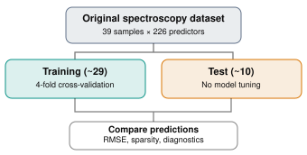

The central objective of this exploration is to understand how different regularization methods behave when the number of predictors substantially exceeds the number of observations, especially when predictors are highly correlated and the data contain unusual observations. 

## Data Selection and Experimental design 

### Near-Infrared Spectroscopy of Gasoline (Octane)

The selected dataset is the [Octane NIR Spectroscopy dataset](https://search.r-project.org/CRAN/refmans/rchemo/html/octane.html), described by Esbensen, Schoenkopf, and Midtgaard (1994). Each observation represents a gasoline sample measured using near-infrared spectroscopy. The objective is to predict its octane number from absorbance measurements recorded at different wavelengths. 


Unlike standard benchmark dataset, this dataset also has 6 samples contain added alcohol, creating a subgroup for studying the behavior of regularized estimators. The wavelengths range from 1102 to 1552 nanometers, with measurements every 2 nanometers. The continuous response is the octane number. 

This dataset is suitable because of four properties:

- With $p=226$ and $n=39$, the OLS estimator is not uniquely determined without additional assumptions. 
- Adjacent wavelengths measure nearby parts of a continuous spectrum, so the predictors are not independent. 
- Although each observation has 226 predictors, a much smaller number of latent spectral patterns may explain most of the variation. 
- The alcohol-containing samples allow us to examine whether shrinkage and variable selection provide reliable predictions when the observations differ chemically. 

### Statistical formulation 

Let $X \in \R^{n\times p}$, $y\in \R^{n}$, $\beta\in \R^p$. Our regression model is 

$$
y = \beta_0\mathbf{1} + X\beta + \epsilon, \quad \epsilon\sim\mathcal N(0, \sigma^2 I_n)
$$

In the exploration, $n=39$ and $p=226$. The methods differs in their treatment of the unknown coefficient vector. 

| Method | Regularization | Primary property to investigate | 
| --- | --- | --- |
| Ridge | $L_2$ penalty | Continuous shrinkage and numerical stability | 
| Lasso | $L_1$ penalty | Exact sparsity and variable selection | 
| Elastic Net | $L_1$ + $L_2$ penalty | Correlated-predictor grouping | 
| PCR | Principle component truncation | Low-rank approximation | 
| Bayesian Lasso | Laplace prior | Posterior shrinkage and uncertainty | 
| Bayesian Horseshoe | Global-local shrinkage | Strong shrinkage with heavy-tailed escaped | 

We will also compare the coefficient patterns produced by the methods. 

### Experimental protocol 

We will use a stratified 75%/25% train/test split, preserving the approximate proportion of alcohold-containing samples. All methods receive the same predictor matrix and training responses. 



The frequentist methods will use the same four cross-validation folds for tuning. The Bayesian models will use priors specified before examining test outcomes, followed by posterior inference using PyMC.

## Data preparation 

### Load the dataset 

```{python}
import numpy as np 
import pandas as pd 
import matplotlib.pyplot as plt 
import requests 
import rdata 
from pathlib import Path 

SEED = 6400 

url = "https://raw.githubusercontent.com/cran/rrcov/master/data/octane.rda"

path = Path("octane.rda")

if not path.exists():
    response = requests.get(url, timeout=60)
    response.raise_for_status()
    path.write_bytes(response.content)

df = rdata.read_rda(path)["octane"]

# first column is the response; the others are spectra
y = df.iloc[:, 0].to_numpy(dtype=float)
X = df.iloc[:, 1:].to_numpy(dtype=float)

wavelengths = np.arange(1102, 1553, 2)

print("Predictor matrix:", X.shape)
print("Response vector:", y.shape)
print("Response range:", y.min(), "-", y.max())
```

The dataset is loaded as a numerical matrix. The wavelength ordering is preserved, which is important because adjacent coefficients correspond to physically adjacent measurements. We will also retain the known alcohol-containing sample labels for the experimental design:

```{python}
sample_ids = np.arange(1, len(y) +1)

alcohol = np.isin(sample_ids, [25, 26, 36, 37, 38, 39])

print("Regular sample:", (~alcohol).sum())
print("Alcohol-containing samples:", alcohol.sum())
```

### Visualize the spectral data 

We first examine whether the unusal samples differ visibly from the regular gasoline samples. 

```{python}
plt.figure(figsize=(10, 5))

for i in range(len(y)):
    if alcohol[i]:
        plt.plot(wavelengths, X[i], color="darkorange", alpha=0.8, lw=1.3)
    else:
        plt.plot(wavelengths, X[i], color="steelblue", alpha=0.25, lw=0.8)

plt.plot([], [], color="steelblue", label="Regular gasoline")
plt.plot([], [], color="darkorange", label="Added alcohol")

plt.xlabel("Wavelength (nm)")
plt.ylabel("NIR absorbance")
plt.title("Near-Infrared Spectra of Gasoline")
plt.legend()
plt.tight_layout()
plt.show()
```

### Establish train/test split 

We use the same outer split for all siz methods and construct cross-validation folds within the training subset. 

```{python}
from sklearn.model_selection import train_test_split, StratifiedKFold
from sklearn.preprocessing import StandardScaler
from sklearn.metrics import mean_squared_error, mean_absolute_error, r2_score

idx_train, idx_test = train_test_split(np.arange(len(y)), test_size = 0.25, stratify=alcohol, random_state=SEED)

X_train, X_test = X[idx_train], X[idx_test]
y_train, y_test = y[idx_train], y[idx_test]

alcohol_train = alcohol[idx_train]
alcohol_test = alcohol[idx_test]

# standardize the response using training information only 
y_mean = y_train.mean()
y_sd = y_train.std(ddof=0)

y_train_z = (y_train - y_mean) / y_sd 

# cv folds 
cv = list(StratifiedKFold(n_splits=4, shuffle=True, random_state=SEED).split(X_train, alcohol_train))

# final training-scaling, used for diagnostic and PyMC 
scaler = StandardScaler().fit(X_train)

X_train_z = scaler.transform(X_train)
X_test_z = scaler.transform(X_test)

print("Train:", X_train.shape)
print("Test:", X_test.shape)
print("Alcohol samples in test:", alcohol_test.sum())
```

The standardized quantities are 

$$
z_{ij} = \frac{x_{ij} - \overline{x_j}}{s_j}, \quad y^* = \frac{y_i -\overline{y}}{s_y}
$$

This allows coefficient magnitudes to be interpreted on comparable scales. A coefficient represents the change in the standardized response associated with a one-standard-deviation increase in a predictor, holding the other predictors fixed. 

The frequentist models will use a `Pipeline` so that their scaling parameters are recomputed inside each cross-validation fold. This avoids leakage from validation observations into their preprocessing. 

For the Bayesian models, the displayed `X_train_z` and `y_train_z` will be used directly. Both were calculated using training data. 

### Investigate the rank and singular values 

Before applying regularization, we should understand the numerical problem we are trying to solve. The standardized design matrix has at most $n_\text{train} - 1$ linearly independent columns because centering removes one degree of freedom. 

Thus, 

$$
\rank(X^*_{\text{train}})\leq n_\text{train} - 1 \ll p. 
$$

Consequently, the Gram matrix 

$$
(X^*_\text{train})^{\top}X^*_\text{train}
$$

is singular, so its ordinary inverse does not exist. 

More importantly, even among the nonzero singular directions, some may have extremely small singular values. Those directions can amplify estimation noise. We can examine this using the singular value decomposition:

$$
X^{*}_\text{train} = UDV^\top 
$$

```{python}
U, singular_values, Vt = np.linalg.svd(X_train_z, full_matrices=False)

rank = np.linalg.matrix_rank(X_train_z)

# correlation between neighboring wavelengths 
corr = np.corrcoef(X_train_z, rowvar=False)
adjacent_corr = np.abs(np.diag(corr, k=1))

print("Matrix rank:", rank)
print("Number of predictors:", X_train_z.shape[1])
print("Median adjacent |correlation|:", np.median(adjacent_corr))

fig, ax = plt.subplots(figsize=(8,5))

ax.semilogy(np.arange(1, len(singular_values) + 1), singular_values, marker = "o", markersize=4)
ax.set_xlabel("Singular value index")
ax.set_ylabel("Singular value (log scale)")
ax.set_title("Singular Value Spectrum")
plt.tight_layout()
plt.show()
```

## Frequentist regularization methods 

### Ridge regression: Continuous spectral shrinkage 

Ridge regression replaces the OLS objective with 

$$
\hat \beta = \arg\min_\beta \{\|y^* - X^* \beta\|_2^2 + \lambda\|\beta\|_2^2\}. 
$$

The intercept remains unpenalized. The solution can be written as 

$$
\hat \beta_R = ({X^*}^\top X^{*} + \lambda I_p)^{-1} {X^*}^\top y^* 
$$

The additional of $\lambda I_p$ makes the matrix strictly positive definite whenever $\lambda>0$, even when $p>n$.

We tune $\lambda$ by 4-CV. 

```{python}
from sklearn.pipeline import Pipeline 
from sklearn.model_selection import GridSearchCV
from sklearn.linear_model import Ridge 

ridge_grid = np.geomspace(1e-4, 1e4, 60)
ridge_search = GridSearchCV(estimator=Pipeline([("scale", StandardScaler()), 
                                                ("regressor", Ridge(solver="svd"))]),
                            param_grid={"regressor__alpha": ridge_grid},
                            cv = cv, 
                            scoring="neg_mean_squared_error")
ridge_search.fit(X_train, y_train_z)

ridge_model = ridge_search.best_estimator_
ridge_alpha = ridge_search.best_params_["regressor__alpha"]
ridge_beta = ridge_model.named_steps["regressor"].coef_

print("Selected lambda:", ridge_alpha)
print("L2 norm of coefficients:", np.linalg.norm(ridge_beta))
```

> __Properties 1: Ridge can be computed in dual space__ 

Where $p\gg n$, an equivalent representation is 

$$
\hat \beta_R = {X^*}^\top (X^*{X^*}^\top + \lambda I_n)^{-1}y^*
$$

Rather than solving a system involving a $226\times 226$, we can solve one involving approximately $29 \times 29$ entries. 

```{python}
Z = X_train_z 
y_centered = y_train_z - y_train_z.mean()

K = Z@Z.T

ridge_beta_dual = Z.T@np.linalg.solve(K+ ridge_alpha * np.eye(len(Z)), y_centered)
difference = np.linalg.norm(ridge_beta - ridge_beta_dual)
print("Difference between implementations:", difference)
```

The two coefficient vectors should agree up to floating-point error. Ridge solution can be obtained from a matrix whose dimension is determined by the number of observations rather than the number of features. 

> __Property 2: Ridge applies smoth shrinkage to singular direction__

Using the SVD, 

$$
\hat \beta_R = V(D^2 + \lambda I)^{-1} D U^\top y
$$

The corresponding fitted response is 

$$
\hat y_R = U \mathrm{diag} \left(\frac{d_j^2}{d_j^2 + \lambda}\right)U^\top y^*
$$

The quantity 

$$
f_j^R = \frac{d_j^2}{d_j^2+ \lambda }
$$

is the ridge spectral shrinkage factor. For large $d_j$, the factor is close to one. For small $d_j$, the factor is close to zero. 

```{python}
ridge_filter = singular_values**2 / (singular_values**2 + ridge_alpha)

plt.figure(figsize=(8, 4))
plt.plot(np.arange(1, len(ridge_filter) + 1), ridge_filter, marker="o", markersize=3)
plt.xlabel("Singular direction")
plt.ylim(-0.05, 1.05)
plt.title("Ridge: Smooth Spectral Shrinkage")
plt.tight_layout()
plt.show()
```

This visualization shows that ridge regularizes the contribution of the singular directions continuously rather than deleting individual predictors. As a consequence, the ridge coefficient vector is generally dense. 

### Lasso regression: Sparsity and variable selection 

Lasso introduces an $L_1$ constraint:

$$
\hat \beta_L = \arg\min_\beta \left\{\frac{1}{2n_\text{train}}\|y^* - X^*\beta\|_2^2 + \lambda\|\beta\|_1 \right\}
$$

Unlike Ridge, the $L_1$ penalty is not differentiableat zero. This allows a solution to contain coefficients that are exactly zero, making Lasso useful for variable selection. 

```{python}
from sklearn.linear_model import Lasso 

lasso_grid = np.geomspace(1e-4, 1.0, 60)
lasso_search = GridSearchCV(estimator=Pipeline([("scale", StandardScaler()), 
                                                ("regressor", Lasso(max_iter=10000, tol=1e-5))]), 
                                                param_grid={"regressor__alpha": lasso_grid}, 
                                                cv=cv, 
                                                scoring="neg_mean_squared_error")
lasso_search.fit(X_train, y_train_z)

lasso_model = lasso_search.best_estimator_
lasso_alpha = lasso_search.best_params_["regressor__alpha"]
lasso_beta = lasso_model.named_steps["regressor"].coef_

lasso_selected = np.abs(lasso_beta) > 1e-7

print("Selected lambda:", lasso_alpha)
print("Nonzero coefficients:", lasso_selected.sum())
print("Selected wavelengths:", wavelengths[lasso_selected])
```

Lasso is solved by coordinate descent, which updates individual coefficients and takes advantage of the soft-thresholding property. The `max_iter` parameter allows the optimization algorithm sufficient iterations when predictors are strongly correlated. The convergence tolerance controls the numerical accuracy of the result. 

> __Property 1: Verify the KKT conditions numerically__

One advantage of using this dataset is that we can verify an important mathematical property directly. For Lasso, the KKT conditions imply 

$$
\frac{1}{n} {X_j^*}^\top (y^* - X^* \hat \beta) = \begin{cases}
\lambda \mathrm{sign}(\hat \beta_j),& \quad \hat \beta_j \neq 0 \\ 
\text{a value in } [-\lambda, \lambda], & \quad \hat \beta_j = 0
\end{cases}
$$

We can calculate the corresponding correlations between the predictors and the residuals. 

```{python}
residual = y_train_z - lasso_model.predict(X_train)
score = X_train_z.T @ residual / len(y_train_z)

active = np.abs(lasso_beta) > 1e-7

active_error = np.max(np.abs(score[active] - lasso_alpha * np.sign(lasso_beta[active]))) if active.any() else np.nan

inactive_violation = np.max(np.maximum(np.abs(score[~active]) - lasso_alpha, 0)) if (~active).any() else 0.0

print("Active-set KKT error:", active_error)
print("Inactive-set KKT violation:", inactive_violation)
```

Both quantities are small, within the numerical optimization tolerance. The result demonstrates why some coefficients are set exactly to zero. Their residual correlations are not large enough to overcome the penalty threshold. 

> __Property 2: The regularization path__ 

We can investigate how the coefficients enter and leave the model as the penalty changes. 

```{python}
from sklearn.linear_model import lasso_path 

path_alphas, path_coefs, _ = lasso_path(X_train_z, y_train_z, alphas = np.geomspace(1.0, 1e-4, 120), max_iter = 10000, tol=1e-5)
nonzero_counts = (np.abs(path_coefs) > 1e-7).sum(axis=0)

fig, ax = plt.subplots(1, 2, figsize=(12, 4))

# regularization paths for prominent coefficients 
top_features = np.argsort(np.max(np.abs(path_coefs), axis=1))[-12:]

for j in top_features: 
    ax[0].plot(path_alphas, path_coefs[j], lw=1)

ax[0].axvline(lasso_alpha, ls="--", color="black")
ax[0].set_xscale("log")
ax[0].invert_xaxis()
ax[0].set_xlabel("Lambda")
ax[0].set_ylabel("Coefficient")
ax[0].set_title("Lasso Coefficient Paths")

# sparsity along the path 
ax[1].plot(path_alphas, nonzero_counts)
ax[1].axvline(lasso_alpha, ls="--", color="black")
ax[1].set_xscale("log")
ax[1].invert_xaxis()
ax[1].set_xlabel("lambda")
ax[1].set_ylabel("Number of nonzero coefficients")
ax[1].set_title("Sparsity Along the Path")

plt.tight_layout()
plt.show()
```

As $\alpha$ increases, stronger regularization tends to produce fewer active predictors. However, individual coefficients do not change monotonically, and correlated predictors can enter or leave the active set as the penalty varies. 

### Elastic Net: Combining sparsity and grouping 

Elastic Net combines the two penalties:

$$
\hat \beta_{\text{EN}} = \arg\min_{\beta} \left\{\frac{1}{2n}\|y^* - X^* \beta\|_2^2 + \lambda \gamma \|\beta\|_1 + \frac{\lambda(1-\gamma)}{2}\|\beta\|_2^2\right\}
$$

Here, $\gamma\in (0, 1)$ controls the balance between the $L_1$ and $L_2$ penalties. When $\gamma = 1$, Elastic Net reduces to Lasso. For smaller $\gamma$, the quadratic penalty becomes more important, encouraging predictors to have more similar coefficient values. We tune both $\gamma$ and $\lambda$. 

```{python}
from sklearn.linear_model import ElasticNet 

enet_search = GridSearchCV(estimator=Pipeline([("scale", StandardScaler()), 
                                                ("regressor", ElasticNet(max_iter=10000, tol=1e-5))]), 
                        param_grid={"regressor__alpha": np.geomspace(1e-4, 5.0, 55), 
                                    "regressor__l1_ratio": [0.2, 0.5, 0.8, 0.95]}, 
                        cv=cv,
                        scoring="neg_mean_squared_error")
enet_search.fit(X_train, y_train_z)
enet_model = enet_search.best_estimator_
enet_alpha = enet_search.best_params_["regressor__alpha"]
enet_ratio = enet_search.best_params_["regressor__l1_ratio"]
enet_beta = enet_model.named_steps["regressor"].coef_

print("Selected lambda:", enet_alpha)
print("Selected L1 ratio:", enet_ratio)
print("Nonzero coefficients:", np.sum(np.abs(enet_beta) > 1e-7))
```

The parameter `alpha` and `l1_ratio` corresponds to $\lambda$ and $\gamma$, respectively. The quadratic component improves the conditioning of the objective. When $0< \gamma<1$ and $\lambda>0$, the Elastic Net objective is strictly convex, giving a unique coefficient vector. 

> __Property: Compare coefficient selection in correlated spectral regions__ 


We plot Lasso and Elastic Net coefficients against their physical wavelengths. 

```{python}
fig, ax = plt.subplots(2, 1, figsize=(11, 6), sharex = True)

ax[0].stem(wavelengths, lasso_beta, markerfmt='.', basefmt=" ")
ax[0].set_title("Lasso Coefficients")
ax[0].set_ylabel("Coeffcient")

ax[1].stem(wavelengths, enet_beta, markerfmt='.', basefmt=" ")
ax[1].set_title("Elastic Net Coefficients")
ax[1].set_xlabel("Wavelength (nm)")
ax[1].set_ylabel("Coeffcient")

plt.tight_layout()
plt.show()
```

### Principal Component Regression: Regularization by projection 

PCR takes a different approach. Rather than penalizing coefficients in the original feature space, it projects the predictor matrix onto a lower-dimensional subspace and performs OLS in that space. 

Using 

$$
X^* = UDV^\top ,
$$

the first $k$ principal component scores are 

$$
Z_k = X^* V_k = U_k D_k . 
$$

PCR estimates 

$$
\hat \theta_k = (Z_k^\top Z_k)^{-1} Z_k^\top y^*, 
$$

and the coefficient vector in the original feature space is 

$$
\hat\beta_{\text{PCR}} = V_k \hat \theta_k  
$$

The parameter $k$ is the regularization parameter: choosing fewer principle components imposes stronger dimensionality reduction. 

```{python}
from sklearn.decomposition import PCA 
from sklearn.linear_model import LinearRegression 

# maximum number of nondegenerate components
# permitted in every CV training fold 
min_fold_train = min(len(tr) for tr, _ in cv)
max_k = min_fold_train - 1 

pcr_search = GridSearchCV(estimator=Pipeline([("scale", StandardScaler()), 
                                                ("pca", PCA(svd_solver="full")), 
                                                ("regressor", LinearRegression())]), 
                        param_grid={"pca__n_components": list(range(1, max_k + 1))}, 
                        cv = cv, 
                        scoring="neg_mean_squared_error")

pcr_search.fit(X_train, y_train_z)

pcr_model = pcr_search.best_estimator_
best_k = pcr_search.best_params_["pca__n_components"]

pca_fitted = pcr_model.named_steps["pca"]
linear_fitted = pcr_model.named_steps["regressor"]

# recover coefficients in the standardized feature space
pcr_beta = pca_fitted.components_.T @ linear_fitted.coef_ 

print("Selected number of components:", best_k)
print("Recovered coefficient vector shape:", pcr_beta.shape)
```

An important computational detail is that PCA is fitted separately within each cross-validation fold. Fitting PCA once before cross-validation would leak information about the validation predictors into the estimated principal directions. 

We also restrict $k$ according to the smallest cross-validation training fold, rather than the original dataset size. This prevent us from attempting more nondegenerate components than the fold can support. 

> __Property 1: Variance explained versus predictive usefulness__ 

The principal components are constructed to explain variation in $X$. 

```{python}
pca_full = PCA(svd_solver="full").fit(X_train_z)

cumulative_variance = np.cumsum(pca_full.explained_variance_ratio_)
k_values = np.array(pcr_search.cv_results_["param_pca__n_components"], dtype=int)

cv_rmse = np.sqrt(-pcr_search.cv_results_["mean_test_score"])

fig, ax = plt.subplots(1, 2, figsize=(12, 4))

ax[0].plot(np.arange(1, len(cumulative_variance) + 1), cumulative_variance)
ax[0].set_xlabel("Number of principal components")
ax[0].set_ylabel("Cumulative explained variance")
ax[0].set_title("Variance Explained by PCA")

ax[1].plot(k_values, cv_rmse, marker="o")
ax[1].axvline(best_k, color="black", ls="--")
ax[1].set_xlabel("Number of principal components")
ax[1].set_ylabel("Cross-validated RMSE")
ax[1].set_title("PCR Model Selection")

plt.tight_layout()
plt.show()
```

> __Property 2: Ridge versus PCR as spectral filters__

Although Ridge and PCR appear to be very different procedures, both can be understood as transformations of the singular values of the design matrix. 

For Ridge, 

$$
f_j^R = \frac{d_j^2}{d_j^2 + \lambda}
$$

For PCR, 

$$
f_j^{\text{PCR}} = \begin{cases}
1, & j\leq k, \\ 
0, & j > k
\end{cases}
$$

Ridge applies continuous shrinkage, whereas PCR retains or discards entire singular directions. 

```{python}
j = np.arange(1, len(singular_values) + 1)
pcr_filter = (j <= best_k).astype(float)

plt.figure(figsize=(8, 5))

plt.plot(j, ridge_filter, marker="o", markersize=3, label="Ridge")
plt.step(j, pcr_filter, where="mid", label="PCR")

plt.xlabel("Singular direction")
plt.ylabel("Spectral filter")
plt.ylim(-0.05, 1.05)
plt.title("Soft Shrinkage versus Hard Truncation")
plt.legend()
plt.tight_layout()
plt.show()
```

As we can see, PCR is a form of regularization, even though its final regression step uses OLS. The regularization is imposed through its restriction to a lower-dimensional subspace. 

## Bayesian regularization using PyMC

The previous methods minimize a penalized objective function. In a Bayesian setting, regularization introduced through the prior distribution on the regression coefficients. 

We retain the same Gaussian likelihood:

$$
y^*_i | \beta_0, \beta, \sigma \sim \mathcal N(\beta_0 + {x_i^*}^\top \beta, \sigma^2). 
$$

However, rather than producing only a point estimate, Bayesian inference characterizes the posterior distribution 

$$
p(\beta_0, \beta, \sigma \mid X^*, y^*)
$$

This allows us to study both the magnitude of coefficient shrinkage and the uncertainty associated with it. 

### Bayesian Lasso: The Laplace prior 

A Bayesian analogue of Lasso places independent Laplace priors on the regression coefficients

$$
\beta_j \sim \mathrm{Laplace}(0, b), \quad j = 1, \ldots, p. 
$$

Its density is 

$$
p(\beta_j \mid b) = \frac{1}{2b}\exp\left(-\frac{|\beta_j|}{b}\right)
$$

Ignoring terms independent of $\beta$, the negative log-posterior for fixed $\sigma$ and $b$ is 

$$
-\log p(\beta\mid X^*, y^*, \sigma, b) = \frac{1}{2\sigma^2} \|y^* - X^*\beta \|_2^2 + \frac{1}{b}\|\beta\|_1 + \text{ constant}
$$

Multiplying by $\sigma^2/n$ gives the Lasso objective with the correspondence

$$
\lambda = \frac{\sigma^2}{nb}
$$

This relationship concerns the conditional posterior mode, or MAP estimator, and not the posterior mean. 

> __A scale-mixture representation__ 

Rather than directly sampling from a Laplace prior, we can express it as a normal-exponential mixture:

$$
\begin{aligned}
\omega_j &\sim \mathrm{Exp}\left(\frac{1}{2b^2}\right) \\ 
\beta_j \mid \omega_j & \sim \mathcal N(0, \omega_j). 
\end{aligned}
$$

Integrating out $\omega_j$ gives the Laplace distribution. This representation allows us to introduce a non-centered parameterizaion:

$$
z_j \sim \mathcal N(0, 1), \quad \beta_j = z_j \sqrt{\omega_j}
$$

We will use $b=0.15$. 

```{python}
import pymc as pm 
import arviz as az 
import pytensor.tensor as pt 

n_train, p = X_train_z.shape 

laplace_scale = 0.15

with pm.Model(coords={"wavelength": wavelengths}) as bayesian_laplace:
    # unpenalized intercept 
    intercept = pm.Normal("intercept", mu=0, sigma=1)

    # unknown observation noise 
    sigma = pm.HalfNormal("sigma", sigma=1)

    # Normal-exponential mixture 
    omega = pm.Exponential("omega", lam=1/(2*laplace_scale**2), dims="wavelength")

    z = pm.Normal("z", mu=0, sigma=1, dims="wavelength")

    beta = pm.Deterministic("beta", z*pt.sqrt(omega), dims = "wavelength")

    mu = intercept + pm.math.dot(X_train_z, beta)

    pm.Normal("y_obs", mu=mu, sigma=sigma, observed=y_train_z)
```

We use a non-centered parametrization because sampling under the underlying standard-normal variables can make the posterior geometry easier to navigate. 

> __Posterior sampling__ 

```{python}
with bayesian_laplace:
    laplace_trace = pm.sample(draws=600, tune=800, chains=2, cores=2, target_accept=0.95, random_seed = SEED)
```

The No-U-Turn Sampler (NUTS) generates posterior draws by using gradients of the log-posterior distribution. `draws=600` and `chains=2` produce 1,200 retained draws in total. The 800 tuning iterations per chain are used for sampler adaptation and discarded. 

___Computational consideration.__ A PyMC model with 226 coefficients and another 226 latent variable is much more expensive than a single Lasso optimization. NUTS explores the posterior rather than locating one minimum. For faster sampling, PyMC also supports the `nutpie` sampler as an optional backend. 

> __Property: Posterior shrinkage is not variable selection__ 

We now compare the Bayesian posterior mean with the frequentist Lasso coefficients. 

```{python}
laplace_beta_mean = laplace_trace.posterior["beta"].mean(dim=("chain", "draw")).values

fig, ax = plt.subplots(figsize=(10, 4))

ax.plot(wavelengths, lasso_beta, label="Frequentist Lasso", alpha=0.8)
ax.plot(wavelengths, laplace_beta_mean, label="Bayesian Laplace (posterior mean)", alpha=0.8)

ax.axhline(0, color="black", lw=0.8)
ax.set_xlabel("Wavelength (nm)")
ax.set_ylabel("Standardize coefficient")
ax.set_title("Lasso versus Bayesian Laplace")
ax.legend()
plt.tight_layout()
plt.show()
```

Their penalty strengths have not been calibrated to be identical, and the Bayesian model estimates the noise scale rather than fixing it. Instead, we should examine how their coefficient structures differ. The frequentist Lasso produces exact zeros; the Bayesian posterior mean does not. 

To study meaningful effects, we can calculate 

$$
P(|\beta_j| > \delta \mid X^*, y^*)
$$

for a chosen effect-size threshold $\delta$. 

```{python}
laplace_draws = laplace_trace.posterior["beta"].stack(sample=("chain", "draw")).transpose("sample", "wavelength").values

threshold = 0.10

laplace_prob = (np.abs(laplace_draws) > threshold).mean(axis=0)

plt.figure(figsize=(10, 4))
plt.plot(wavelengths, laplace_prob)
plt.axhline(0.5, color="black", ls="--")
plt.xlabel("Wavelength (nm)") 
plt.ylabel("Posterior probability")
plt.title("Bayesian Laplace: Probability of a material coefficient")
plt.tight_layout()
plt.show()
```

The threshold of 0.10 refers to standardized coefficients magnitude. It is a descriptive choice. High collinearity may make individual coefficients poorly identifed even when the overal prediction is reliable. Posterior probabilities for individual wavelengths should be interpreted with caution. 

### Bayesian Horseshoe: Global-local shrinkage

The horseshoe prior introduces a different form of sparsity-inducing regularization. Rather than applying a common amount of shrinkage to all coefficients, it assigns each coefficient a local scale while also controlling the overall degree of shrinkage through a global parameter. The standard Horseshoe is 

$$
\begin{aligned}
\beta_j \mid \tau, \lambda_j &\sim \mathcal N(0, \tau^2 \lambda_j^2), \\ 
\lambda_j  & \sim \mathcal C^+ (0,1),
\end{aligned}
$$

where $\mathcal C^+$ denotes the half-Cauchy distribution. 

The global parameter $\tau$ shrinks the overall coefficient vector, while the local parameters $\tau_j$ allow some coefficients to escape strong shrinkage. For computational stability, we will use a _regularized Horseshoe_ with a slab component. Its coefficient scale becomes 

$$
\tilde{\lambda_j}^2 = \frac{c^2\lambda_j^2}{c^2 + \tau^2 \lambda_j^2}
$$

so that 

$$
\beta_j \mid \tau \lambda_j, c  \sim \mathcal N(0, \tau^2 \tilde{\lambda_j}^2). 
$$

The slab parameter $c$ limits the extent to which large local scales can produce extremely diffuse coefficient priors. 

> __Calibrating global shrinkage__

For a sparse regression problem, a useful prior scale is based on the expected number of substantially nonzero coefficients $p_0$:

$$
\tau_0 = \frac{p_0}{p-p_0} \frac{\sigma}{\sqrt{n}}
$$

We begin with $p_0=8$ as an illustrative sparsity assumption, without claiming that gasoline spectroscopy depends on only eight distinct wavelengths. 

```{python}
p0 = 8 

global_scale = (p0 / (p-p0)) / np.sqrt(n_train)

with pm.Model(coords={"wavelength": wavelengths}) as horseshoe_model:
    intercept = pm.Normal("intercept", mu=0, sigma=1)
    sigma = pm.HalfNormal("sigma", sigma=1)

    # global shrinkage 
    tau = pm.HalfStudentT("tau", nu=2, sigma=global_scale * sigma)
    
    # local shrinkage 
    local_scale = pm.HalfCauchy("local_scale", beta=1, dims="wavelength")

    # regularized slab 
    c2 = pm.InverseGamma("c2", alpha=2, beta=2)

    # non-centered coefficients 
    z = pm.Normal("z", mu=0, sigma=1, dims="wavelength")

    local_variance = tau**2 * local_scale**2
    beta_scale = pt.sqrt(local_variance*c2/ (c2 + local_variance))
    beta = pm.Deterministic("beta", z*beta_scale, dims = "wavelength")

    mu = intercept + pm.math.dot(X_train_z, beta)

    pm.Normal("y_obs", mu=mu, sigma=sigma, observed=y_train_z)
```

There are three computational design choices here. First, the global scale incorporates $n$ and $p$, so its magnitude reflects the dimension of the problem. Second, the slab prevents the variance of weakly regularized coefficients from becoming arbitrarily large because a local scale is large. Third, we sample auxiliary standard-normal variables and transform them into regression coefficients. This non-centered representation often improves sampling compared with direct sampling a large vector of coupled coefficients. 

```{python}
with horseshoe_model: 
    horseshoe_trace = pm.sample(draws=600, tune=1000, chains=2, cores=2, target_accept=0.97, random_seed=SEED)
```

The higher acceptance target is to reduce numerical intergration errors associated with challenging posterior geometry, although it may increase compuation time. 

Note that a Horseshoe prior is appropriate when relatively few coefficients contain meaningful signals. Spectroscopy, however, may exhibit correlated, distributed effects. iF The Horseshoe performs poorly or produces unstable coefficient estimates, this may reflect a mismatch between the prior sparsity assumption and the structure of the scientific problem. 

> __Property: Local shrinkage and posterior coefficient magnitudes__ 

We can inspect whether the fitted model concentrates its effects into relatively few wavelenghts. 

```{python}
horseshoe_draws = horseshoe_trace.posterior["beta"].stack(sample=("chain", "draw")).transpose("sample", "wavelength").values

horseshoe_beta_mean = horseshoe_draws.mean(axis=0)

horseshoe_prob = (np.abs(horseshoe_draws) > threshold).mean(axis=0)

fig, ax = plt.subplots(2, 1, figsize=(11, 6), sharex=True)

ax[0].plot(wavelengths, laplace_beta_mean, label="Laplace")
ax[0].plot(wavelengths, horseshoe_beta_mean, label="Horseshoe")
ax[0].axhline(0, color="black", lw=0.8)
ax[0].set_ylabel("Posterior mean")
ax[0].legend()

ax[1].plot(wavelengths, laplace_prob, label="Laplace")
ax[1].plot(wavelengths, horseshoe_prob, label="Horseshoe")
ax[1].set_xlabel("Wavelength (nm)")
ax[1].set_ylabel("P(|beta| > 0.10)")
ax[1].legend()

plt.tight_layout()
plt.show()
```

A Horseshoe posterior may show stronger concentration near zero while preserving larger effects for some coefficients.

### Bayesian diagnostic checks 

Before comparing predictions, we must confirm that the Bayesian computations are sufficiently reliable. 

```{python}
for name, trace in {"Bayesian Laplace": laplace_trace,
                    "Horseshoe": horseshoe_trace}.items():
    diagnostics = az.summary(trace, var_names=["beta"], kind="diagnostics")
    divergences = int(trace.sample_stats["diverging"].sum().item())

    print(f"\n{name}")
    print("Divergences:", divergences)
    print("Maximum R-hat:", diagnostics["r_hat"].max())
    print("Minimum bulk ESS:", diagnostics["ess_bulk"].min())
```

The main checks are $\hat R$, effective sample size (ESS), and the number of divergent transitions. Ideally $\hat R$ should be close to 1, commonly below 1.01, with sufficiently large effective sample sizes for the parameters and quantities of interest. Divergences indicate potential problems exploring the posterior geometry. 

If convergence is inadequare, increasing the number of draws alone may not be sufficient. We may need to reconsider the prior scale, parameterization, sampler settings, or model assumptions. 

## Comparative evalulation and further computational experiments 

We now have six fitted methods on the same dataset. 

### Posterior predictive distributions

For the Bayesian models, the predictive distribution incorporates both parameter uncertainty and residual noise:

$$
p(y_\text{new} \mid x_\text{new}, D) = \int p(y_\text{new}\mid x_\text{new}, \theta)p(\theta \mid D) d\theta
$$

Here $\theta = (\beta_0, \beta, \sigma)$. 

We can calculate posterior predictive draws for the held-out observations from the saved posterior samples. 

```{python}
def bayesian_predict(trace, X_new_z, seed=6400): 
    posterior = trace.posterior 
    beta_draws = posterior["beta"].stack(sample=("chain", "draw")).transpose("sample", "wavelength").values
    intercept_draws = posterior["intercept"].stack(sample=("chain", "draw")).values
    sigma_draws = posterior["sigma"].stack(sample=("chain", "draw")).values 

    # expected response for each posterior draw
    mu_draws = intercept_draws[:, None] + beta_draws @ X_new_z.T 

    rng = np.random.default_rng(seed)

    # include observation noise 
    predictive_draws_z = rng.normal(loc=mu_draws, scale=sigma_draws[:, None])

    # Average over posterior draws to obtain one prediction per observation.
    predicted_mean_z = predictive_draws_z.mean(axis=0)
    lower_z, upper_z = np.quantile(predictive_draws_z, [0.05, 0.95], axis=0)

    # Return the predictions and intervals to the original octane-number scale.
    predicted_mean = y_mean + y_sd * predicted_mean_z
    lower = y_mean + y_sd * lower_z
    upper = y_mean + y_sd * upper_z

    return predicted_mean, lower, upper 
```

The multiplication $B(X^*_{\text{test}})^\top$ is efficient here, where each row of $B$ is one posterior draw of the complete coefficeint vector. All predictions are computed using matrix multiplication. 

```{python}
lap_pred, lap_lo, lap_hi = bayesian_predict(laplace_trace, X_test_z)
hs_pred, hs_lo, hs_hi = bayesian_predict(horseshoe_trace, X_test_z)
```

These intervals are posterior predictive intervals for future observations. 

### Common test-set evaluation 

We use three standard measures:

$$
\begin{aligned}
RMSE &= \sqrt{\frac{1}{n_\text{test}} \sum_i (y_i - \hat y_i)^2}, \\ 
MAE &= \frac{1}{n_\text{test}}\sum_i |y_i \hat y_i| , \\ 
R^2 &= 1- \frac{\sum_{i} (y_i - \hat y_i)^2}{\sum_i (y_i - \overline y_\text{test})^2}
\end{aligned}
$$

RMSE is sensitive to large prediction errors, which may be relevant for unusual samples. MAE provides a complementary measure that is less sensitive to individual large errors. 

```{python}
def inverse_y(pred_z):
    return y_mean + y_sd * np.asarray(pred_z)

predictions = {"Ridge": inverse_y(ridge_model.predict(X_test)), 
                "Lasso": inverse_y(lasso_model.predict(X_test)), 
                "Elastic Net": inverse_y(enet_model.predict(X_test)), 
                "PCR": inverse_y(pcr_model.predict(X_test)), 
                "Bayesian Laplace": lap_pred, 
                "Horseshoe": hs_pred}

results = [] 

for name, pred in predictions.items():
    results.append({"Method": name, 
                    "RMSE": np.sqrt(mean_squared_error(y_test, pred)), 
                    "MAE": mean_absolute_error(y_test, pred), 
                    "R2": r2_score(y_test, pred)})

results_df = pd.DataFrame(results).sort_values("RMSE")
print(results_df.round(4).to_string(index=False))
```

This table will show which method achieves the best prediction on the selected holdout. However, because the test set contains only 10 observations, relatively small changes in the split may substantially alter the rankings.

### Regular vs alcohold-containing samples 

A model may achieve good overall prediction while performing poorly on this chemically different subgroup. We can examine this without changing or refiting the models. 

```{python}
group_results = []
groups = {"Regular": ~alcohol_test, 
            "Added alcohol": alcohol_test}

for name, pred in predictions.items():
    for group_name, mask in groups.items():
        if mask.sum() == 0:
            continue 
        error = y_test[mask] - pred[mask]

        group_results.append({"Method": name, 
                            "Group": group_name,
                            "n": mask.sum(), 
                            "RMSE": np.sqrt(np.mean(error**2)), 
                            "MAE": np.mean(np.abs(error))})

group_df = pd.DataFrame(group_results)

print(group_df.pivot(index="Method", columns="Group", values="RMSE").round(4))
```

This allows us to ask whether the different methods behave similarly across the two subgroups. 

### Prediction uncertainty 

The Bayesian appraoches provide an additional comparison unvailable from ordinary point predictions alone. We can assess the emprical coverage of their 90% posterior predictive intervals. 

```{python}
intervals = {"Bayesian Laplace": (lap_lo, lap_hi), 
            "Horseshoe": (hs_lo, hs_hi)}
for name, (lower, upper) in intervals.items():
    covered = (y_test >= lower) & (y_test <= upper)

    width = upper - lower 
    print(name, " | Coverage:", round(covered.mean(), 3), " | Mean width:", round(width.mean(), 3))            
```

We are intersted in the relationship between interval width and coverage. 

We can also visualize the predictions and intervals:

```{python}
order = np.argsort(y_test)
positions = np.arange(len(y_test))

plt.figure(figsize=(10, 5))

plt.scatter(positions, y_test[order], color="black", label="Observed", zorder=5)

for offset, name, mean, lo, hi in [(-0.12, "Laplace", lap_pred, lap_lo, lap_hi),
                                    (0.12, "Horseshoe", hs_pred, hs_lo, hs_hi)]:
    plt.errorbar(positions + offset, mean[order], yerr=[mean[order] - lo[order], hi[order] - mean[order]], fmt="o", capsize=3, alpha=0.8, label=name)

plt.xlabel("Held-out sample (sorted by octane)")
plt.ylabel("Octane number")
plt.title("Bayesian Posterior Predictive Intervals")
plt.legend()
plt.tight_layout()
plt.show()
```

### Compare all coefficient estimates 

The six methods each produce a coefficient summary in the same standardize feature space/ For the frequentist methods, we use the posterior mean. 

```{python}
coefficient_df = pd.DataFrame({"Ridge": ridge_beta, 
                                "Lasso": lasso_beta, 
                                "Elastic Net": enet_beta, 
                                "PCR": pcr_beta, 
                                "Bayesian Laplace": laplace_beta_mean, 
                                "Horseshoe": horseshoe_beta_mean}, index=wavelengths)
coefficient_df.index.name = "Wavelength"

# use a common color scale for all methods 
coef_matrix = coefficient_df.T.to_numpy()
limit = np.max(np.abs(coef_matrix))

fig, ax = plt.subplots(figsize=(12, 5))

im = ax.imshow(coef_matrix, aspect="auto", cmap="coolwarm", vmin=-limit, vmax=limit, extent=[wavelengths[0], wavelengths[-1], len(coefficient_df.columns) - 0.5, -0.5])

ax.set_yticks(np.arange(len(coefficient_df.columns)))
ax.set_yticklabels(coefficient_df.columns)

ax.set_xlabel("Wavelength (nm)")
ax.set_title("Coefficient Patterns Across Regularization Methods")

plt.colorbar(im, ax=ax, label="Standardized coefficient")
plt.tight_layout()
plt.show()
```

### Stability of Lasso variable selection 

To demonstrate another important property of regularization, we can ask whether Lasso consistently selects the same wavelengths when the training observations change. A simple approach is bootstrap resampling. 

```{python}
from sklearn.base import clone 

rng = np.random.default_rng(SEED)
B = 60 

selection = np.zeros((B, X_train.shape[1]), dtype=bool)
for b in range(B): 
    boot_idx = rng.choice(len(X_train), size =len(X_train), replace=True)
    model = clone(lasso_model)
    model.fit(X_train[boot_idx], y_train_z[boot_idx])
    beta_boot = model.named_steps["regressor"].coef_
    selection[b] = np.abs(beta_boot) > 1e-7 

selection_frequency = selection.mean(axis=0)

plt.figure(figsize=(10, 4))
plt.plot(wavelengths, selection_frequency)
plt.xlabel("Wavelength (nm)")
plt.ylabel("Selection frequency")
plt.ylim(-0.05, 1.05)
plt.title("Boostrap Stability of Lasso Selection")
plt.tight_layout()
plt.show()
```
