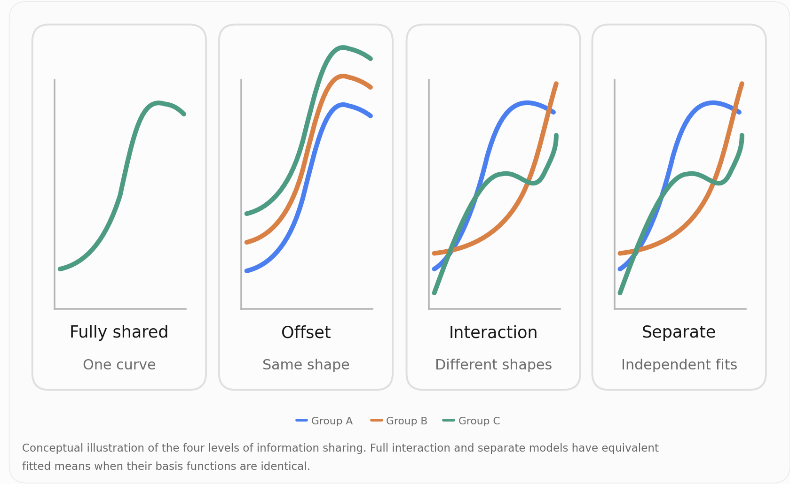

## Core mathematical objective 

### Interactions as a problem of information 

Suppose we observe

$$ 
\mathcal D = \{(y_i, x_i, g_i)\}_{i=1}^n
$$

where $y_i$ is a continuous outcome, $x_i$ is a continuous predictor, and $g_i\in \{1, \ldots, K\}$ indicates group membership. 

Modeling question:

> _Should every group follow the same regression function, or should each group have its own relationship?_



Let $b(x) = (b_1(x), \ldots, b_q(x))^\top$ represent a spline basis for the continuous predictor. 

__Fully shared model.__ All groups have the same conditional mean:

$$
\E[Y\mid x, g] = \beta_0 + b(x)^\top \beta. 
$$

__Partially shared model.__ Each group has a different intercept, but the same nonlinear shape:

$$
\E[Y\mid x, g] = \beta_0 + b(x)^\top \beta + \alpha_g. 
$$

__Full interaction model.__ Both the intercept and the nonlinear shape can differ:

$$
\E[Y\mid x, g] = \beta_0 + b(x)^\top \beta + \alpha_g + b(x)^\top \delta_g. 
$$

__Fully separate models.__ Every group has its own regression function:

$$
\E[Y\mid x, g] = \beta_{0g} + b(x)^\top \beta_g
$$

The full-interaction and fully separate approaches span the same set of conditional mean functions when the same spline basis is used. Their distinction arises when additional restrictions are imposed, such as separate residual variances or regularization. 

### Extending interactions to nonlinear response surfaces

With two continuous predictors $x_1$, $x_2$, interactions can also occur between the predictors themselves. Define the spline bases $b_1(x_1)$ and $b_2(x_2)$. A nonlinear surface can be expressed using a [tensor-product basis](https://en.wikipedia.org/wiki/Tensor_product):

$$
f(x_1, x_2) = \beta_0 + b_1(x_1)^\top \beta_1 + b_2(x_2)^\top \beta_2 + [b_1(x_1) \otimes b_2(x_2)]^\top \gamma.
$$

The last term allows the effect of $x_1$ to depend on $x_2$. We can then compare 

- _Additive-in-group_: $\E[Y\mid x_1, x_2, g] = f(x_1, x_2) + \alpha_g$
- _Interactive-in-group_: $\E[Y\mid x_1, x_2, g] = f(x_1, x_2) + d_g(x_1, x_2)$.

The second model allows to have different response-surface shapes. 

### Regularizing group-specific deviations 

Rather than selecting a sharing structure entirely by hand, we introduces a decomposition:

$$
f_g(x) = f_0(x) + d_g(x) 
$$

where $f_0(x)$ is a global regression function and $d_g(x)$ is the deviation for group $g$. Using sum-to-zero contrasts,

$$
\sum_{g=1}^K d_g(x) = 0. 
$$

Consequently, $f_0(x)$ represents the equally weighted average of the group curves. Partition the design matrix into 

$$
X = \begin{bmatrix}X_\text{global} & X_\text{dev} \end{bmatrix}
$$

with corresponding coefficients $\beta$ and $\delta$. We can estimate them by minimizing 

$$
\min_{\beta, \delta} \left\{\frac{1}{2n} \|y- X_\text{global}\beta - X_\text{dev}\delta  \|^2_2 + \lambda P(\delta) \right\}
$$

Only the deviation coefficients are penalized. The golabl regression function remains unpenalized. 

The two penalties considered are 

$$
P_\text{ridge}(\delta) = \frac{1}{2} \|\delta_2^2 \|, \quad P_\text{lasso}(\delta) = \|\delta\|_1
$$

This gives a continuous spectrum of sharing:

- As $\lambda\to 0$, the model approaches the full-interaction fit. 
- At intermediate $\delta$, group-specific relationships are shrunk toward the shared curve. 
- As $\lambda\to\infty$, the deviation coefficients approach zero and the model becomes fully shared. 

Ridge shrinks continuously, whereas lasso can set individual coefficients exactly to zero. Ordinary lasso does not guarantee that an entire group's deviation disappears together. 

## Homework dataset 

I selected the [Gapminder dataset](https://plotly.com/python-api-reference/generated/plotly.express.data.html), contains 1,704 country-year observations. 

We will model:

| Role | Variable | Description |
| --- | --- | --- | 
| Outcome $Y$ | `lifeExp` | Life expectancy in years | 
| First predictor $x_1$ | `year` | Observation year, 1952-2007 | 
| Second predictor $x_2$ | `log_gdp` | Logarithm of GDP per capita | 
| Group $G$ | `continent` | Africa, Americas, Asia, Europe | 
| CV identifier | `country` | Keeps country observations together | 

I exclude Oceania because it contains only two countries in this version of Gapminder, leaving 1680 observations across 140 countries. 

### Load and examine the dataset 

```{python}
import numpy as np 
import pandas as pd 
import patsy 
import statsmodels.api as sm 

import matplotlib.pyplot as plt 
import seaborn as sns 
import plotly.express as px 
import plotly.graph_objects as go 

from sklearn.model_selection import GroupKFold 
from sklearn.metrics import mean_squared_error
```

```{python}
df = px.data.gapminder()

# exclude oceania 
df = df.query("continent != 'Oceania'").copy()
df["log_gdp"] = np.log(df["gdpPercap"])

levels = ["Africa", "Americas", "Asia", "Europe"]
df["continent"] = pd.Categorical(df["continent"], categories=levels)

print("Shape:", df.shape)
print(df.groupby("continent", observed=True).agg(n=("country", "size"),
                                                countries=("country", "nunique")))
```

The logarithm of GDP per capita helps compress its heavily right-skewed distribution. We should also inspect the relationship between the response and the predictors before fitting any models. 

```{python}
fig = px.scatter(df, x="year", y="lifeExp", color="continent", hover_data=["country"], opacity=0.4, title="Life expectancy over time, by continent")

fig.show()
```

### Fit the full/partial/no-sharing ladder 

> _Fit the full/partial/no-sharing ladder from this chapter (fully shared, shared-shape offset, full interaction, fully separate) and report which point on the spectrum the data support using cross-validated MSE._

We start with one continuous predictor, `year`. Let $b(t)\in R^3$ be its natural cubic spline basis. The four models are:

$$
\begin{aligned}
M_0: \E[Y\mid t, g] &= \beta_0 + b(t)^\top\beta, \\ 
M_1: \E[Y\mid t, g] &= \beta_0 + b(t)^\top \beta + \alpha_g \\ 
M_2: \E[Y\mid t, g] &= \beta_0 + b(t)^\top \beta + \alpha_g + b(t)^\top \delta_g \\ 
M_3: \E[Y\mid t, g] &= \beta_{0g} + b(t)^\top \beta_g
\end{aligned}
$$

```{python}
S = 'cr(year, df=3, constraints="center")'
G = "C(continent, Sum)"

formulas = {"Shared": S,
            "Offset": f"{S} + {G}",
            "Full interaction": f"{S} * {G}"}
```

Now we create the design matrix and OLS prediction functions.

```{python}
def make_design(formula, train, test=None):
    X_train = patsy.dmatrix(formula, train, return_type="dataframe")

    if test is None:
        return X_train
    
    X_test = patsy.build_design_matrices([X_train.design_info], test)[0]
    return X_train, X_test 

def predict_ols(train, test, formula): 
    X_train, X_test = make_design(formula, train, test)

    beta = np.linalg.lstsq(np.asarray(X_train), train["lifeExp"].to_numpy(), rcond=None)[0]

    return np.asarray(X_test) @ beta
```

We use `np.linalg.lstsq()` because the objective is OLS:

$$
\hat \beta = \arg\min_\beta \|y-X\beta \|_2^2
$$

Next, we implement the full separate model using the same spline basis across groups. 

```{python}
def predict_separate(train, test): 
    X_train, X_test = make_design(S, train, test)

    X_train, X_test = np.asarray(X_train), np.asarray(X_test)

    y_train = train["lifeExp"].to_numpy()
    predictions = np.empty(len(test))

    for group in levels:
        tr = (train["continent"] == group).to_numpy()
        te = (test["continent"] == group).to_numpy()

        beta_g = np.linalg.lstsq(X_train[tr], y_train[tr], rcond=None)[0]

        predictions[te] = X_test[te] @ beta_g 
    return predictions 
```

The separate model uses only the observations belonging to each continent to estimate its coefficients. It also permits group-specific residual variances if those are estimated separately. 

Instead of random K-fold, the splits should preserve the country clusters.

```{python}
cv = GroupKFold(n_splits = 5)
folds = list(cv.split(df, groups=df["country"]))

def cv_mse(formula=None, separate=False):
    errors = [] 
    for train_idx, test_idx in folds:
        train = df.iloc[train_idx] 
        test = df.iloc[test_idx]

        if separate:
            predictions = predict_separate(train, test)
        else:
            predictions = predict_ols(train, test, formula)
        
        errors.append(mean_squared_error(test["lifeExp"], predictions))
    return np.mean(errors)
```

```{python}
task1_results = {name: cv_mse(formula) for name, formula in formulas.items()}

task1_results["Separate"] = cv_mse(separate=True)

print(pd.Series(task1_results).round(3))
```

Our objective is to estimate the expected prediction error:

$$
\widehat{\text{CV-MSE}} = \frac{1}{K} \sum_{k=1}^K \frac{1}{|V_K|}\sum_{i \in V_k} (y_i - \hat f^{(-k)} (x_i , g_i))^2. 
$$

Here $V_k$ contains validation observations from countries excluded from the corresponding training fold. 

__Interpretation__. The fully shared model performs worse. Adding continent-specific intercepts greatly reduces, implying that the continent is an important predictor. Allowing the shape of the time trend to vary also improves prediction. The full-interaction and fully separate models produce identical point predictions because they use the same spline basis without additional constraints. 

### Group-specific nonlinear response surface 

> Fit a group-specific response surface: two continuous predictors, additive-in-group vs. interactive-in-group (`rcs(x1,4)*rcs(x2,4) + group` vs. `rcs(x1,4)*rcs(x2,4)*group`). Compare CV-MSE between the two, and produce at least one plotly surface per group for the interactive model.

We now use both `year` and `log_gdp`. 

```{python}
S2 = 'cr(log_gdp, df=3, constraints="center")'

surface_formulas = {"Additive surface": f"{S2} + {G}", 
                    "Interactive surface": f"{S} * {S2} * {G}"}
```

The additive-in-group model has a common nonlinear surface:

$$
\E[Y \mid t, z, g] = f(t, z) + \alpha_g 
$$

The interactive-in-group model has a different surface for every continent: 

$$
\E[Y \mid t, z, g] = f_g(t, z) 
$$

The second model has substantially more parameters because each group's tensor-product interaction coefficients may differ. 

```{python}
task2_results = {name: cv_mse(formula) for name, formula in surface_formulas.items()}

print(pd.Series(task2_results).round(3))
```

The fully interactive surface performs much worse on average. Its validation errors are highly variable across folds, including one particularly large error. This suffest that the additional flexibility is not reliably supported by the data. The two predictors are correlated, and some combinations of year, GDP per capita, and continent have limited coverage.

Now we fit the interactive model on the full dataset for visualization. 

```{python}
formula = surface_formulas["Interactive surface"]

X = make_design(formula, df)

beta = np.linalg.lstsq(np.asarray(X), df["lifeExp"].to_numpy(), rcond=None)[0]
```

Now construct a prediction grid separately for each continent. 

```{python}
for group in levels:
    local = df[df["continent"] == group]
    years = np.linspace(df["year"].min(), df["year"].max(), 35)

    log_gdp = np.linspace(local["log_gdp"].quantile(0.10), 
                        local["log_gdp"].quantile(0.90), 35)

    YY, GG = np.meshgrid(years, log_gdp)
    grid = pd.DataFrame({"year" : YY.ravel(), 
                        "log_gdp": GG.ravel(), 
                        "continent": group})
    
    X_grid = patsy.build_design_matrices([X.design_info], grid)[0]
    Z = (np.asarray(X_grid) @ beta).reshape(YY.shape)

    fig = go.Figure(data=[go.Surface(x=YY, y=np.exp(GG), z=Z)])
    fig.update_layout(title=f"Life expectancy surface - {group}", 
                    scene=dict(xaxis_title="Year", 
                                yaxis_title="GDP per capita", 
                                zaxis_title="Life expectancy (years)"), 
                    height=550 
                    )
    fig.show()
```

### Group-specific ridge and lasso regularization 

> Reparameterize the group predictor with sum-to-zero contrasts (`contr.sum`) as in this chapter, build the global/deviation `penalty.factor` vector via `attr(X, "assign")`, and fit both ridge and lasso. Report, at the cross-validated, which groups’ curves get pulled essentially back to the shared curve and which remain distinct.

We return to the single-predictor model

$$
\E[Y \mid t, g]  = \beta_0 + b(t)^\top \beta + \alpha_g + b(t)^\top \delta_g
$$

Because we have four groups and three spline terms, the design matrix has 16 columns (1+3+3+9=16). These comprise the intercept, three global spline columns, three group main effects, and nine spline-by-group interaction columns. 

The penalty-factor vector is 

$$
p_j = \begin{cases} 0 & \text{global coefficient} \\ 1 & \text{group-deviation coefficient}\end{cases}
$$

```{python}
F = formulas["Full interaction"]
X = make_design(F, df)

penalty_factor = np.zeros(X.shape[1], dtype=int)
for term, columns in X.design_info.term_name_slices.items():
    if "C(continent, Sum)" in term:
        penalty_factor[columns] += 1 

penalty_table = pd.DataFrame({"coefficient": X.columns, 
"penalty_factor": penalty_factor})

print(penalty_table)
```

Notice that the intercept and the three global spline coefficeints are never penalized. 

For ridge, we minimize 

$$
\frac{1}{2n} \|y - X\theta \|_2^2 +\frac{\lambda}{2} \sum_{j=1}^p p_j\theta_j^2
$$

For lasso, 

$$
\frac{1}{2n} \|y- X\theta\|_2^2 + \lambda \sum_{j=1}^p p_j |\theta_j| 
$$

```{python}
def fit_penalty(train, method, lam):
    X = make_design(F, train)
    A = np.asarray(X)

    # identify group-deviation columns
    mask = np.zeros(A.shape[1], dtype=bool)

    for term, columns in X.design_info.term_name_slices.items():
        if "C(continent, Sum)" in term:
            mask[columns] = True 
    
    # scale deviation columns only 
    scale = np.ones(A.shape[1])
    scale[mask] = np.maximum(A[:, mask].std(axis=0), 1e-10)
    A_scaled = A / scale

    # ridge: L1_wt = 0; lasso: L1_wt = 1 
    l1_weight = 0 if method =="ridge" else 1 
    model = sm.OLS(train["lifeExp"].to_numpy(), A_scaled)

    fit = model.fit_regularized(method="elastic_net", alpha=lam*mask.astype(float), L1_wt = l1_weight, maxiter=1000, cnvrg_tol=1e-7)

    return X.design_info, scale, np.asarray(fit.params), mask

def predict_penalty(fit, test):
    design_info, scale, coefficients, mask = fit
    X_test = patsy.build_design_matrices([design_info], test)[0]
    return (np.asarray(X_test) / scale) @ coefficients
```

We chose the penalty strength using the minimum mean CV-MSE 

```{python}
lambdas = np.geomspace(0.003, 10, 10)

def best_lambda(train, method, n_splits=4):
    cv_inner = GroupKFold(n_splits=n_splits)
    splits = list(cv_inner.split(train, groups=train["country"]))
    cv_errors = []

    for lam in lambdas:
        fold_errors = []
        for tr, va in splits:
            inner_train = train.iloc[tr]
            inner_valid = train.iloc[va]
        fit = fit_penalty(inner_train, method, lam)

        pred = predict_penalty(fit, inner_valid)

        fold_errors.append(mean_squared_error(inner_valid["lifeExp"], pred))
    cv_errors.append(np.mean(fold_errors))
    best_idx = np.argmin(cv_errors)
    return lambdas[best_idx], cv_errors
```

To report prediction performance without optimism from selecting $\lambda$, we use nested cV: innter fold choose $\lambda$, and outer folds estimate test error. 

```{python}
regularized_results = {}
final_models = {}

for method in ["ridge", "lasso"]:
    outer_errors = []
    for tr, te in folds:
        train = df.iloc[tr]
        test = df.iloc[te]
        best_lam, _ = best_lambda(train, method, n_splits=4)

        fit = fit_penalty(train, method, best_lam)

        pred = predict_penalty(fit, test)

        outer_errors.append(mean_squared_error(test["lifeExp"], pred))

    regularized_results[method] = np.mean(outer_errors)

    # Select lambda on all observations for final fitted curves
    lam, _ = best_lambda(df, method, n_splits=5)

    final_models[method] = fit_penalty(df, method, lam)

    print(method,"lambda =", round(lam, 5), "Nested CV-MSE =", round(np.mean(outer_errors), 3))
```

Now we want to interpret how strongly each group is pulled toward the shared curve. We measure deviations in the _outcome's original units_, using a common prediction grid. 

For a fitted model, define 

$$
\overline{f}(t) = \frac{1}{K} \sum_{g=1}^K \hat f_g(t) 
$$

Then we define the root mean squared deviation of group $g$ from that shared curve:

$$
D_g = \sqrt{\frac{1}{m} \sum_{j=1}^m [\hat f_g(t_j) - \overline{f}(t_j)]^2}
$$

The quantity $D_g$ is measured in years of life expectancy. A small value means the group's fitted curve is close to the shared curve. 

```{python}
# Unpenalized full-interaction fit
X_ols = make_design(F, df)

beta_ols = np.linalg.lstsq(np.asarray(X_ols), df["lifeExp"].to_numpy(),rcond=None)[0]


def predict_full_ols(newdata):
    X_new = patsy.build_design_matrices([X_ols.design_info], newdata)[0]
    return np.asarray(X_new) @ beta_ols

year_grid = np.linspace(1952, 2007, 80)
deviation_results = []

for method in ["OLS", "ridge", "lasso"]:
    curves = []
    for group in levels:
        grid = pd.DataFrame({"year": year_grid,
                             "continent": group})

        if method == "OLS":
            pred = predict_full_ols(grid)
        else:
            pred = predict_penalty(final_models[method], grid)
        curves.append(pred)
    curves = np.array(curves)
    shared_curve = curves.mean(axis=0)
    for group, curve in zip(levels, curves):
        deviation_results.append({
            "Model": method,
            "Continent": group,
            "RMS deviation": np.sqrt(
                np.mean((curve - shared_curve) ** 2))})

deviation_table = (
    pd.DataFrame(deviation_results).pivot(
          index="Continent",
          columns="Model",
          values="RMS deviation"))

print(deviation_table.round(3))
```

First, Africa and Europe remain different from the shared curve. Asia and the Americas are closer to it. Second, both penalities produce only small changes to the curves at their selected values of $\lambda$. Third, the lasso sets three of the twelve explicitly parameterized deviation coefficients to zero. This is coefficient-level sparsity. The results do not follow a simple group-size rule. Africa has the most observations and the largest departure from the shared curve, while the Americas has the fewest observations among the four groups and remains much closer to the shared curve. That points toward genuine difference relationships. 

### Discussion

>  One-paragraph conclusion: does your dataset support a fully shared, fully separate, or regularized in-between model for the grouping variable you chose? Justify using both predictive evidence (CV-MSE across the ladder and the regularized fit) and interpretive evidence (which groups’ coefficients/curves shrank the most, and whether that tracked group size, distinctiveness of the group’s curve, or something else — be honest if the pattern doesn’t look clean).

The Gapminder data provide strong evidence against a fully shared relationship between year and life expectancy across continents. The fully shared spline model produced a cross-validated MSE of 135.396, while introducing continent-specific intercepts reduced the error to 55.888. Allowing nonlinear time trends to interact with continent improved the CV-MSE further to 54.026, indicating some additional value from group-specific shapes. Regularized interaction models achieved comparable performance, with nested CV-MSE values of 54.109 for ridge and 53.966 for lasso, although these improvements over the unpenalized interaction model were negligible. The fitted deviations show that Africa and Europe remain substantially distinct from the shared curve, whereas Asia and the Americas are much closer to it. Both regularization methods produce relatively small shrinkage at their selected penalties, and the pattern does not follow group size alone. Overall, the evidence supports continent-specific relationships, with a lightly regularized interaction model providing a reasonable compromise between flexibility and information sharing. However, the very similar predictive errors of the interaction and regularized fits do not establish a decisive advantage for regularization.

### Derive the sum-to-zero contrast tranformation matrix $R$. 

> In the notes above, the R command
>```
>contrasts(nhanes_reg$Race1) <- contr.sum(nlevels(nhanes_reg$Race1))
>```
> implemented a reparameterization of the race indicator variables. Derive the transformation matrix R that takes the standard parameterization to the parameterization implemented by `conctr.sum`. In other words, what is  such that
>$$
>Z=RX
>$$


Suppose the five levels are ordered as Black, Hispanic, Mexican, White, Other. With Black as the treatment reference group, the standard design matrix for one observation from each category is 

$$
X=
\begin{pmatrix}
1&0&0&0&0\\
1&1&0&0&0\\
1&0&1&0&0\\
1&0&0&1&0\\
1&0&0&0&1
\end{pmatrix}.
$$

The first column repreents the intercept. The remaining four columns represent deviations from Black. Under sum-to-zero contrasts, the last category (Other) is ommitted from the indicator columns. We define 

$$
D_j = I_j - I_5, \quad j = 1, \ldots, 4
$$

The new design matrix is 

$$
Z=
\begin{pmatrix}
1&1&0&0&0\\
1&0&1&0&0\\
1&0&0&1&0\\
1&0&0&0&1\\
1&-1&-1&-1&-1
\end{pmatrix}.
$$

Since $Z= XR$ and $X$ is invertible in this five-row representation, 

$$
R = X^{-1}Z
$$

Hence, 

$$
R=
\begin{pmatrix}
1&1&0&0&0\\
0&-1&1&0&0\\
0&-1&0&1&0\\
0&-1&0&0&1\\
0&-2&-1&-1&-1
\end{pmatrix}.
$$

Notice the last row. Since the Other category has four negative indicators in $Z$, whereas its treatment-coded row has the intercept and its own dummy variable equal to one, the final row of $R$ must account for the subtraction of the first row.

```{python}
from patsy import dmatrix

race_levels = ["Black", "Hispanic", "Mexican","White", "Other"]
groups = pd.DataFrame({"Race1": pd.Categorical(race_levels, categories=race_levels)})

X = dmatrix("C(Race1, Treatment)", groups, return_type="dataframe")
Z = dmatrix("C(Race1, Sum)",groups, return_type="dataframe")
R = np.linalg.solve(np.asarray(X),np.asarray(Z))

print(np.round(R).astype(int))

print("Z = XR:",np.allclose(np.asarray(X) @ R, np.asarray(Z)))
```
