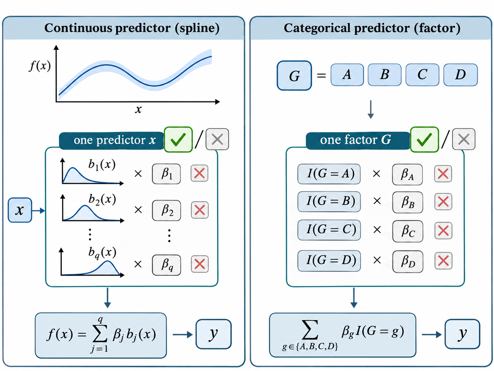

The [lasso](10.qmd) provides frameworks for simultaneous estimation and variable selection by introducing an $L_1$ penalty into the least-squares objective. Its central property is sufficiently penalized regression coefficients become exactly zero. However, this approach treats each coefficient as an independent object of selection, an assumption that may be inappropriate when several coefficients collectively represent a single explanatory variable, factor, or functional component. 

Consider a continuous predictor represented through a spline basis. Although its effect may require several coefficients, our scientific question is not to determine which spline coefficients should remain in the model. Rather, we want to determine whether the predictor itself contributes to the response. Similarly, when a categorical predictor is represented through several indicator variables, selecting only some indicators may not correspond to a meaningful decision about the categorical factor. 



This distinction motivates __group lasso__, a regularization method that preserves the sparsity-inducing behavior of the lasso while shifting the unit of selection from individual coefficients to groups of coefficients. The mathematical developement below integrates three complementary contributions: the group-selection formulation and its relationship to group least angle regression and the non-negative garrotte (@yuanModelSelectionEstimation2006) efficient descent algorithms for group lasso and noncovex group penalties (@brehenyGroupDescentAlgorithms2015), and groupwise majorization-descent for general loss functions and design matrices (@yangFastUnifiedAlgorithm2015). 

## From individual variable selection to grouped regression 

### Regression models with grouped predictors

Consider the linear regression model 

$$
Y = \sum_{j=1}^J X_j \beta_j + \epsilon, \quad \epsilon\sim \mathcal N_n(0, \sigma^2I_n)
$$

where $Y\in \R^n$ is the response vector, $X_j\in \R^{n\times p_j}$ contains the predictors belonging to group $j$, and $\beta_j\in \R^{p_j}$ is its coefficient vector. The full design matrix is 

$$
X=(X_1, \ldots, X_J), \quad \beta=(\beta_1^\top, \ldots, \beta_j^\top)^\top, 
$$

with $p=\sum_{j=1}^J$ total coeffcients. We assume the groups are non-overlapping, as in the papers. 

For simplicity, assume the response and predictor columns have been centered, so the intercept can be ommited. When an intercept is included, it is normally left unpenalized. 

We have discussed about the OLS and Lasso in [previous chapter](10.qmd). The lasso modifies the estimation problem to 

$$
\hat \beta_\text{lasso} = \arg\min_{\beta}\left\{\frac{1}{2n} \|Y-X\beta\|_2^2 + \lambda \sum_{j=1}^J \sum_{k=1}^{p_j} |\beta_{jk}| \right\}
$$

The penalty is applied independently to every $\beta_{jk}$. Consequently, the model may retain one basis coefficient while setting the remaining coefficients of the same factor to zero. That is appropriate when the individual coefficients are themselves meaningful targets for selection; otherwise, group-based penalties might be more suitable.

### The group-lasso estimator 

To address this problem, we replace the sum of aboslute coefficient values with a sum of group norms. 

::: {#def-group-lasso}

## Group lasso

For a partition of the predictors into $J$ groups, the group-lasso estimator is 

$$
\hat \beta_{\text{GL}} (\lambda) = \arg\min_{\beta} \left\{\frac{1}{2n} \|Y-X\beta\|_2^2 + \lambda \sum_{j=1}^J w_j \|\beta_j\|_2\right\}
$${#eq-group-lasso}

where $w_j>0$ is a group-specific penalty weight and $\lambda\geq 0$ controls regularization. 
:::

The @yuanModelSelectionEstimation2006 formulation is slightly more general. For positive-definite matrices $K_j$, define 

$$
\|\beta_j\|_{K_j} = \sqrt{\beta_j^\top K_j \beta_j}
$$

Then group lasso can be written as 

$$
\hat \beta = \arg\min_\beta \left\{\frac{1}{2n} \left\|Y - \sum_{j=1}^J X_J \beta_j\right\|_2^2 + \lambda \sum_{j=1}^J \|\beta_j\|_{K_j}\right\}
$${#eq-group-lasso-general}

Yuan and Lin use $K_j = p_jI_{p_j}$, producing the penalty $\lambda\sum_j \sqrt{p_j}|\beta_j|_2$.

::: {#exm-group-lasso}

Suppose our dataset contains four observations.

| $x_i$ | $g_i$ | $Y_i$ | 
| --- | --- | --- |
| 1 | A | 5 | 
| 2 | B | 10 | 
| 3 | C | 12 |
| 4 | A | 10 | 

The regression design matrix (exluding the intercept) is 

$$
X = \begin{pmatrix}
1 & 0 & 0 \\
2 & 1 & 0 \\
3 & 0 & 1 \\
4 & 0 & 0
\end{pmatrix} = \underbrace{\begin{pmatrix}
1 \\ 2 \\ 3 \\ 4
\end{pmatrix}}_{X_1} \underbrace{\begin{pmatrix}0 & 1 \\ 1 & 0 \\ 0 & 1 \\ 0 & 0 \end{pmatrix}}_{X_2}
$$

Consequently, the model can be rewritten as 

$$
Y = \beta_0\mathbf{1} + X_1 \beta_1 + X_2 \beta_2 + \epsilon, \quad X_1 \in \R^{4\times 1}, X_2 \in \R^{4\times 2}
$$

Therefore, the group-lasso objective becomes 

$$
\min_{\beta_0, \beta_1, \beta_2, \beta_3} \left\{ \frac{1}{2\times 4} \sum_{i=1}^4 (Y_i - \hat Y_i)^2 + \lambda \left[w_1 |\beta_1| + w_2 \sqrt{\beta_2^2 + \beta_3^2}\right]\right\}
$$

Suppose we are evaluating the candidate coefficients 

$$
\beta_0 = 2, \beta_1 = 2, \beta_2 = 3, \beta_3 = 4. 
$$

Then the group norms are 

$$
\|\beta_1\|_{K_1} = |2| = 2, \quad \|\beta_2\|_{K_2} = \sqrt{3^2 + 4^2} = 5
$$

Now consider @yuanModelSelectionEstimation2006 definition: 

$$
\|\beta_j\|_{K_j} = \sqrt{\beta_j^\top K_j \beta_j}
$$

The matrix $K_j$ defines how the magnitude of a group is measured. For our second group $\beta_2 = \begin{pmatrix} 3 \\ 4 \end{pmatrix}$, Yuan and Lin chose $K_j = p_jI_{p_j}$. Since group 2 contains two coefficients, $p_2=2$, so 

$$
\|\beta_2\|_{K_2} = \sqrt{\begin{pmatrix} 3 & 4 \end{pmatrix} \begin{pmatrix} 2 & 0 \\ 0 & 2 \end{pmatrix} \begin{pmatrix} 3 \\ 4 \end{pmatrix}} = \sqrt{2(3^2 + 4^2)} = \sqrt{2 \cdot 25} = 5\sqrt{2}
$$

In general, 

$$
\|\beta_j\|_{K_j} = \sqrt{p_j} \|\beta_j\|_2 \quad \text{when } K_j = p_j I_{p_j}
$$
:::

@eq-group-lasso uses a normalized loss, whereas @eq-group-lasso-general follows the @yuanModelSelectionEstimation2006 unnormalized loss. They represent equivalent optimization formulations after the appropriate rescaling of $\lambda$. 

### Why the group weights matter? 

Suppose two groups have different dimensions, with $p_1$ = 2 and $p_2$ = 8. For independent standardized predictors under a null model, a group containing eight predictor will exhibit a larger residual correlation norm than a group containing only two predictors. If both groups received an identical penalty weight, larger groups could enjoy an advantage during selection. 

Using $w_j = \sqrt{p_j}$ ensures that each group is penalized based on its size, making the penalty more fair and balanced across groups of different dimensions. In particular, when the block is orthonormal and the response contains Gaussian noise, the squared norm of its residual correlations has an expectation proportional to $p_j$. 

### Why grouped variables? 

#### Categorical predictors 

Suppose $G$ has four levels: A, B, C, and D. Using A as the reference level, a regression model might contain 

$$
\E[Y | G] = \beta_0 + \beta_B I(G=B) + \beta_C I(G=C) + \beta_D I(G=D).
$$

The coefficients form one group $\beta_G = \begin{pmatrix} \beta_B & \beta_C & \beta_D \end{pmatrix}^\top$. A group-lasso penalty acts on 

$$
\lambda \sqrt{3} \sqrt{\beta_B^2 + \beta_C^2 + \beta_D^2}
$$

If $\hat \beta_G = \mathbf{0}$, the fitted means for all four levels are equal. The factor has been excluded from the model. When the group is retained, the model can estimate differences between the categories without imposing individual coefficient sparsity. 

#### Nonlinear regression with splines 

Suppose a continuous predictor $x$ has an unknown nonlinear effect approximated by a spline basis 

$$
f(x) = \sum_{k=1}^q \beta_k b_k(x). 
$$

For observations $x_1, \ldots, x_n$, the associated design matrix is 

$$
X_j = \begin{pmatrix} b_1(x_1) & b_2(x_1) & \cdots & b_q(x_1) \\ b_1(x_2) & b_2(x_2) & \cdots & b_q(x_2) \\ \vdots & \vdots & \ddots & \vdots \\ b_1(x_n) & b_2(x_n) & \cdots & b_q(x_n) \end{pmatrix}
$$

Instead of selecting $b_1, \ldots, b_q$, group lasso decides whether the entire function $f$ should contribute to the model. For an additive regression model, 

$$
\E[Y\mid x_1, \ldots, x_J] = \beta_0 + \sum_{j=1}^J f_j(x_j)
$$

we can penalize 

$$
\lambda \sum_{j=1}^J \sqrt{p_j} \|\beta_j\|_2
$$

After the appropriate centering and basis standardization, setting $\beta_j = \mathbf{0}$ removes the functional component $f_j$. This provides a direct bridge between nonlinear basis regression and variable selection. 

### Geometric interpretation of the penalty 

The group-lasso optimization problem has a constrained counterpart, 

$$
\min_{\beta} \frac{1}{2n} \|y - X\beta\|_2^2 \quad \text{subject to} \quad \sum_{j=1}^J w_j \|\beta_j\|_2 \leq t
$$

where $t\geq 0$ controls the size of the feasible set. For appropriate choices of $t$ and $\lambda$, the constrained and penalized formulations have the same solutions. Smaller $t$ correponds to stronger regularization. 

As with ordinary lasso, sparsity aries when the least-squared loss is minimized on a nonsmooth portion of the constraint boundary. The difference is where the nonsmoothness occurs. Ordinary lasso has nonsmoothness at individual coefficient zero, while group lasso has nonsmoothness when an entire group norm vanishes. 

```{python}
#| code-fold: true
#| code-summary: "View Python code"
import numpy as np
import matplotlib.pyplot as plt
from matplotlib.patches import Rectangle, Circle

# For X.T @ X / n = I, set z = X.T @ y / n.
lam = 1.0
w = 1.0                     
z_star = np.array([0.8, 0.8])

fig, axs = plt.subplots(1, 2, figsize=(11, 5.3))
fig.subplots_adjust(left=0.08, right=0.98, bottom=0.13, top=0.79, wspace=0.28)
fig.suptitle("Lasso and group lasso: exact zero regions",
             fontsize=16, fontweight="bold", y=0.98)

for ax in axs:
    ax.set(aspect="equal", xlim=(-2, 2), ylim=(-2, 2),
           xlabel=r"$z_1=X_1^\top y/n$", ylabel=r"$z_2=X_2^\top y/n$")
    ax.axhline(0, color="#444444", linewidth=0.8)
    ax.axvline(0, color="#444444", linewidth=0.8)
    ax.set_xticks([-2, -1, 0, 1, 2])
    ax.set_yticks([-2, -1, 0, 1, 2])
    ax.grid(alpha=0.12)
    ax.scatter(*z_star, marker="*", s=180, color="#bd3743",
               edgecolors="white", linewidth=0.7, zorder=6)
    ax.annotate(r"$z^*=(0.8,0.8)$", xy=z_star, xytext=(1.02, 1.4),
                fontsize=10, color="#a72c36",
                arrowprops=dict(arrowstyle="-", color="#a72c36"))

# Lasso: both coefficients zero iff max(|z1|, |z2|) <= lambda.
axs[0].axvspan(-lam, lam, color="#f1bf89", alpha=0.22)
axs[0].axhspan(-lam, lam, color="#f1bf89", alpha=0.22)
axs[0].add_patch(Rectangle(
    (-lam, -lam), 2*lam, 2*lam,
    facecolor="#4b8bc1", edgecolor="#125b92", alpha=0.47, lw=2.5, zorder=3
))
axs[0].text(0, -0.3, r"$\hat\beta_1=\hat\beta_2=0$",
            ha="center", fontsize=12, color="#15466b")
axs[0].set_title("Lasso: full zero region is a square\n"
                 r"$\|z\|_\infty\leq\lambda$",
                 fontsize=12, pad=10)

# Group lasso: both coefficients zero iff sqrt(z1^2+z2^2) <= lambda*w.
axs[1].add_patch(Circle(
    (0, 0), radius=lam*w,
    facecolor="#73bbad", edgecolor="#096d62", alpha=0.49, lw=2.5, zorder=3
))
axs[1].text(0, -0.3, r"$\hat{\boldsymbol{\beta}}=\mathbf{0}$",
            ha="center", fontsize=12, color="#0b645b")
axs[1].set_title("Group lasso: full zero region is a disk\n"
                 r"$\|z\|_2\leq\lambda w$",
                 fontsize=12, pad=10)

plt.show()

```

::: {#exm-lasso-vs-group-lasso}

At $\lambda$ = 1.2, consider the unpenalized vector $z=(1, 1)^\top$. For ordinary lasso, both cooridnates are smaller than $\lambda$, so the solution is 

$$
\hat{\beta}_\text{lasso} = (0, 0)^\top
$$

For group lasso, $\|z\|_2 = \sqrt{2}>1.2$, so the group survives even though neither coefficient exceeds the threshold:

$$
\hat{\beta}_\text{GL} = \left(1- \frac{1.2}{\sqrt{2}}\right) \begin{pmatrix} 1 \\ 1 \end{pmatrix} \approx \begin{pmatrix} 0.151 \\ 0.151 \end{pmatrix}
$$

We will discuss how we achieve this estimation of $\hat \beta_{\text{GL}}$ later. 

:::

### Orthonormalization and invariance of group representation 

There is another issuse that arise in ordinary lasso: a group of coefficients may represent the same underlying factor in many different ways. For example, a categorical variable may be expressed using reference contrasts, sum-to-zero contrasts, or another system of basis vectors. Likewise, the same spline function space may be represented by different bases. Ideally, whether a factor is selected should not depend on an arbitrary choice of coordinates. 

@yuanModelSelectionEstimation2006 begin with groupwise orthonormalized design matrices

$$
X_j^\top X_j = I_{p_j}
$$

@brehenyGroupDescentAlgorithms2015 work with the normalized version, 

$$
\frac{1}{n} X_j^\top X_j = I_{p_j}
$${#eq-normalized-version}

These conditions concern columns _within a group_. To obtain @eq-normalized-version, consider the eigendecomposition 

$$
\frac{1}{n} X_j^\top X_j = Q_j \Lambda_j Q_j^\top. 
$$

For a full-rank group, define 

$$
\tilde{X_j} = X_j Q_j \Lambda_j^{-1/2}. 
$$

Then 

$$
\begin{aligned}
\frac1n\widetilde X_j^\top\widetilde X_j
&=
\Lambda_j^{-1/2}Q_j^\top
\left(\frac1nX_j^\top X_j\right)
Q_j\Lambda_j^{-1/2}\\
&=
\Lambda_j^{-1/2}\Lambda_j\Lambda_j^{-1/2}\\
&=I.
\end{aligned}
$$

The corresponding coefficient transformation is 

$$
\beta_j = Q_j \Lambda_j^{-1/2}\tilde{\beta}_j
$${#eq-coefficient-transformation}

Consequently, 

$$
X_j \beta_j = \tilde{X}_j \tilde{\beta}_j,
$$

so the fitted contribution of the factor remains unchanged. If $X_j$ is rank deficient, we omit its zero eigenvalues and corresponding eigenvectors. The transformation model then operates in the lower-dimensional space of rank $r_j$ and @eq-coefficient-transformation maps the estimated coefficeints back to their original dimensions. 

However, we must distinguish preserving the fitted functions from preserving the original penalty. In general, 

$$
\|\tilde{\beta}_j \|_2 = \frac{1}{\sqrt{n}} \|X_j \beta_j\|_2 
$$

Penalizing orthonormalized coefficients is thus equivalent to penalizing the empirical norm of a group's fitted contribution. The penalty is invariant under orthogonal transformations of an orthonormal group basis, because for any orthogonal $R$, 

$$
\|R^\top \tilde{\beta}_j \|_2 = \|\tilde{\beta}_j \|_2.
$$

The same invariance does not extend to arbitrary nonorthogonal transformations if the Euclidean coefficient penalty is left unchanged. 

::: {#exm-orthonormalization}

Suppose our regression model contains one predictor represented by two basis functions

$$
f(x) = \beta_1 b_1(x) + \beta_2 b_2(x) 
$$

For four observations, suppose these basis function give the following column vectors:

$$
u = \begin{pmatrix} 1 \\ 1 \\ -1 \\ -1 \end{pmatrix}, \quad v = \begin{pmatrix} 1 \\ -1 \\ 1 \\ -1 \end{pmatrix}
$$

The associated design matrix is 

$$
X = \begin{pmatrix} 1 & 1 \\ 1 & -1 \\ -1 & 1 \\ -1 & -1 \end{pmatrix} = \begin{pmatrix} u & v \end{pmatrix}
$$

For simplicity, assume the observations are centered so that we can omit the intercept. Suppose the coefficients are $\beta = \begin{pmatrix} 2 \\ 1 \end{pmatrix}$. The fitted contribution of this group is 

$$
X\beta= 2u + v = \begin{pmatrix} 3 \\ 1 \\ -1 \\ 3 \end{pmatrix}
$$

The group-lasso penalty is based on 

$$
\|\beta \|_2 = \sqrt{2^2 + 1^2}  = \sqrt{5} \approx 2.236
$$

Now suppose we decide to use a different basis 

$$
b^*_1 = b_1, \quad b^*_2 = b_1 + b_2
$$

In terms of design columns, our new basis is 

$$
u^* = u, \quad v^* = u+ v
$$

Consequently, 

$$
X^* = \begin{pmatrix} u & u + v \end{pmatrix} = \begin{pmatrix} 1 & 2 \\ 1 & 0 \\ -1 & 0 \\ -1 & -2 \end{pmatrix}
$$

Notice that we have not introduced any new information: $u$ and $u+v$ span the same space as $u$ and $v$. The original function was 

$$
f(x) = 2b_1(x) + b_2(x)
$$

We can rewrite it as 

$$
f(x) = 1\times b_1^*(x) + 1\times b_2^*(x) 
$$

because $b^*_1 + b^*_2 = b_1 + (b_1 + b_2) = 2b_1 + b_2$.

Therefore, the new coefficient vector is 

$$
\beta^* = \begin{pmatrix} 1 \\ 1 \end{pmatrix}
$$

Check the fitted values: 

$$
X^* \beta^* = \begin{pmatrix} 3 \\ 1 \\ -1 \\ 3 \end{pmatrix} = X\beta 
$$

The two representations are exactly equivalent in terms of predictions. However, their Euclidean norms are different:

$$
\|\beta^* \|_2 = \sqrt{1^2 + 1^2} = \sqrt{2} \approx 1.414
$$

$$
\|\beta \|_2 = \sqrt{2^2 + 1^2} = \sqrt{5} \approx 2.236
$$

If we use the group-lasso penalty $\lambda \| \beta \|_2$, we penalize exactly the same function by two different amounts depending on how we choose the basis. That means our arbitrary choice of coordinates can affect which group gets selected.  

To address the problem, we can use an orthonormal basis, which ensures that the penalty is invariant to the choice of coordinates. For a group with $n$ observations, we want 

$$
\frac{1}{n} X^T X = I
$$

This equation imposes two requirements:

1. Different columns must have zero inner product (orthogonality)
2. Every column must have squared length $n$ (normalization)

Now we check those basis vectors:

$$
\frac{1}{4} X^T X = \begin{pmatrix} 1 & 0 \\ 0 & 1 \end{pmatrix} 
$$

The columns of $X$ are orthonormal, satisfying both requirements.

$$
\frac{1}{4} (X^*)^\top X^* = \begin{pmatrix} 1 & 1 \\ 1 & 2 \end{pmatrix} \neq I 
$$

For the second design matrix, the columns are not orthonormal. Now we perform the eigendecomposition. We already calculated $G = \frac{1}{4} (X^*)^\top X^*$ above. Our goal is to find a transformation that makes 
this matrix euqla to identity. 

The eigenvalues of $G$ satisfy 

$$
\det(G - \lambda I) = \det\left(\begin{pmatrix} 1 & 1 \\ 1 & 2 \end{pmatrix} - \lambda \begin{pmatrix} 1 & 0 \\ 0 & 1 \end{pmatrix}\right) = (1-\lambda)(2-\lambda) - 1 = \lambda^2 - 3\lambda + 1 = 0
$$

Therefore, $\lambda = \frac{3 \pm \sqrt{5}}{2}$. The corresponding eigendecomposition is 

$$
G = Q \Lambda Q^\top, 
$$

where, approximate 

$$
Q = \begin{pmatrix} \frac{2}{\sqrt{10 + 2\sqrt{5}}} & \frac{2}{\sqrt{10 - 2\sqrt{5}}} \\ \frac{1+\sqrt{5}}{\sqrt{10 + 2\sqrt{5}}} & \frac{1-\sqrt{5}}{\sqrt{10 + 2\sqrt{5}}} \end{pmatrix}, \quad \Lambda = \begin{pmatrix} \frac{3-\sqrt{5}}{2} & 0 \\ 0 & \frac{3+\sqrt{5}}{2} \end{pmatrix}
$$

Remeber the meaning of this decomposition:

- $Q$ rotates the coefficeint-coordinate system into orthogonal eigenvector directions. 
- $\Lambda$ describes the squared scales in those directions. 
- $\Lambda^{-1/2}$ rescales those directions to have unit normalized squared length. 

Hence, the orthonormalized design matrix is 

$$
\tilde X = X^* Q \Lambda^{-1/2} = 
\begin{pmatrix}
\dfrac{2+\sqrt5}{\sqrt{5+2\sqrt5}}&
\dfrac{2-\sqrt5}{\sqrt{5-2\sqrt5}}\\[10pt]
\dfrac{1}{\sqrt{5+2\sqrt5}}&
\dfrac{1}{\sqrt{5-2\sqrt5}}\\[10pt]
-\dfrac{1}{\sqrt{5+2\sqrt5}}&
-\dfrac{1}{\sqrt{5-2\sqrt5}}\\[10pt]
-\dfrac{2+\sqrt5}{\sqrt{5+2\sqrt5}}&
-\dfrac{2-\sqrt5}{\sqrt{5-2\sqrt5}}
\end{pmatrix}.
$$

We started with the second representation $X^*\beta^*$ with $\beta^* = \begin{pmatrix} 1 \\ 1 \end{pmatrix}$. After orthonormalization, we need a new coefficient vector $\tilde{\beta}$ such that 

$$
X^* \beta^* = \tilde X \tilde \beta 
$$

Substituting the numbers (at 2A.M) gives 

$$
\tilde \beta \approx \begin{pmatrix} -0.2008 \\ 2.2270 \end{pmatrix}
$$

Its norm is 

$$
\|\tilde \beta\|_2 \approx 2.237 = \sqrt 5
$$


:::


```{python}
#| code-fold: true 
#| code-summary: "View Python code"

import numpy as np
import matplotlib.pyplot as plt

# Four observations, two basis functions
X = np.array([
    [ 1,  1],
    [ 1, -1],
    [-1,  1],
    [-1, -1]
], dtype=float)

n = X.shape[0]
beta = np.array([2., 1.])
y = X @ beta

# Change coordinates:
# new basis = (u, u + v)
A = np.array([[1., 1.],
              [0., 1.]])

X_star = X @ A
beta_star = np.linalg.solve(A, beta)

# Eigenvalue-based orthonormalization
G = X_star.T @ X_star / n
eigenvalues, Q = np.linalg.eigh(G)

D_inv_sqrt = np.diag(1 / np.sqrt(eigenvalues))
D_sqrt = np.diag(np.sqrt(eigenvalues))

X_tilde = X_star @ Q @ D_inv_sqrt
beta_tilde = D_sqrt @ Q.T @ beta_star

print("Same fitted values:",
      np.allclose(X @ beta, X_star @ beta_star))
print("Normalized Gram matrix:")
print(np.round(X_tilde.T @ X_tilde / n, 5))
print("Original coefficient norm:", np.linalg.norm(beta))
print("Changed basis norm:", np.linalg.norm(beta_star))
print("Orthonormalized norm:", np.linalg.norm(beta_tilde))
print("Empirical function norm:", np.linalg.norm(y) / np.sqrt(n))

# Group selection at lambda = 3
lam = 3.0
score_original = np.linalg.norm(X.T @ y / n)
score_changed = np.linalg.norm(X_star.T @ y / n)
score_normalized = np.linalg.norm(X_tilde.T @ y / n)

print("\nGroup selected? (True means nonzero)")
print("Original:", score_original > lam)
print("Changed basis:", score_changed > lam)
print("Orthonormalized:", score_normalized > lam)

# Visualization
fig, axes = plt.subplots(1, 2, figsize=(12, 5))

# Panel 1: basis vectors in the same 2D function space
ax = axes[0]

vectors = [
    ((1, 0), "u"),
    ((0, 1), "v"),
    ((1, 1), "u + v"),
    ((2, 1), "2u + v")
]

for vec, label in vectors:
    ax.annotate(
        "", xy=vec, xytext=(0, 0),
        arrowprops=dict(arrowstyle="->", lw=2)
    )
    ax.annotate(label, vec, xytext=(5, 5),
                textcoords="offset points")

ax.axhline(0, lw=0.7)
ax.axvline(0, lw=0.7)
ax.set_xlim(-0.3, 2.8)
ax.set_ylim(-0.3, 1.8)
ax.set_aspect("equal")
ax.set_xlabel("u direction")
ax.set_ylabel("v direction")
ax.set_title("Same fitted vector, different basis")

# Panel 2: zero-selection regions
ax = axes[1]
theta = np.linspace(0, 2*np.pi, 500)

# Original design: r1^2 + r2^2 <= lambda^2
circle_x = lam * np.cos(theta)
circle_y = lam * np.sin(theta)

# Changed design:
# r1^2 + (r1 + r2)^2 <= lambda^2
ellipse_x = lam * np.cos(theta)
ellipse_y = lam * (np.sin(theta) - np.cos(theta))

ax.fill(circle_x, circle_y, alpha=0.12)
ax.plot(circle_x, circle_y, lw=2,
        label="Orthonormal basis: zero region")

ax.fill(ellipse_x, ellipse_y, alpha=0.12)
ax.plot(ellipse_x, ellipse_y, lw=2,
        label="Changed basis: zero region")

ax.scatter([2], [1], s=85, marker="x",
           linewidths=2, label="Observed score (2, 1)")

ax.axhline(0, lw=0.7)
ax.axvline(0, lw=0.7)
ax.set_aspect("equal")
ax.set_xlim(-4.7, 4.7)
ax.set_ylim(-4.7, 4.7)
ax.set_xlabel("Score along u")
ax.set_ylabel("Score along v")
ax.set_title("Which groups are set to zero?")
ax.legend(fontsize=8, loc="upper right")

plt.tight_layout()
plt.show()


```


## Optimality conditions, group thresholding, and descent algorithm 

### The Karush-Kuhn-Tucker conditions 

Having established the group-lasso objective, we next examine why it can set an entire coefficient vector to zero. Consider 

$$
Q(\beta) = \frac{1}{2} \|y - X\beta\|_2^2 + \lambda \sum_{j=1}^J w_j \| \beta_j \|_2
$$

The loss is differentiable, but the group norm is not differentiable at $\beta_j=\mathbf 0$. Therefore, ordinary gradient equations are insufficient; we need subgradient optimality conditions. 

For the smooth component, 

$$
\nabla_{\beta_j} \left(\frac{1}{2} \|Y-X\beta \|_2^2  \right) = -\frac{1}{n} X_j^\top (Y- X\beta)
$$

For the group norm, its subdifferential is 

$$
\partial \| \beta_j\|_2 = \begin{cases}\left\{\frac{\beta_j}{\|\beta_j\|_2} \right\}, \quad \beta_j \neq \mathbf 0, \\ \{v: \|v\|_2 \leq 1\}, \beta_j \neq \mathbf 0 \end{cases}
$$

::: {#prp-lasso-optimality-conditions}

## Group-lasso optimality conditions; @yuanModelSelectionEstimation2006

A coefficient vector $\hat \beta$ minimizes $Q$ iff, for every group $j$, 

$$
- \frac{1}{n} X_j^\top (Y- X\hat \beta) + \lambda w_j \frac{\hat \beta_j}{\|\hat \beta_j \|}=0 \quad \forall \hat \beta_j \neq 0 
$${#eq-lasso-optimality-conditions}

and 

$$
\| \frac{1}{n} X_j^\top (Y- X\hat \beta) \| \leq \lambda w_j \quad \forall \hat \beta_j = 0
$${#eq-group-lasso-optimality}
:::


::: {.proof}

By the subgradient version of the Fermat optimality condition @tuyenOptimalityConditionsInfinity2024, 

$$
\mathbf 0 \in \partial_{\beta_j} Q(\hat \beta)
$$

Subsituting the derivative of the squared-error loss and the subdifferential of the group norm gives 

$$
\mathbf{0} \in - \frac{1}{n} X_j^\top (Y- X\hat \beta) + \lambda w_j \partial \| \hat \beta_j \|_2
$$

When $\hat \beta_j \neq \mathbf{0}$, substituting the unique subgradient produces euqation @eq-lasso-optimality-conditions. When $\hat \beta_j = \mathbf 0$, there must exist a vector $v$, with $\|v\|_2\leq 1$, satisfying 

$$
\frac{1}{n} X_j^\top (Y-X\hat \beta) = \lambda w_j v
$$

Taking its Euclidean norm gives equation @eq-group-lasso-optimality. Converely, if @eq-group-lasso-optimality holds, such a subgradient exists. Because $Q$ is convex, these conditions are necessary and sufficient for global optimality. 
:::

### Deriving multivariate soft-thresholding 

Suppose the columns within group $j$ have been orthonormalized so that 

$$
\frac{1}{n} X_j^\top X_j = I
$$

Fix all coefficeint groups except $\beta_j$. Define the partial residual 

$$
r_{-j} = Y- \sum_{l\neq j} X_l \beta_l
$${#eq-partial-residual}

The optimization with respect to $\beta_j$ is 

$$
\min_{\beta_j} \left\{\frac{1}{2n} \|r_{-j} - X_j \beta_j\|_2^2 + \lambda w_j \| \beta_j \|_2 \right\}
$$

Expanding the squared loss, 

$$
\frac{1}{2n} \|r_{-j} - X_j\beta_j \|_2^2 = \frac{1}{2n} r_{-j}^\top r_{-j} - \frac{1}{n} r_{-j}^\top X_j \beta_j + \frac{1}{2n} \beta_j^\top X_j^\top X_j \beta_j
$$

By groupwise orthonormality, the final term becomes $\frac{1}{2} \|\beta_j \|_2^2$. After completing the square and discarding terms independent of $\beta_j$, the problem reduces to 

$$
\min_{\beta_j} \left\{\frac{1}{2} \|\beta_j  - \frac{1}{n} X_j^\top r_{-j} \|_2^2+ \lambda w_j \| \beta_j \|_2 \right\}
$$

The original multivariate regression problem has now been reduced to a particularly simple regularized least-squares problem. For a nonzero, differentiation gives 

$$
\beta_j - \frac{1}{n} X_j^\top r_{-j} + \lambda w_j \frac{\beta_j}{\|\beta_j\|_2} = 0
$$

Rearranging, 

$$
\frac{1}{n} X_j^\top r_{-j}= \left(1+ \frac{\lambda w_j }{\|\beta_j \|_2}\right) \beta_j 
$$

Hence $\beta_j$ must have the same direction as $z_j$. Only its magnitude changes. Taking norms, 

$$
\| \beta_j \|_2 = \| \frac{1}{n} X_j^\top r_{-j}\|_2 - \lambda w_j 
$$

whenever the solution is nonzero. If $\|z_j\|_2 \leq \lambda w_j$, the subgradient condition implies that the solution is zero. Combining the cases gives the central group-lasso update:

$$
\hat \beta_j = \left(1- \frac{\lambda w_j}{\|\frac{1}{n} X_j^\top r_{-j}\|_2}\right)_{+} \frac{1}{n} X_j^\top r_{-j}
$${#eq-central-group-lasso-update}

where $(a)_+ = \max(a, 0)$, with the expression defined as zero when $\frac{1}{n} X_j^\top r_{-j}=\mathbf 0$.

::: {#exm-numerical}

Suppose we have three orthonormal coefficeint groups with equal weights $w_j=1$, and $z = \frac{1}{n} X_j^\top r_{-j}$ with 

$$
z_A = \begin{pmatrix} 2\\ 1 \end{pmatrix}, \quad z_B = \begin{pmatrix} 0.3 \\ 0.4 \end{pmatrix}, \quad z_C = \begin{pmatrix} 1 \\ 1 \end{pmatrix}
$$

Let $\lambda = 1$. For group A, $\| z_A \|_2 = \sqrt{5}$, and thus 

$$
\hat \beta_A =  \left(1-\frac{1}{\sqrt{5}}\right) \begin{pmatrix} 2\\ 1 \end{pmatrix} \approx \begin{pmatrix} 1.106 \\ 0.553 \end{pmatrix}
$$

For group B, $\| z_B \|_2 = \sqrt{0.25} = 0.5 < 1$, and thus 

$$
\hat \beta_B = \mathbf 0
$$

Finally, group $C$ satisfies $\| z_C \|_2 = \sqrt{2} \approx 1.414 > 1$, and thus 

$$
\hat \beta_C =  \left(1-\frac{1}{\sqrt{2}}\right) \begin{pmatrix} 1 \\ 1 \end{pmatrix} \approx \begin{pmatrix} 0.293 \\ 0.293 \end{pmatrix}
$$

:::

### Groupwise coordinate descent 

The thresholding expression provides an efficient way to fit the complete model. In ordinary coordinate descent, we fix all coefficients except one and minimize the objective with respect to that coordinate.

If $r= Y - X\beta$ denotes the current residual, the partial residual statistic satisfies 

$$
z_j = \frac{1}{n}X_j^\top r_{-j} = \frac{1}{n} X_j^\top (r + X_j \beta_j) = \frac{1}{n} X_j^\top r + \beta_j
$$

This eliminates the need to reconstruct the partial residual from scratch during each update. 

::: {.callout-note icon=false}
### Algorithm 1. Groupwise descent for linear group lasso

```
Initialize beta = 0 and r = y

Repeat until convergence:
    for j = 1, ..., J:
        z_j = X_j.T @ r / n + beta_j

        beta_new = S(z_j, lambda * w_j)

        r = r - X_j @ (beta_new - beta_j)

        beta_j = beta_new

Return beta
```
:::

Because @eq-central-group-lasso-update gives the exact solution to every orthonormalized block subproblem, each update cannot increase the objective 

$$
Q(\beta^{(m+1)}) \leq Q(\beta^{(m)})
$$

For convex group lasso, convergence to an optimal solution follows under the usual block-coordinates descent conditions. For nonorthonomal groups, @eq-central-group-lasso-update may not hold. One must either orthonormalize the blocks with the intended penalty transformation or use an optimization method that accomodates general Gram matrices. 

### Understanding the regularization path 

Rather than fitting the model at one fixed $\lambda$, it is usually more informative to examine a sequence of solutions 

$$
\{\hat \beta(\lambda): \lambda \geq 0\}
$$

The collection is called the _regularization path_. At sufficiently large $\lambda$, all penalized groups are zero. As $\lambda$ decreases, groups may enter the model and their coefficeint vectors are allowed to increase in magnitude. 

From the KKT conditions, the smallest regularization value at which the all-zero coefficient vector is optimal is 

$$
\lambda_{\min} = \max_{j: w_j > 0} \frac{\| X_j^\top Y/n \|_2}{w_j}, 
$$

provided the response the predictors are centered and no other unpenalized variables are present. If unpenalized predictors are included, $Y$ in this expression is replaced by the residual from the model containing those unpenalized predictors. 

For every $\lambda \geq \lambda_\text{max}$, the zero coefficient vector satisfies all groupwise KKT inequalites. We begin at $\lambda_\max$, then gradually decrease $\lambda$, using the previous solution to initialize the next optimization. This technique is called a _warm start_. As we will see, however, the shape of this path is substantially more complicated than the ordinary lasso path. 

### A synthetic example 

```{python}
import numpy as np 
import matplotlib.pyplot as plt 

rng = np.random.default_rng(6400)
n = 180 
sizes = [2, 4, 8, 3]
groups = []
X_blocks = []
shared = rng.normal(size=(n, 2))

for p_j in sizes:
    A = rng.normal(size=(n, p_j))
    A += 0.35 * shared @ rng.normal(size=(2, p_j)) / np.sqrt(2)
    A -= A.mean(axis=0)
    # orthonormalize within each group 
    Q, _ = np.linalg.qr(A) 
    X_blocks.append(np.sqrt(n) * Q) 

X = np.column_stack(X_blocks)
start = 0 
for p_j in sizes:
    groups.append(np.arange(start, start+ p_j))
    start += p_j

# group 1: signal; group 2: noise; group3: signal; group4: weak signal

beta_true = np.array([
    1.5, -1.0, # G1
    0.0, 0.0, 0.0, 0.0,  #G2
    0.95, -0.8, 0.6, -0.4, 0, 0, 0, 0, # G3
    0.45, 0.0, 0.0 # G4 
], dtype=float)

y = X @ beta_true + rng.normal(0, 0.75, n)
y -= y.mean()
weights = np.sqrt(sizes) # w_j = sqrt(p_j)

# compute exact lambda_max from groupwise KKT conditions 
lambda_max_group = max(np.linalg.norm(X[:, g].T @ y /n) / w for g, w in zip(groups, weights))

lambda_max_lasso = np.max(np.abs(X.T @ y / n))

print(f"Group-lasso lambda_max: {lambda_max_group:.2f}")
print(f"Lasso lambda_max: {lambda_max_lasso:.2f}")
```


```{python}
#| code-fold: true
#| code-summary: "View Python code"
def group_lasso_path(X, y, groups, weights, lambdas,
                     max_iter=2500, tol=1e-10):
    """Minimize ||y-Xb||^2/(2n) + lam * sum_j w_j ||b_j||_2.
       Requires X_j.T @ X_j / n = I for each group."""
    n, p = X.shape
    beta = np.zeros(p)
    residual = y.copy()
    path = []

    for lam in lambdas:         # from large to small
        for _ in range(max_iter):
            largest_change = 0.0

            for g, w in zip(groups, weights):
                old = beta[g].copy()

                # Partial residual excluding this group
                residual += X[:, g] @ old
                z = X[:, g].T @ residual / n

                # Group soft-thresholding
                z_norm = np.linalg.norm(z)
                if z_norm <= lam * w:
                    new = np.zeros_like(z)
                else:
                    new = (1 - lam * w / z_norm) * z

                beta[g] = new
                residual -= X[:, g] @ new
                largest_change = max(
                    largest_change, np.max(np.abs(new - old))
                )

            if largest_change < tol:
                break
        else:
            raise RuntimeError("Group-lasso solver did not converge")

        path.append(beta.copy())       # next lambda uses warm start

    return np.array(path)


def lasso_path(X, y, lambdas, max_iter=2500, tol=1e-10):
    """Minimize ||y-Xb||^2/(2n) + lam * ||b||_1.
       Assumes columns satisfy X_k.T @ X_k / n = 1."""
    n, p = X.shape
    beta = np.zeros(p)
    residual = y.copy()
    path = []

    for lam in lambdas:
        for _ in range(max_iter):
            largest_change = 0.0
            for k in range(p):
                old = beta[k]
                residual += X[:, k] * old
                z = X[:, k] @ residual / n
                new = np.sign(z) * max(abs(z) - lam, 0.0)
                beta[k] = new
                residual -= X[:, k] * new
                largest_change = max(largest_change, abs(new - old))

            if largest_change < tol:
                break
        else:
            raise RuntimeError("Lasso solver did not converge")

        path.append(beta.copy())

    return np.array(path)
```

```{python}
fractions = np.geomspace(1.0, 0.025, 100)
group_path = group_lasso_path(
    X, y, groups, weights, lambda_max_group * fractions
)
lasso_path_values = lasso_path(
    X, y, lambda_max_lasso * fractions
)

group_norms = np.column_stack([
    np.linalg.norm(group_path[:, g], axis=1) for g in groups
])
lasso_group_norms = np.column_stack([
    np.linalg.norm(lasso_path_values[:, g], axis=1) for g in groups
])

```


```{python}
#| code-fold: true
#| code-summary: "View Python code"
fig, axes = plt.subplots(2, 2, figsize=(13, 9.5), sharex=True)
fig.subplots_adjust(wspace=0.27, hspace=0.29, top=0.91, bottom=0.10)
fig.suptitle("Regularization paths: group lasso versus ordinary lasso",
             fontsize=16, weight="bold")

names = [
    "G1: 2 (signal)", "G2: 4 (noise)",
    "G3: 8 (signal)", "G4: 3 (weak signal)"
]

# Upper left: group lasso norms
ax = axes[0, 0]
for j in range(len(groups)):
    ax.plot(fractions, group_norms[:, j], lw=2.3, label=names[j])
ax.set_title("A. Group lasso: whole-group magnitudes")
ax.set_ylabel(r"$\|\hat\beta_j(\lambda)\|_2$")
ax.legend(fontsize=9)
ax.grid(alpha=0.2)

# Upper right: the same group norms under ordinary lasso
ax = axes[0, 1]
for j in range(len(groups)):
    ax.plot(fractions, lasso_group_norms[:, j], lw=2.3, label=names[j])
ax.set_title("B. Ordinary lasso: grouped magnitudes")
ax.set_ylabel(r"$\|\hat\beta_j(\lambda)\|_2$")
ax.grid(alpha=0.2)

# Bottom left: individual coefficient paths inside group G3
ax = axes[1, 0]
chosen = groups[2]  # dimension 8
for k, column in enumerate(chosen):
    ax.plot(fractions, group_path[:, column], lw=1.7,
            label=rf"$\beta_{{3,{k+1}}}$")
ax.axhline(0, lw=0.8, linestyle=":")
ax.set_title("C. Group lasso: coefficients inside G3 (p=8)")
ax.set_ylabel(r"$\hat\beta_{3,k}(\lambda)$")
ax.legend(ncol=4, fontsize=9)
ax.grid(alpha=0.2)

# Bottom right: group sizes create jumps in active coefficient count
ax = axes[1, 1]
threshold = 1e-7
active_gl = np.sum(np.abs(group_path) > threshold, axis=1)
active_l1 = np.sum(np.abs(lasso_path_values) > threshold, axis=1)
ax.step(fractions, active_gl, where="post", lw=2.3,
        label="Group lasso: active coefficients")
ax.step(fractions, active_l1, where="post", lw=2.3,
        label="Lasso: active coefficients")
ax.set_title("D. Number of nonzero coefficients")
ax.set_ylabel("Number of nonzero coefficients")
ax.legend(fontsize=9)
ax.grid(alpha=0.2)

for ax in axes.flat:
    ax.set_xlim(1.02, 0.02)  # lambda decreases left -> right
    ax.set_xticks([1, 0.8, 0.6, 0.4, 0.2, 0.05])
    ax.set_xlabel(r"$\lambda/\lambda_{\max}$   (decreasing $\lambda$ →)")
    ax.axvline(1, lw=1, ls="--", alpha=0.5)

```


```{python}
for j, name in enumerate(names):
    entered = np.flatnonzero(group_norms[:, j] > threshold)
    first = fractions[entered[0]] if len(entered) else None
    print(f"{name}: first nonzero at lambda/lambda_max = {first}")

```

## Solution paths, group LARS, and model selection 

### Why group-lasso paths are not piecewise linear 

One of the reasons ordinary lasso became computationally attractive was the discovery that its least-squares solution path is piecewise linear. This property allows algorithms such as least angle regression (LARS) to construct entire solution paths through a sequence of linear segments. 

It is tempting to expect the same behavior from group lasso because its single-group update is a simple extension of soft-thresholding. The difference appears when predictors are correlated across groups. 

Suppose, for a moment, that the entire design matrix is orthonormal:

$$
\frac{1}{n} X^\top X = I_p 
$$

This is stronger than groupwise orthonormality because it also requires different groups to be mutually orthogonal. Then the groups can be optimized independently, and $z_j = \frac{1}{n} X_j^\top Y$ does not depend on the other coefficient groups. Thus, 

$$
\hat \beta_j(\lambda) = \left(1- \frac{\lambda w_j}{\|z_j\|_2}\right)_+  z_j 
$$

Because $z_j$ is fixed, the expression is linear in $\lambda$. But when groups are correlated, the partial residual (@eq-partial-residual) changes as the other coefficients change. Consequently, 

$$
z_j(\lambda) = \frac{1}{n} X_j^\top r_{-j} (\lambda)
$$

may change both in magnitude and in direction. The group-lasso KKT condition involves $\frac{\beta_j}{\|\beta_j\|_2}$, and this direction isn't remain constant along the solution path. Therefore, even between changes in the set of selected groups, the coefficient path can be curved. 

::: {#exm-correlated-group}

Consider a regression model with two groups $G_1 = \{x_1, x_2\}$ and $G_2 = \{x_3\}$. Suppose their standardized Gram matrix is 

$$
\frac{X^\top X}{n} = \begin{pmatrix}
1 & 0 & 0.8 \\
0 & 1 & 0 \\
0.8 & 0 & 1
\end{pmatrix}
$$

Here, $x_1$ and $x_2$ are orthogonal within the first group, but $x_1$ and $x_3$ have correlation 0.8. Suppose also that 

$$
z = \frac{X^\top y}{n} = \begin{pmatrix}
0.7 \\
0.9 \\
1.6
\end{pmatrix}
$$

For simplicity, use $w_1=w_2=1$. We minimize 

$$
\frac{1}{2n} \|y-X\beta\|^2_2 + \lambda \left(\sqrt{\beta_1^2 + \beta_2^2} + |\beta_3|\right)
$$


The starting regularization parameter is 

$$
\lambda_{\max} = \max\left\{\sqrt{0.7^2 + 0.9^2}, |1.6|\right\} = 1.6
$$

Initially, ever coefficient is zero. The singleton group $G_2$ enters first. While $G_1$ remains zero, 

$$
\hat \beta_3(\lambda) = 1.6 - \lambda 
$$

The partial-residual correlation for $G_1$ therefore becomes 

$$
z_1(\lambda) = \begin{pmatrix} 0.7 \\ 0.9 \end{pmatrix} - \begin{pmatrix} 0.8 \\ 0 \end{pmatrix} (1.6 - \lambda) = \begin{pmatrix} -0.58 + 0.8 \lambda \\ 0.9 \end{pmatrix}
$$

Notice that the first coordinate changes while the second remains fixed. The direction of the residual-correlation vector therefore rotates as $\lambda$ decreases. 

The first group enters when 

$$
\sqrt{(-0.58 + 0.8 \lambda)^2 + 0.9^2} = \lambda \implies \lambda \approx 0.9124
$$

After that, both groups are active, but their coefficients continue to interact. This is where we can observe a curved group-lasso path. 

```{python}
#| code-fold: true 
#| code-summary: "View Python code"
import numpy as np
import matplotlib.pyplot as plt

# Sufficient statistics of the synthetic regression problem
G = np.array([
    [1.0, 0.0, 0.8],
    [0.0, 1.0, 0.0],
    [0.8, 0.0, 1.0]
])
z = np.array([0.7, 0.9, 1.6])

lambda_max = max(np.linalg.norm(z[:2]), abs(z[2]))
lambdas = np.linspace(lambda_max, 0, 641)

# Group-lasso path using warm-start block coordinate descent
beta = np.zeros(3)
path = []

for lam in lambdas:
    for iteration in range(3000):
        old = beta.copy()

        # Group 1: two-dimensional group soft threshold
        partial = z[:2] - G[:2, 2] * beta[2]
        r = np.linalg.norm(partial)

        if r <= lam:
            beta[:2] = 0
        else:
            beta[:2] = (1 - lam / r) * partial

        # Group 2: singleton soft threshold
        partial3 = z[2] - G[2, :2] @ beta[:2]
        beta[2] = np.sign(partial3) * max(
            abs(partial3) - lam, 0
        )

        if np.max(np.abs(beta - old)) < 1e-12:
            break

    path.append(beta.copy())

path = np.array(path)

# Comparison: globally orthogonal design
z1 = z[:2]
orthogonal = np.array([
    max(0, 1 - lam / np.linalg.norm(z1)) * z1
    for lam in lambdas
])

fig, ax = plt.subplots(1, 2, figsize=(12, 5))

# Coefficient paths as lambda decreases
ax[0].plot(lambdas, path[:, 0], label=r"$\beta_1$")
ax[0].plot(lambdas, path[:, 1], label=r"$\beta_2$")
ax[0].plot(lambdas, path[:, 2], label=r"$\beta_3$")
ax[0].invert_xaxis()
ax[0].set_xlabel(r"$\lambda$")
ax[0].set_ylabel("Coefficient value")
ax[0].set_title("Coefficient paths")
ax[0].legend()
ax[0].grid(alpha=0.2)

# Geometry of the first group's path
ax[1].plot(
    path[:, 0], path[:, 1],
    linewidth=2.5, label="Correlated groups"
)
ax[1].plot(
    orthogonal[:, 0], orthogonal[:, 1],
    "--", linewidth=2,
    label="Orthogonal groups"
)

for lam in [0.8, 0.5, 0.2]:
    i = np.argmin(np.abs(lambdas - lam))
    b1, b2 = path[i, :2]

    ax[1].scatter(b1, b2, s=45)
    ax[1].annotate(
        rf"$\lambda={lam}$", (b1, b2),
        xytext=(5, 8), textcoords="offset points"
    )

ax[1].set_xlabel(r"$\beta_1(\lambda)$")
ax[1].set_ylabel(r"$\beta_2(\lambda)$")
ax[1].set_title("Group coefficient trajectory")
ax[1].axis("equal")
ax[1].legend()
ax[1].grid(alpha=0.2)

plt.tight_layout()
plt.show()

```

As we can see, the first group enter near 0.9124. Its two coefficients then follow smooth, nonlinear trajectories. Instead of plotting each coefficient separately, we can also plot $\lambda \mapsto (\beta_1(\lambda), \beta_2(\lambda))$. With globally orthogonal predictors, the group follows a straight ray. With correlated groups, it follows a visibly curved trajectory. 

For $\lambda \in [0.2, 0.8]$, both groups are active and $\beta_3>0$. Let $R= \sqrt{\beta_1^2 +\beta_2^2}$. The KKT conditions are 

$$
\begin{aligned}
\beta_1 + 0.8 \beta_3 + \lambda \frac{\beta_1}{R} &= 0.7 \\ 
\beta_2 + \lambda \frac{\beta_2}{R} &= 0.9 \\
0.8 \beta_1 + \beta_3 + \lambda &= 1.6
\end{aligned}
$$

Substituting (3) into the first equation gives 

$$
\begin{aligned}
\left(0.36 + \frac{\lambda}{R}\right)\beta_1 &= -0.58 + 0.8\lambda\\ 
\left(1+\frac{\lambda}{R}\right) \beta_2 &= 0.9  
\end{aligned}
$$

So here $R$ itself depends on $\beta_1$ and $\beta_2$, and therefore on $\lambda$. Unlike the ordinary linear equation in $\lambda$, the coefficients feed back into their own shrinkage term through $R$. Compare this with the globally orthogonal case:

$$
\hat \beta_{G_1}(\lambda)= \left(1-\frac{\lambda}{\sqrt{0.7^2+0.9^2}}\right)_{+} \begin{pmatrix} 0.7\\0.9\end{pmatrix}
$$

For an active group, this is just 

$$
\hat \beta_{G_1}(\lambda) = \begin{pmatrix} 0.7\\0.9\end{pmatrix} - \lambda \frac{\begin{pmatrix} 0.7\\0.9\end{pmatrix}}{\sqrt{0.7^2+0.9^2}}
$$

The intercept vector and slope vector are fixed. Therefore the coefficient path is linear, and its direction never changes. 
:::

Yun and Lin characterize the special situation in which this difficulty disappears. 

::: {#thm-piecewise-linearity-of-group-lasso-path}

## Piecewise Linearity of Group Lasso Path; @yuanModelSelectionEstimation2006

Under the paper's least-squares setting, the group-lasso solution path is piecewise linear if and only if every solution on that path can be expressed as 

$$
\hat \beta_j = c_j \beta_j^{LS}, \quad j = 1, \ldots, J,
$${#eq-piecewise-linearity}

for scalars $c_1, \ldots c_J$, where $\beta^{LS}$ is the full least-squares solution. 
:::

The condition means that the coefficient vector within every group remains on the line through the origin and its corresponding least-squares coefficient vector. 

::: {.proof}

Forst suppose the representation in @eq-piecewise-linearity holds. Substituting $\beta_j = c_j \beta_j^{LS}$ into the group-lasso objective gives 

$$
\frac{1}{2} \left\|Y - \sum_{j=1}^J c_j X_j \beta_j^{LS} \right\|_2^2 + \lambda\sum_{j=1}^J |c_j| \| \beta_j^{LS}\|_{K_J}
$$

This is an ordinary weighted lasso problem in the scalar coefficients $c_j$. Its least-squares solution path is piecewise linear. 

For the converse, the paper first proves a geometric lemma: if two distinct group-lasso solutions are joined by a straight line and every point on that line is also a solution along the path, then their corresponding nonzero coefficient vectors must be proportional within each group. Applying this lemma to the linear segments of a piecewise-linear path, ending at the least-squares solutoin, establishes the required representation. 
:::

A consequence is that group lasso has a piecewise-linear path when the entire design is orthonormal. The property also holds for ordinary lasso, where every group is a singleton. For general correlated groups of dimension greater than one, it is restrictive and does not usually hold. This motivates alternative algorithms that exploit group structure without requiring the exact group-lasso path to be piecewise linear. 

### Group least angle regression 

LARS provides a way to construct a regularization path by progressively introducing predictors according to their association with the residual. For ordinary LARS, a variable enters the active set when its absolute correlation with the current residual equals that of the currently active variables. @yuanModelSelectionEstimation2006 extend this principle by measuring association with an entire predictor subspace rather than a single column. 

For a groupwise orthonormal design with $X_j^\top X_j = I$, let $\theta(r, X_j)$ denote the angle between the residual vector $r$ and the subspace spanned by $X_j$. Then 

$$
\cos^2\theta(r, X_j) = \frac{||X_j^\top r||^2}{||r||^2}
$$

This measures the proportion of the residual sum of squares explained by projecting the residual onto the space associated with group $j$. To account for different group dimensions, the group LARS procedure compares 

$$
\frac{\|X_j^\top r\|^2}{p_j}
$${#eq-group-lars-comparison}

Initally, all coefficient groups are zero, so $r=Y$. The group with the largest value in @eq-group-lars-comparison enters first. 

Once a group is active, the procedure moves the fitted coefficients in the least-squares projection direction associated with the active groups. It continues until another group reaches the same normalized residual association. 

Let $A$ denote the active set. The direction of movement is determined through 

$$
\gamma_A = (X_A^\top X_A)^{-} X_A^\top r,
$$

where the inverse is an ordinary matrix inverse when possible and a generalized inverse when necessary. Coefficients outside $A$ have zero direction. For an inactive group $j$, the next entry time is determined by solving 

$$
\frac{\|X_j^\top (r- \alpha X \gamma) \|_2^2}{p_j} = \frac{\| X_{j'}^\top (r- \alpha X \gamma) \|_2^2}{p_{j'}}
$$

where $j'$ is an active group and $\alpha \in [0,1]$. Both sides are quadractic in $\alpha$, so the candidate step lengths can be obtained by solving quadratic equations. 

The algorithm takes the smallest admissible entry step, updates the active set, and repeats. In the original full-rank setting, it utimately reaches the least-squares fit. Unlike group lasso, this procedure constructs a piecewise-linear coefficient path by design. 

For an entirely orthonormal design, the paths of group LARS and group lasso coincide. With correlated groups, however, they differ: group LARS is a related factor-selection procedure rather than an replacement for group lasso. 

::: {.callout-note icon=false}
### Algorithm 2. Group LARS

```
Initialize beta = 0, r = y, A = {}

# Select the first group
A = {argmax_j ||X_j.T @ r||² / p_j}

Repeat:
    # Compute direction using active groups
    gamma = 0
    gamma_A = solve(X_A.T @ X_A, X_A.T @ r)

    d = X @ gamma

    # Find when the next group enters
    for j not in A:
        Find smallest alpha_j in (0, 1] such that

            ||X_j.T @ (r - alpha_j * d)||² / p_j
            =
            ||X_a.T @ (r - alpha_j * d)||² / p_a

        where a is any group in A

    # Take the smallest step
    alpha = min(1, min_j alpha_j)

    beta = beta + alpha * gamma
    r = r - alpha * d

    if alpha == 1:
        break

    # Add the next group
    A = A union {argmin_j alpha_j}

Return beta, path
```
:::

### Group non-negative garrotte 

A second group-selection method starts with the least-squares solution and then shrinks its group contributions. Suppose $\beta_j^{LS}$ is the least-squares coefficient vector for group $j$. Write 

$$
\beta_j = d_j \beta_j^{LS},\quad d_j \geq 0 
$$

The scalar $d_j$ controls the contribution of the entire group. Define 

$$
Z_j = X_j \beta_j^{LS}, \quad Z = (Z_1, \ldots, Z_J). 
$$

Notice that each $Z_j$ is an $n$-dimensional vector containing the fitted contribution of group $j$. The __group non-negative garrotte__ solves 

$$
\hat d(\delta) = \arg\min_{d_j\geq 0} \left\{\frac{1}{2} \|Y - Zd\|_2^2 + \lambda \sum_{j=1}^J p_j d_j \right\} 
$$

The final coefficients are 

$$
\hat \beta_j = \hat d_j \beta_j^{LS}
$$

Thus, each group is either eliminated when $d_j=0$ or retained with its least-squares coefficient vector multiplied by a common nonnegative factor. Because $Z$ is fixed, the optimization problem is a nonnegative weighted lasso in the $d_j$. Its solution path is piecewise linear. When the entire design is orthonormal, the solutoin takes the form

$$
\hat \beta_j = \left(1- \frac{\lambda p_j}{\|X_j^\top Y\|_2^2}\right)_+ X_j^\top Y,
$$

using the $X^\top X=I$ normalization.  